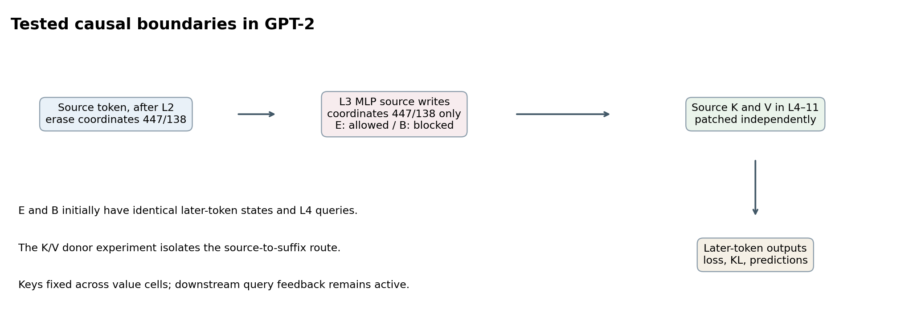
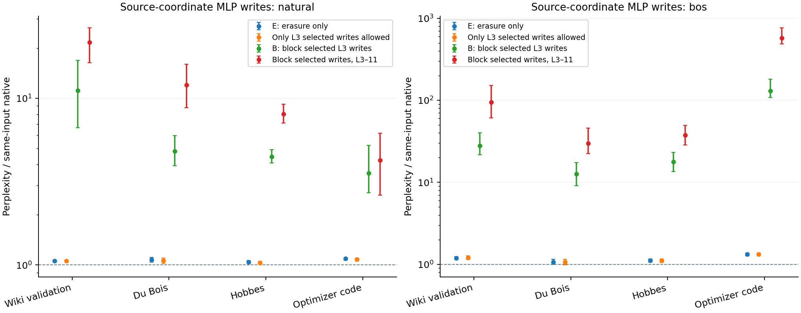
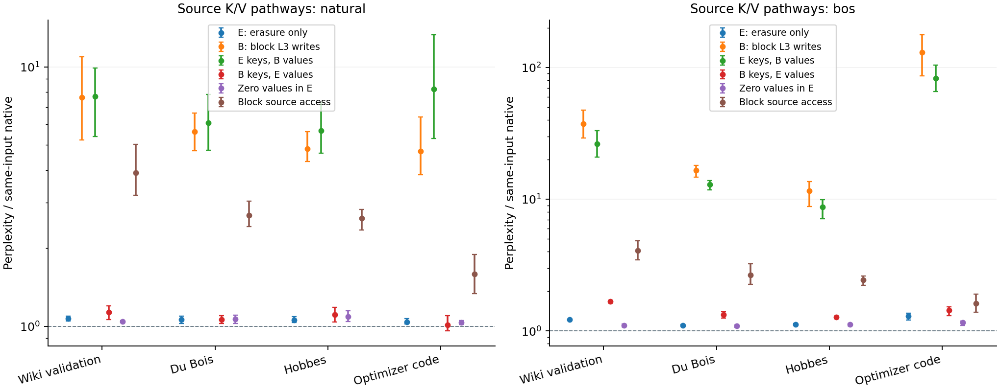
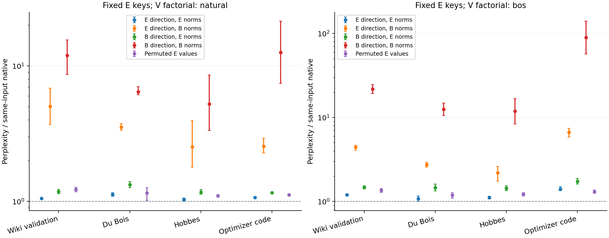

# How GPT-2's conditional coordinate writes affect later predictions

Research continuation, 21 October 2026. Three fresh, sequential batches extend
the six-batch OLMo-to-GPT-2/Llama transfer report. This report concerns the
pinned GPT-2 checkpoint and deliberately perturbed source-token computation.
It does not claim that a natural forward pass detects an error and repairs it.

## What is established, and what remains open

After erasing source coordinates 447 and 138 after layer 2, the layer-3 MLP's
writes to those coordinates protect much of the tested suffix performance.
Their conditional importance reaches later tokens through source K/V states.
Under either donor-key state, the values from the world with those writes
blocked are more damaging than the values from the world with writes allowed.
Zeroing these source values often preserves substantially better loss than
blocking access to the source altogether. This supports a role in preventing
a harmful value contribution under this lesion; it does not establish that
the regrown values encode indispensable linguistic information.

Raw coordinate reappearance does not restore the native trajectory. Native
attention, all other residual coordinates and most MLP computations remain
active throughout. Keys also matter, especially with BOS starts. Fixed source
keys leave downstream queries and attention gates responsive to the intervention.

## Protocol and scope

Model: `openai-community/gpt2`, revision
`75e09b43581151bd1d9ef6700faa605df408979f`, FP32, native Transformers SDPA,
12 layers, 12 heads, hidden width 768. Indices are zero-based. No parameters
are modified; before/after hashes and parameter version counters match.

C is native. E erases only coordinates 447/138 at source position 0 after L2.
B performs E and also zeros those two coordinates in the source's L3 MLP
output. E and B first differ after that MLP; their later-token L3 states and
later-token L4 queries are identical. All K/V interventions below span source
position 0 in L4–11, all 12 heads. The final-layer nontransmission control in
the first batch concerns MLP writes after its attention, not L11 values.

Each batch uses four new 512-token passages from each of Wiki validation,
Du Bois, Hobbes and optimizer code, with natural and BOS start conditions.
Replacing the first token leaves every later token unchanged. Targets 2–511
are scored, so the source's immediate prediction is excluded. The fourth,
fifth and sixth panel fractions are respectively (.25,.45,.65,.85),
(0,.05,.9,.95), and (.175,.375,.575,.775). Actual token-character spans are
disjoint from earlier panels; larger extraction buffers can overlap. The
fifth panel includes source edges and can include front matter/code headers.
No post-result content filtering, selection or calibration uses these panels.
The original coordinate selection was frozen before them.

Tables report exp(mean paired NLL difference) relative to each input's native
prediction. Figures show 2,000-draw paired bootstrap intervals, seed 20261021,
four passages per corpus/start group. These are small, conditional panels,
not population-wide confidence or independent pretraining-distribution tests.
No multiple-comparison adjustment is applied. Duplicate recipient and diagonal
arms are closure controls, not extra samples. Per-token losses, KL and argmax
IDs are retained privately; the repository exports numerical reductions and
native-prediction equality masks without token IDs or corpus text.

## 1. The first post-erasure MLP layer has a conditional role

The layer-local factorial crosses erasure, blocking L3's two-coordinate MLP
writes, and blocking those writes in L4–11. Further arms allow only one later
MLP layer to write, or block successively longer prefixes. Random-coordinate
and final-layer controls accompany these interventions.

Natural starts:

| Intervention | Wiki validation | Du Bois | Hobbes | Optimizer code |
|---|---:|---:|---:|---:|
| E: erasure only | 1.0592 | 1.0733 | 1.0418 | 1.0895 |
| Only L3 selected writes allowed | 1.0577 | 1.0613 | 1.0316 | 1.0808 |
| B: block selected L3 writes | 11.114 | 4.8117 | 4.4547 | 3.5532 |
| Block selected writes, L3–11 | 21.642 | 11.979 | 8.0456 | 4.2368 |

BOS starts:

| Intervention | Wiki validation | Du Bois | Hobbes | Optimizer code |
|---|---:|---:|---:|---:|
| E: erasure only | 1.1909 | 1.0647 | 1.1167 | 1.3266 |
| Only L3 selected writes allowed | 1.2022 | 1.06 | 1.1081 | 1.3213 |
| B: block selected L3 writes | 27.994 | 12.58 | 17.815 | 130.21 |
| Block selected writes, L3–11 | 94.989 | 29.862 | 37.687 | 576.4 |

Blocking L3 after E raises loss in all 32 input/start pairs; all eight group
intervals exclude zero. Without E, blocking L3 alone gives ratios
0.999423–1.000147. Allowing only L3's selected writes leaves performance close
to E, whereas later single writers generally fail to rescue the lesion.
The last MLP layer cannot broadcast to earlier or other tokens: allowing only
its writes exactly matches blocking all later MLP writes on scored loss, KL
and predictions in all 32 pairs. These controls localize a conditional
coordinate-write dependency, not whole-network sufficiency. Agreement with
native predictions remains below 100% even in the low-loss conditions.

## 2. Value differences carry much of the conditional damage

The full E/B source K/V factorial uses each donor-key state with each
donor-value state in both E and B recipients. Diagonal donors reproduce their
world exactly; equal mixed donors give identical suffix results in the two
recipients. Under source blocking the recipients also agree exactly. These
closures follow the causal boundary and validate the implementation.

Natural starts:

| Intervention | Wiki validation | Du Bois | Hobbes | Optimizer code |
|---|---:|---:|---:|---:|
| E: erasure only | 1.0706 | 1.0597 | 1.0561 | 1.0403 |
| B: block L3 writes | 7.636 | 5.6231 | 4.8302 | 4.7236 |
| E keys, B values | 7.682 | 6.088 | 5.6854 | 8.2124 |
| B keys, E values | 1.1314 | 1.0597 | 1.1069 | 1.0102 |
| Zero values in E | 1.0452 | 1.0675 | 1.0883 | 1.0343 |
| Block source access | 3.9046 | 2.6798 | 2.6043 | 1.5911 |

BOS starts:

| Intervention | Wiki validation | Du Bois | Hobbes | Optimizer code |
|---|---:|---:|---:|---:|
| E: erasure only | 1.2195 | 1.1063 | 1.1245 | 1.293 |
| B: block L3 writes | 37.282 | 16.649 | 11.588 | 130.73 |
| E keys, B values | 26.331 | 12.901 | 8.7493 | 83.122 |
| B keys, E values | 1.6721 | 1.3338 | 1.271 | 1.435 |
| Zero values in E | 1.1045 | 1.0886 | 1.1191 | 1.1563 |
| Block source access | 4.0826 | 2.6546 | 2.4342 | 1.6258 |

B values increase NLL relative to E values under either donor-key state in
every one of the 32 input/start pairs; all 16 grouped value-effect intervals
exclude zero. This is a causal effect of the tested source-value replacement,
conditional on the key state. Key effects and signed K/V interactions vary
with corpus and starting token; they are not additive mediation fractions.

Zero values are less damaging than complete source blocking in every pair,
both with endogenous keys and with E keys clamped. All 64 explicit causal-mask
references have zero scored loss drift and exact prediction agreement, so
the reference-adjusted comparison agrees with the raw comparison here. Zero
values preserve the source's role in attention normalization; blocking it
redistributes attention over other positions. Thus these operations do not
test the same mechanism. Lower loss under zero values also does not imply
exact output fidelity or that native values have no function.

## 3. Separating projected-value norm and direction

The next batch uses a B recipient for all four main factorial cells, freezes
E source keys and crosses E/B value direction with
E/B norm separately for every layer/head. “B norm” denotes a joint profile;
it is larger in many earlier layers but is not uniformly larger. Exact
diagonals copy original donors. Mixed cells rescale one direction to the
other world's head norm. Downstream queries remain endogenous. A fixed
signed permutation, drawn before execution with seed 20261023, preserves
each head's absolute-value multiset at both original E and B profiles.
Those two controls are separately permuted source vectors, not one common
random direction compared at two scales. C/E/B zero-value controls test the
broader consequence of eliminating source values.

Natural starts (all four factorial cells use E keys):

| Intervention | Wiki validation | Du Bois | Hobbes | Optimizer code |
|---|---:|---:|---:|---:|
| E direction, E norms | 1.0548 | 1.1246 | 1.0329 | 1.0698 |
| E direction, B norms | 5.0352 | 3.5299 | 2.5306 | 2.5535 |
| B direction, E norms | 1.1838 | 1.3292 | 1.1707 | 1.1617 |
| B direction, B norms | 11.957 | 6.4558 | 5.2543 | 12.614 |
| Permuted E values | 1.2259 | 1.1549 | 1.1023 | 1.1198 |
| Permuted B values | 8.4738 | 5.0949 | 3.5976 | 5.2168 |
| Native C with zero values | 1.0089 | 1.0039 | 1.0095 | 1.0014 |
| E keys, zero values | 1.0393 | 1.1145 | 1.0327 | 1.0385 |

BOS starts:

| Intervention | Wiki validation | Du Bois | Hobbes | Optimizer code |
|---|---:|---:|---:|---:|
| E direction, E norms | 1.2016 | 1.08 | 1.1131 | 1.3976 |
| E direction, B norms | 4.4214 | 2.7301 | 2.1969 | 6.6545 |
| B direction, E norms | 1.4716 | 1.4616 | 1.431 | 1.7336 |
| B direction, B norms | 21.786 | 12.536 | 11.865 | 89.202 |
| Permuted E values | 1.3527 | 1.1908 | 1.2157 | 1.3033 |
| Permuted B values | 11.991 | 7.3262 | 5.0196 | 4.9205 |
| Native C with zero values | 1.007 | 1.0107 | 1.0131 | 1.0021 |
| E keys, zero values | 1.112 | 1.0415 | 1.1032 | 1.2076 |

Both the norm profile and direction matter causally in this factorial. Giving
E directions the B per-head norms produces natural-start PPL ratios
2.531–5.035; giving B directions the E norms reduces them to 1.162–1.329.
The B-direction/B-norm diagonal with E keys remains at 5.254–12.614. The
corresponding BOS mixed-cell ranges are 2.197–6.654 and 1.431–1.734.
All four simple effects—two norm effects and two direction effects—raise NLL
in each of the 32 input/start pairs. Thus neither an amplitude-only nor a
direction-only explanation describes this intervention family.

Define the signed norm/direction interaction as NLL(DE,NE) − NLL(DE,NB) −
NLL(DB,NE) + NLL(DB,NB). It is positive in 31 of 32 pairs and all
eight group intervals exclude zero. One Wiki natural-start passage has a small
negative interaction (−0.01484 nats/token), which is retained. Direction damage
is generally stronger at the B norm profile. These are conditional effects,
not percentages of mediated damage or proof of one underlying mechanism.
Even B direction with E norms agrees with native argmax predictions only
79.71–88.77% for natural starts and 70.00–80.29% for BOS starts; rescaling is
not native-output restoration.

The norm profile requires care: although the complete L11 value vector is
smaller in B, only head 8 has a smaller norm in every pair; its other 11 heads
are larger. Earlier whole-layer norm summaries would conceal that structure.
The signed-permuted controls are also not uniformly worse than their originals.
At E norms their natural-start ratios are 1.102–1.226; at B norms they are
3.598–8.474. Permuted E values improve the BOS optimizer group by 0.0699
nats/token on average (all four inputs; interval below zero), and permuted B
values improve over the unpermuted B/B cell in 30 of 32 inputs and all eight
group means. The random controls neither identify a unique semantic direction
nor supply a distribution over random interventions: one seed was frozen.

Zeroing these values in otherwise native C gives natural-start ratios
1.0014–1.0095 and BOS ratios 1.0021–1.0131. Native argmax agreement remains
95.15–97.30% and 94.41–96.91%, respectively. Therefore the low-loss zero-value
operation is an approximate intervention, not a faithful replacement of native
outputs. Together with the source-block comparison, the results motivate a
direct query/gating test while keeping values zero, rather than another sweep
of the original weight's numerical value.

## Relationship to prior work

These are targeted replication/extension measurements, not a discovery of
GPT-2 massive coordinates or compensatory computation. The detailed novelty
comparison in Report8 remains applicable. In particular, the pinned
[Weight-Dictionary Decomposition author code](https://github.com/sunmoonron/weight-dictionary-decomposition/tree/33504a4d90840bc01d0ef75609265e48a34403bb)
already scales coordinate 447 after block 2, measures later layer/neuron
compensation and conditional reserves, and separates a neuron's coordinate
contribution from its complement. We inspected that code rather than
independently reproducing its reported experiments; full OpenReview PDF
access remained blocked. Our source-only joint-coordinate write lesions,
paired suffix-loss panels and source-K/V/norm-direction interventions define
the estimand here. A different estimand alone does not establish priority.

[Massive Activations](https://arxiv.org/html/2402.17762v2) studied GPT-2,
starting-token concentration and explicit K/V bias alternatives.
[A Mechanistic Account of Attention Sinks in GPT-2](https://arxiv.org/html/2604.14722v1)
connects positional MLP processing, key projections and query biases, and
tests their effects on sink attention. Our source K/V loss experiment does
not by itself test that query-bias explanation.
[The Communication Map](https://arxiv.org/pdf/2608.22007) already identifies
447/138 and tests coordinate deletion. Architecture-dependent clamping
results in [Transient Reserves](https://arxiv.org/html/2607.09279v1) and
collective-norm/magnitude-control results in
[Life Cycle of Massive Activation](https://arxiv.org/html/2610.00423v2)
further constrain novelty claims. The latter's training-time restoration is
different from our fixed-weight within-forward interventions. The present
results do not uniquely attribute cross-model differences to normalization.

## Reproduction, uncertainty and resources

The exact protocols, scripts, checkpoint/source hashes, seeds, token manifests,
raw donors, source trajectories, closures and failed-check preservation are
retained. Independent reviewers used CPU only and did not load pretrained
models or contend for the GPU. Numerical audit validates saved reductions;
full-vocabulary logits are not retained, so KL is not independently rebuilt
from logits. Runtime assertions check hook locality beyond saved source
vectors. A single RTX 3060 Ti ran each experiment sequentially with four CPU
threads; no paid resources or network model fetches were used.

| Batch | Forwards | Wall seconds | GPU peak GiB | Worker RSS GiB |
|---|---:|---:|---:|---:|
| gpt2_layer_writes_run | 776 | 43.22 | 0.706 | 1.823 |
| gpt2_regrowth_kv_run | 616 | 40.36 | 0.708 | 2.015 |
| gpt2_value_geometry_run | 520 | 36.96 | 0.706 | 2.187 |

The three new batches total 1912
forwards/records and 120.54 worker
seconds, including loading, hashing and checkpoint writes as measured by each
runner. This is research execution cost; any additional reproduction runs
are recorded separately. These interventions still compute native modules
before replacing outputs and establish no efficiency improvement.

Main limitations are four passages per group, one checkpoint, teacher-forced
suffix scoring, source-only interventions, and conditional dependence on
large artificial lesions. Neither low-dimensional correlations nor low loss
prove one mechanism or exact functional replacement. Query-path interventions,
causal low-rank directions fitted on fresh development data, and generated
continuations remain useful tests. Research is not declared exhausted.

The private GitHub creation remains denied and unexecuted; no alternate route
or credential/security change has been attempted. Reviewed local commits and
private raw bundles are preserved while publication confirmation is pending.
