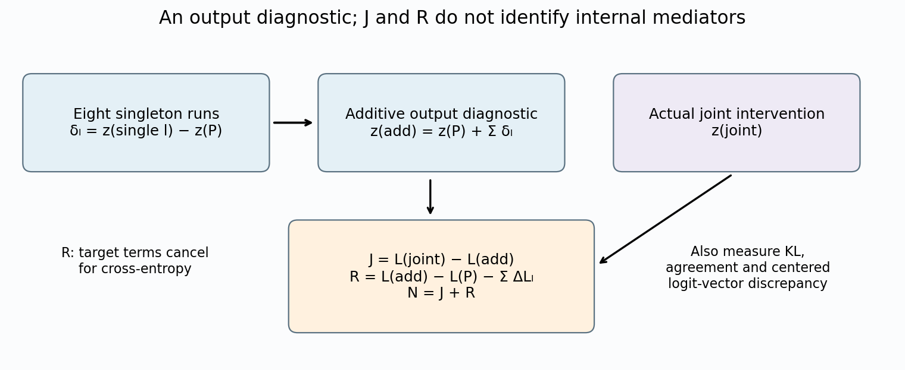
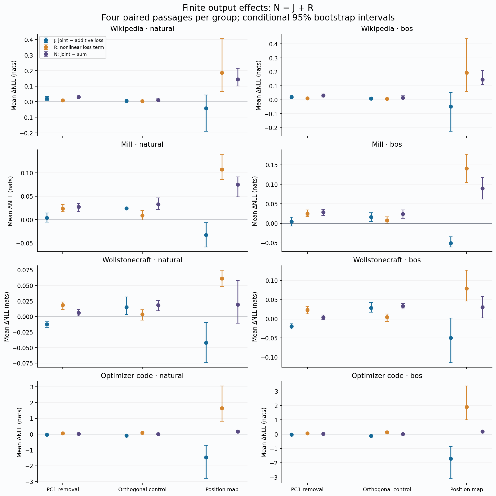
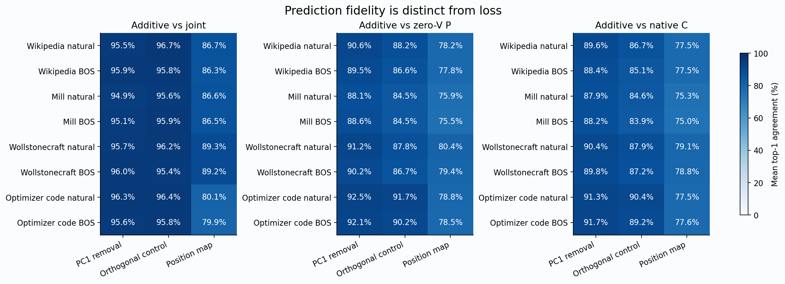
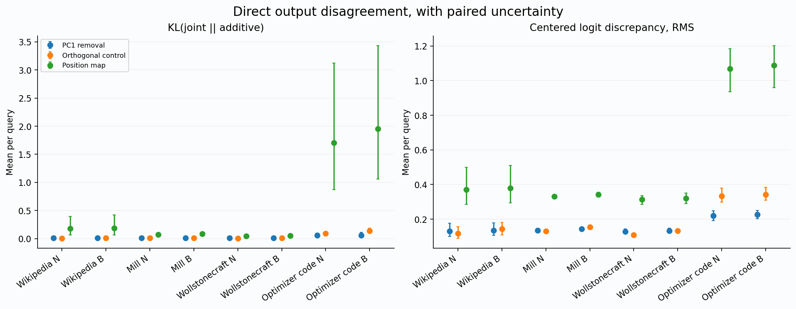

# Why do combined gate changes fail to add?

Reviewed research checkpoint, 21 October 2026. Investigation continues.

**The combined effects are nonadditive at both the output and loss levels, and the two can oppose each other.** A positive joint-minus-singleton loss residual does not mean the joint network output is uniformly worse than an additive combination of singleton outputs. Fresh data show strong cancellation, corpus dependence and a change across early versus later targets. The additive construction also fails to preserve predictions and is not a cheaper replacement.

## Findings supported by saved outputs

**Positive full-window loss residuals hide different output behavior.** Across all 24 corpus/start/family groups, the primary residual N has a positive mean; 20 paired intervals exclude zero. The nonlinear loss term R also has 24 positive means and 20 positive intervals. But J, the loss of the actual joint output minus the loss of the explicit additive output, has only 10 positive means: eight intervals are positive, nine negative and seven cross zero. Neither this identity nor these signs identify an internal mediator.

For PC1 removal on Wiki, the two terms reinforce one another. Natural-start means are J=+0.02094 and R=+0.00891 nats, giving N=+0.02985; both component intervals exclude zero. BOS gives +0.01990 and +0.01042. Mill's J intervals cross zero while R remains positive. Wollstonecraft reverses J: −0.01237 naturally and −0.01946 with BOS, with both intervals below zero, against positive R=+0.01842/+0.02297. The small resulting BOS N=+0.00350 has an interval crossing zero despite two individually well-resolved, opposing terms.

**The strongest cancellation is a warning against interpreting scalar nonadditivity as a mechanism.** For position replacement on optimizer code, natural J=−1.46874 and R=+1.64105 leave N=+0.17231 nats. BOS gives J=−1.71081 and R=+1.89303, leaving +0.18223. Both J and R have intervals excluding zero. The actual joint intervention has perplexity/P of 1.3781/1.3681; the additive output has 5.9861/7.5705. Thus the additive construction greatly overstates loss damage here, even though the joint intervention itself is harmful relative to P.

This is an output-level finite-difference result. The additive construction extrapolates separately measured changes into an output the model need not produce. A negative J does not demonstrate an internal compensating circuit, feedback or adaptation. The orthogonal control on code also exhibits cancellation: J=−0.08639/−0.12132 versus R=+0.08830/+0.13215. A near-zero net loss residual can coexist with material output disagreement.

**Approximate loss agreement does not imply faithful computation.** For PC1 removal, additive-versus-joint top-1 agreement ranges from 94.85% to 96.32%, and mean KL(joint‖additive) ranges from 0.00838 to 0.05768 nats. Centered logit-vector RMS disagreement remains 0.12868–0.22642. Orthogonal-control agreement is 95.44–96.67%; position-map agreement falls to 79.85–89.31%, with code KL reaching 1.70/1.95 nats. These are measured mean disagreements, not universal tolerances for acceptable replacement. The additive outputs require eight singleton executions, so even perfect fidelity would not establish a faster implementation.

**The full-window sign is not uniform along the sequence.** All 24 early-view N means are positive and 22 intervals exclude zero. In the later view only 16 means are positive, with nine positive and four negative intervals. The four negative intervals are PC1 removal on Wollstonecraft and optimizer code, at both starts. Their later-view means are −0.00487/−0.00501 and −0.00778/−0.00712 nats, respectively. These views share the same 512-token execution and passages. They do not establish that context length or position causes the difference; content, history and position vary together.

**The localized cross-corpus pattern recurs, while a blanket book-improvement claim fails.** L10 PC1 removal raises Wiki perplexity/P to 1.0050/1.0046 and lowers Mill to 0.9904/0.9905, Wollstonecraft to 0.9715/0.9726, and optimizer code to 0.9912/0.9895. All eight paired intervals are on those respective sides of one. L10 was already a candidate from the earlier screen; this fresh panel strengthens the scoped pattern but does not explain it or correct for all comparisons.

Joint PC1 removal raises Wiki perplexity/P to 1.0549/1.0563 and lowers Wollstonecraft to 0.9291/0.9339, with intervals excluding one. Mill instead gives 1.0043/1.0056, and code 1.0041/0.9940; their intervals include one. “PC1 removal improves books” is therefore too broad. Joint-removal agreement with P is only 85.98–91.27%, even where loss improves. Likewise, the position replacement's near-neutral Wollstonecraft loss does not make it faithful: agreement with P is 79.80%/79.07%.

## What remains unresolved

The evidence supports a scoped causal account of these patches: a source-value boundary exposes an allocation gate, frozen directions affect layers differently, and their finite output/loss effects combine differently across domains and score views. It does not reduce the original pulse-dependent computation to one shared scalar or establish one universal mechanism across models.

The next discriminating line is the previously proposed fresh-calibration center-by-basis factorial. Cross the original calibration mean with a fresh mean, and the original direction with a fresh direction, at the development-selected L10 boundary and the full layer set, retaining matched controls and new confirmation inputs. This tests whether the recurring domain contrast depends on centering, direction or both. A separate controlled prefix-history experiment would be needed to attribute the early/later difference to history or position. Neither question is settled by the present decomposition; useful research remains.

## Question and exact comparison

The preceding layer screen found positive joint-minus-singleton loss residuals. That alone cannot tell whether output changes fail to add, or whether the nonlinear cross-entropy calculation converts additive output changes into nonadditive losses. This experiment measures both terms on fresh passages. It does not identify an internal mediator or demonstrate feedback.

The checkpoint remains GPT-2 revision `75e09b43581151bd1d9ef6700faa605df408979f`, FP32 with SDPA. All executions have physical length 512; layer, head and token indices are zero-based. Native C is the unchanged model. Reference P zeroes the position-0 value at L4–L11. Every scientific arm retains that boundary. At each patched head/query, the current context is multiplied by `sigmoid(b′)/a`, where a is non-source attention mass and b is its logit. This changes the mass while preserving the current conditional non-source value mixture at that boundary; subsequent network computation remains live.

The frozen eight-passage calibration supplies α and the first centered direction u of `b−log(q)` per layer. A seeded orthogonal direction v provides a matched logit-norm control. Three patch families are evaluated at each of eight layers separately and at all eight jointly:

- PC1 removal: `b′ = b − s u`, with `s = (b − log(q) − α) · u`.
- Orthogonal control: `b′ = b − s v` using the coefficient at that arm's own incoming state.
- Position replacement: `b′ = α + log(q)`.

All 27 scientific arms, native C, reference P and two exact-copy controls are retained. Gate maps act on queries 1 onward and preserve the source-query context relative to P; they do not undo P’s source-value lesion. Singletons must receive the same incoming logits, masses and contexts as P at their patched layer. Matching logit norm does not match delivered context norm, and one orthogonal control does not sample a distribution of random directions.

Let z denote the actual full-vocabulary output logits. For each family, build the diagnostic `z_add = z_P + Σ_l (z_l − z_P)` in fixed L4…L11 order, using CPU FP64 on actual FP32 model logits. For next-token cross-entropy L, define:

```
S = Σ_l [L(z_l) − L(z_P)]
N = L(z_joint) − L(z_P) − S
J = L(z_joint) − L(z_add)
R = L(z_add) − L(z_P) − S
N = J + R
```

All component losses in this identity use the same FP64 calculation. The inherited FP32 losses are a separately checked numerical readout. R is target-independent: the target-logit terms cancel, leaving `LSE(z_add) + 7 LSE(z_P) − Σ LSE(z_l)`. R can have either sign; convexity does not require it to be nonnegative for this extrapolation. J is a loss contrast between two outputs, not a path-specific causal interaction. Direct centered logit discrepancies, both KL directions and top-1 agreements accompany it: a small J alone does not imply similar output distributions. The additive output uses eight singleton executions and is a diagnostic, not a cheaper replacement.

## Fresh panel, controls and uncertainty

There are four passages each from WikiText-2 validation, Mill's *On Liberty*, Wollstonecraft's *A Vindication of the Rights of Woman*, and local optimizer source (Adagrad, RMSprop and LBFGS). The original tokenizer-only preflight scans 84 historical manifests and excludes previously exposed intervals. The fresh Wiki grid fractions are 119/379/620/877; the other sources use 125/375/625/875. One code passage each comes from RMSprop and LBFGS and two from Adagrad. Full source hashes, selected intervals, candidate rejections and exact token hashes remain in the local manifest. These are exposure-separated research inputs, not a claim that the model never saw the text during pretraining.

A later provenance review found that the inherited inventory had not explicitly mapped the original main/smoke/readme report windows. A supplementary tokenizer-only audit validated their original OLMo tokenizer, revision, source and saved token arrays, mapped 102 exact source ranges, and checked both latest studies' eight Wiki passages using GPT-2 offsets. It found zero overlaps. This audit occurred after T17 execution; no passage was changed or replaced, and it is disclosed as supplementary verification rather than part of the original prospective selection.

Natural/BOS pairs reuse exactly the same 512-token sequence and replace token 0 only. Wiki window 1 and Mill window 1 begin with token 68, which appeared among calibration starts. Therefore the present panel tests fresh passages and varying natural starts; it is not uniformly a held-out starting-token identity test. BOS is absent from calibration starts. There are no new calibration forwards.

Every condition receives a fixed-shape suffix control: positions 128–511 rotate by one token, leaving the first 128 unchanged. The unchanged prefix's logits, hidden states, gates, source projections and contexts must match exactly. Changed suffix targets are not scored. Targets 2–511 form the primary view; targets 2–127 and 128–511 are correlated early/later views of that same 512-token execution, not different context lengths. Query 0 remains an unscored diagnostic.

The plan specifies 1,000 main records, including eight native repeat/identity anchors, and 992 suffix controls: 1,992 forwards. Four paired passages per corpus/start yield 2,000 bootstrap draws with seed 20261021. J, R and N share resampling indices, preserving their identity within every draw. Intervals condition on this fixed calibration and small nonrandom panel. Starts, views and families are correlated; there is no multiplicity correction, population-wide generalization or mediation percentage. All declared conditions and all groups are reported.

## Preserved evidence and numerical limits

The actual tensor entering `lm_head` after final LayerNorm is saved at all 512 positions for 29 distinct trajectories per input, totaling 928 hidden tensors. The exact tied unembedding identity, shape, dtype, bias absence and parameter version are recorded. Main gate states and prefix controls, source states, per-query losses/distribution metrics, operation guards and four fixed attention snapshots are preserved.

The prospective storage test found the original eight sampled full-vocabulary rows left too little room for analysis. Before any pretrained output, independent review accepted six rows `{0,1,126,127,254,510}` for all 31 conditions and all additive families on natural window 0 of each corpus. All-query hidden states and runtime metrics stayed unchanged. The original proposal, input preflight and eight-row sizing evidence remain intact, alongside the reviewed storage addendum. Raw successful full-vocabulary model outputs are independently available at those 744 condition/query rows only. Complete successful source/context arrays exist only where explicitly saved; other closures rely on runtime comparisons and fingerprints.

An independent CPU audit can reconstruct logits approximately from every saved hidden state and the pinned unembedding tensor without loading the whole model. That reconstruction is a numerical cross-check, not an exact replay of the actual GPU readout or a replacement for runtime primaries. Sampled raw outputs allow direct error checks at six positions only. No complete second pretrained replay of this new batch is claimed.





## Every primary decomposition group

Values are mean nats per target, followed by conditional paired 95% bootstrap intervals. All groups contain four paired passages. These are three terms in an output/loss diagnostic, not mediation shares. Intervals are calculated separately from shared bootstrap draws; their endpoints must not be added.


### PC1 removal

| Corpus/start | J | R | N = J + R |
|---|---:|---:|---:|
| Wiki / natural | +0.02094 [+0.00899, +0.03290] | +0.00891 [+0.00588, +0.01245] | +0.02985 [+0.01841, +0.04130] |
| Wiki / bos | +0.01990 [+0.00798, +0.03236] | +0.01042 [+0.00721, +0.01384] | +0.03032 [+0.01917, +0.04147] |
| Mill / natural | +0.00398 [-0.00534, +0.01402] | +0.02353 [+0.01691, +0.03219] | +0.02750 [+0.01671, +0.03452] |
| Mill / bos | +0.00419 [-0.00676, +0.01515] | +0.02453 [+0.01740, +0.03438] | +0.02872 [+0.01991, +0.03576] |
| Wollstonecraft / natural | -0.01237 [-0.01756, -0.00821] | +0.01842 [+0.01157, +0.02351] | +0.00606 [+0.00116, +0.01128] |
| Wollstonecraft / bos | -0.01946 [-0.02625, -0.01268] | +0.02297 [+0.01338, +0.03240] | +0.00350 [-0.00245, +0.00946] |
| Optimizer code / natural | -0.03040 [-0.06323, +0.00243] | +0.05959 [+0.02256, +0.09662] | +0.02919 [+0.02358, +0.03723] |
| Optimizer code / bos | -0.02703 [-0.07933, +0.00626] | +0.05500 [+0.02325, +0.10649] | +0.02797 [+0.02180, +0.03568] |


### Orthogonal control

| Corpus/start | J | R | N = J + R |
|---|---:|---:|---:|
| Wiki / natural | +0.00629 [+0.00311, +0.01091] | +0.00463 [+0.00264, +0.00726] | +0.01092 [+0.00681, +0.01840] |
| Wiki / bos | +0.00773 [+0.00269, +0.01681] | +0.00682 [+0.00348, +0.01191] | +0.01456 [+0.00637, +0.02868] |
| Mill / natural | +0.02411 [+0.02198, +0.02641] | +0.00883 [-0.00028, +0.01976] | +0.03293 [+0.02128, +0.04660] |
| Mill / bos | +0.01595 [+0.00457, +0.02733] | +0.00779 [-0.00027, +0.01659] | +0.02374 [+0.01284, +0.03438] |
| Wollstonecraft / natural | +0.01494 [+0.00321, +0.03176] | +0.00346 [-0.00585, +0.01084] | +0.01840 [+0.00931, +0.02603] |
| Wollstonecraft / bos | +0.02847 [+0.01730, +0.04275] | +0.00441 [-0.00685, +0.01211] | +0.03289 [+0.02571, +0.04007] |
| Optimizer code / natural | -0.08639 [-0.13692, -0.03041] | +0.08830 [+0.05029, +0.12631] | +0.00191 [-0.01833, +0.02173] |
| Optimizer code / bos | -0.12132 [-0.16773, -0.07491] | +0.13215 [+0.08779, +0.18704] | +0.01083 [-0.00445, +0.02610] |


### Position replacement

| Corpus/start | J | R | N = J + R |
|---|---:|---:|---:|
| Wiki / natural | -0.04292 [-0.19003, +0.04375] | +0.18623 [+0.06673, +0.40511] | +0.14331 [+0.10156, +0.21508] |
| Wiki / bos | -0.04923 [-0.22584, +0.05251] | +0.19421 [+0.05889, +0.43691] | +0.14499 [+0.10994, +0.21095] |
| Mill / natural | -0.03264 [-0.05849, -0.00679] | +0.10739 [+0.08607, +0.13919] | +0.07475 [+0.04844, +0.09145] |
| Mill / bos | -0.05105 [-0.06064, -0.03461] | +0.14063 [+0.10482, +0.17643] | +0.08958 [+0.06202, +0.11744] |
| Wollstonecraft / natural | -0.04199 [-0.07437, -0.00961] | +0.06124 [+0.04789, +0.07460] | +0.01925 [-0.01085, +0.05788] |
| Wollstonecraft / bos | -0.04934 [-0.11455, +0.00156] | +0.07948 [+0.04678, +0.12680] | +0.03014 [+0.00221, +0.05807] |
| Optimizer code / natural | -1.46874 [-2.80637, -0.70134] | +1.64105 [+0.81413, +3.05916] | +0.17231 [+0.09932, +0.24530] |
| Optimizer code / bos | -1.71081 [-3.09002, -0.86723] | +1.89303 [+1.00588, +3.36136] | +0.18223 [+0.10154, +0.26292] |








## Independent checks and practical limits

The independent saved-evidence audit checks the declared record universe, all per-target summaries and shared bootstrap draws, source/input/map closure, suffix controls, singleton incoming-state identities and the fixed attention snapshots. It verifies 72 exact-copy closures and independently recomputes the family/input/view loss identities and 1,440 aggregate readouts, rather than trusting the production summary. The complementary readout audit streams the 928 saved final-LayerNorm tensors through one pinned tied embedding tensor on CPU in FP64. It does not load a second model or use the GPU. Its exact numerical results and reconstruction error bounds accompany the final audit record.

The independent reconstruction must be distinguished from the actual GPU logits used in the experiment. Floating-point matrix multiplication can differ between devices and algorithms. Direct comparisons exist for 744 saved condition/query logit rows. The CPU audit uses explicit error bounds and reports discrepancies; agreement does not establish bit-identical unrecorded GPU logits. Full second pretrained replay of T17 remains unperformed. The earlier fixed-shape study's exact replay is separate evidence, not a replay of this batch.

The completed CPU audit reconstructed 474,208 query rows from 928 trajectories in 1,194.1 seconds, using about 1.21 GiB peak RSS. All 744 direct GPU-row comparisons passed the prospective dot-product, loss and KL error bounds; the largest logit error was 0.0007915, sampled loss error 0.0004043 nats, and KL in either direction at most 5.14×10⁻⁹. Across all reconstructed rows, three top-1 predictions differed. For J/R/N, maximum per-query discrepancies were 0.0030783/0.0024483/0.0030783 nats, with 50/21/49 sign changes among 49,056 family/query comparisons. The largest original magnitude at a changed sign was 0.0011803/0.00006151/0.0006540, respectively. These are reported differences, not silently substituted results. The actual runtime GPU readouts remain primary; this audit does not claim exact reproduction of every per-token sign or bootstrap interval on CPU.

The rescaling operator is sometimes ill-conditioned. The smallest observed non-source mass is about 5.35×10⁻¹¹ and the largest gain about 1.87×10¹⁰. Both arise at optimizer-code window1, natural start, L4/H11/query1 in PC1-removal conditions. The extreme lies outside the four prospectively fixed full-attention snapshots. Runtime finite, algebraic and reconstruction checks passed at that operation, but the complete raw Q/K/V attention inputs for that extreme were not saved. We therefore report a checked FP32 result within the measured guards, not broad numerical stability at arbitrarily small mass. No clipping or tolerance relaxation was used to make this batch pass.

All-query runtime guards have maximum conditional-mixture error about 4.10×10⁻⁵, mixed reconstruction error 2.68×10⁻⁵ and fullrank logit reconstruction error 1.34×10⁻⁵, below the inherited 10⁻⁴ threshold. Formula checks are exact; the logit-norm control has maximum relative discrepancy 1.17×10⁻⁷. A logit-norm match is not a context-norm match. The source-query context is preserved relative to the zero-value reference P, not restored to native C.

Only four passages contribute to each interval. Corpus labels, BOS variants, sequence views and intervention families do not provide independent replication counts. The calibration remains the original eight passages; uncertainty across calibration draws is unmeasured. Successive development choices were recorded before this panel, and no reported count of intervals is corrected for all comparisons. A single orthogonal direction is a limited control, and new-source code passages cover three optimizer files rather than code in general.

The earlier cross-length failures remain preserved and unresolved as cross-length evidence. Fixed 512-token shape and changed-suffix controls support the present causal-prefix checks; they do not establish invariance to shorter physical execution shapes. Negative hypotheses are retained: positive loss residuals do not imply positive J, small residuals do not imply additive outputs, loss improvement does not establish faithful replacement, and a book-wide benefit does not survive the new Mill panel.

## Reproduction and continued work

The portable numerical auditor works from exported scalar arrays and can recompute tables and paired uncertainty without model weights or corpora. It cannot prove the original hooks from scalar outputs. Local raw tensors and hashed snapshots support the stronger numerical checks. The standalone preparation path was checked with the actual tokenizer and adversarial metadata tests; it rebuilds exact token and direction files while making three explicit metadata-only hash changes to remove private paths and prior token identities. Its optional model-execution branch has bookkeeping tests, but no second 1,992-forward model replay has been run.

With an existing verified calibration, preparation needs only the GPT-2 tokenizer and six lawful source files. Rebuilding the original calibration through the inherited bootstrap additionally requires the pinned Llama tokenizer/config files to reconstruct historical metadata, but never Llama weights or earlier Llama experiments. It then performs eight GPT-2 calibration forwards. Strict byte identities are enforced; numerical differences on another platform must be reported rather than silently accepted. Exact reproduction is therefore a documented, auditable path with remaining platform and end-to-end verification limits.

Useful research remains. The next proposed experiment crosses fresh/original calibration means and directions at L10 and the full layer set, on newly separated confirmation data. The early/later reversal also motivates a separately controlled prefix-history experiment. Neither is an established result here. Previous raw outputs, failed experiments and reviewed reports remain preserved; no unrelated UIT job is resumed.

## Relation to established work

The attention source-value decomposition is established. *Massive Activations in Large Language Models* examines attention-bias behavior and zero-value/synthetic alternatives ([sections 4.2–4.3 and Appendix B.4](https://arxiv.org/html/2402.17762v2)). Later work writes non-source allocation as a sigmoid/log-sum-exp gate and tests zero-value variants ([Fu et al.](https://arxiv.org/html/2602.01203v1)); explicit query/head gating also precedes this study ([Qiu et al.](https://arxiv.org/html/2505.06708v1)). GPT-2 query bias, positional contributions and massive key coordinates have their own prior analysis ([GPT-2 attention-sink study](https://arxiv.org/html/2604.14722v1)). The repository's earlier reports compare the broader super-weight, massive-activation and compensation literature.

The additive-logit construction and identity N=J+R are elementary accounting, not a new attribution method. [Circuit Tracing's methods paper](https://transformer-circuits.pub/2025/attribution-graphs/methods.html) constructs linear feature-attribution graphs after freezing attention patterns and normalization denominators and validates proposed mechanisms through interventions. This study instead combines actual output differences from separately executed finite gate patches while letting the rest of the model respond. Its loss contrasts cannot identify which internal response produced an output discrepancy. This distinction in estimands does not support a priority claim.

The empirical contribution is the measured behavior of these specific, frozen interventions on an exposure-separated panel, with matched controls, raw numerical evidence, failed assumptions and uncertainty retained. We have not established that no previous study reported this exact decomposition, and make no first-result claim. An earlier potentially related residual-variance primary text remained inaccessible; that literature comparison is unresolved rather than treated as absent prior art.

These results do not establish that OLMo's single super weight, Llama's source-value dependence and GPT-2's conditional coordinate regrowth share one mechanism. Nor do they demonstrate generation quality, a faster replacement, a unique gate dimension, or an internal feedback pathway. The two earlier cross-length numerical failures remain failures: this experiment tests fixed 512-token executions and their prefix controls.


## Execution and local reproduction

The experiment completed **1,992 forwards**, comprising
**1,000 main records** and **992 suffix controls**,
in 700.473 worker seconds. It reused eight original calibration
forwards and performed zero new calibration forwards. Peak allocated GPU
memory was 0.948 GiB; peak host RSS was
2.594 GiB. One RTX 3060 Ti ran one model worker.
The frozen manifest binds source revisions, seeds, precision settings, all
intervention definitions and before/after model, map and input identities.

The readable report, scripts, manifests, numerical results and audit guidance
belong in the existing local private-repository package. Model weights,
corpora, token payloads, private paths and raw donor activations stay outside
its export. Original input/source hashes identify restricted dependencies;
retrieval and reconstruction instructions identify what another researcher
must supply. Any metadata portability adaptations are explicit and separately
reviewed. No complete second pretrained replay of this new batch is claimed.

Private GitHub creation remains denied and unexecuted, awaiting the specific
confirmation handled by the parent task. No publication retry, alternate
repository upload, credential change or paid compute purchase occurred.
