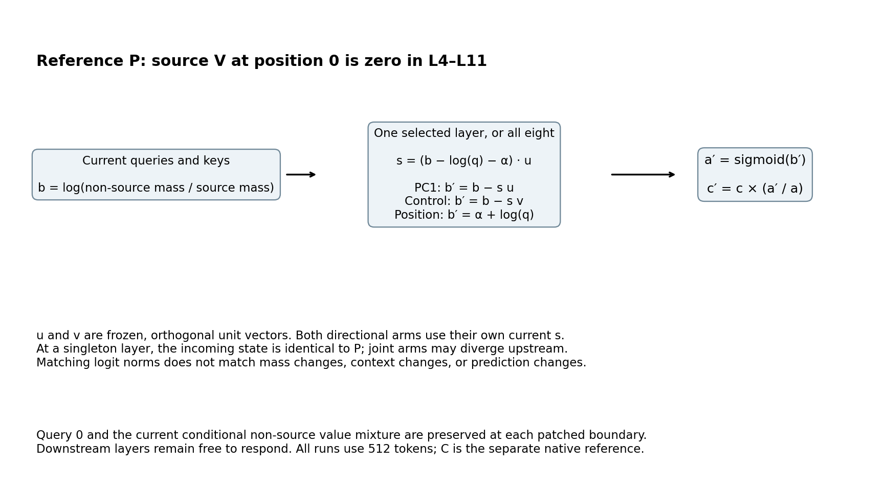
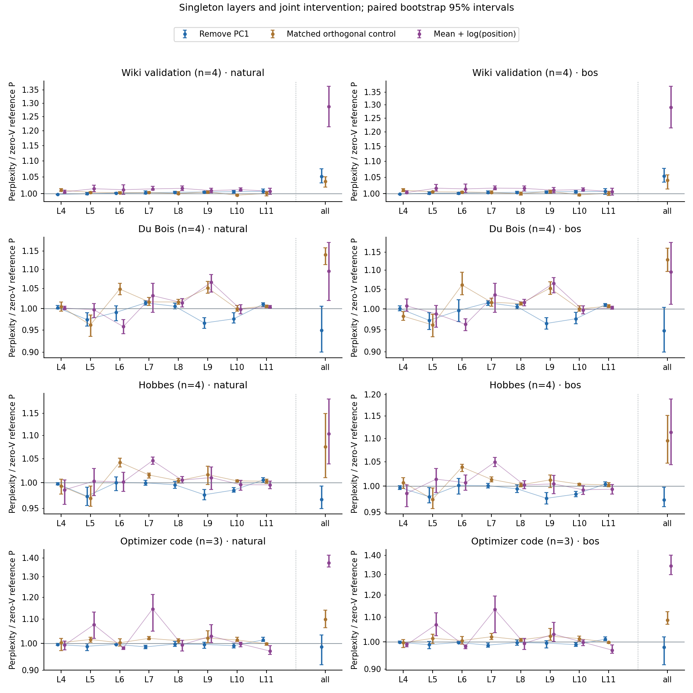
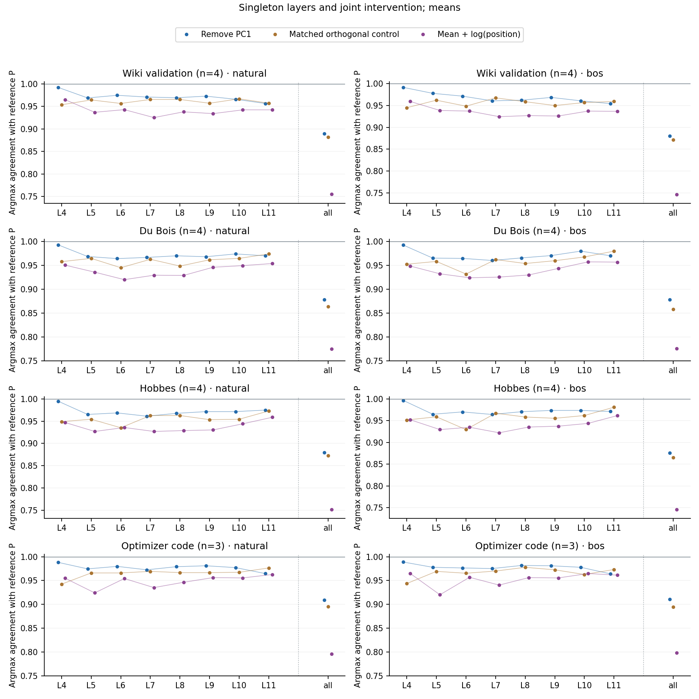
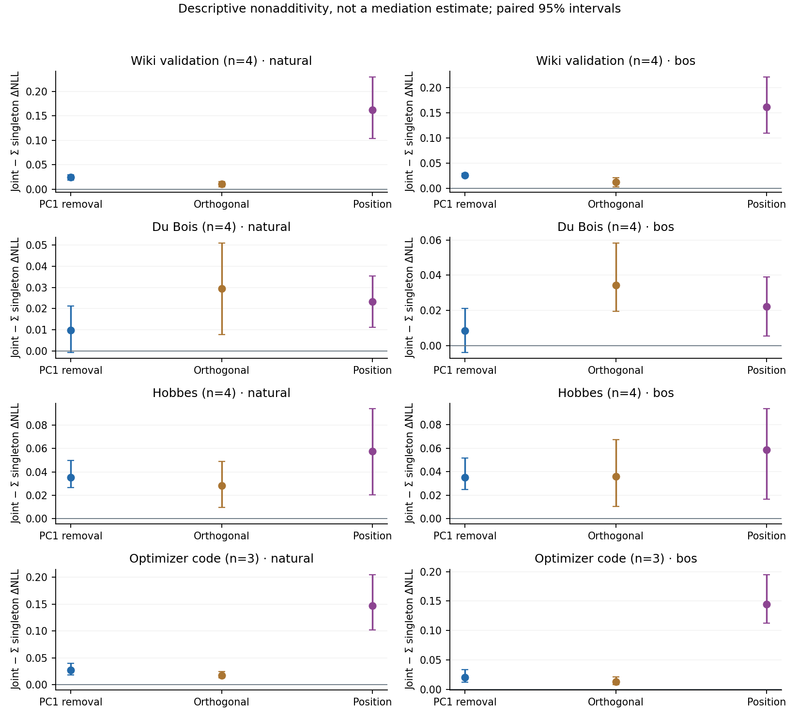

# Which layers depend on GPT-2’s leading gate directions?

Research continuation, 21 October 2026. This is a reviewed checkpoint in an ongoing investigation.

**The loss effects are spread across layers and change sign across corpora.**
No tested singleton reproduces the full pattern of joint effects. On fresh
passages, removing PC1 at all eight layers raises Wiki perplexity about 5%,
while lowering the mean on books and code. Several singleton effects oppose
one another, and the joint result is consistently less favorable than the
sum of singleton loss changes. These are causal effects of the specified
patches, not proof of one underlying mechanism.

## Findings supported by the reviewed outputs

**The Wiki penalty replicates; the book improvement needs qualification.**
Joint PC1 removal gives perplexity/P of 1.0514 naturally and 1.0533 with BOS on
Wiki. Their paired intervals are [1.0315, 1.0749] and [1.0343, 1.0776]. Du Bois
means are 0.9488 and 0.9476, but the new intervals [0.8999, 1.0057] and
[0.8986, 1.0035] cross one. The direction of its earlier result recurs, while
its interval evidence does not. Hobbes ratios 0.9668 and 0.9734 have intervals
below one. Code means 0.9859 and 0.9795 have intervals crossing one. All eight
joint-removal groups change substantial numbers of predictions: agreement
with P is only 87.60–91.11%; with native C, 86.57–90.39%.

**Individual layers have different roles in this intervention family.**
L9 and L10 PC1 removal reduce loss on both books at both starts; all eight
paired intervals against P are below zero. L10 removal raises Wiki loss at
both starts, and its removal-minus-orthogonal-control contrast is positive
on Wiki but negative on both books, with all six intervals excluding zero.
For L10, the natural-start changes in mean NLL versus P are +0.00593 on Wiki,
−0.02475 on Du Bois and −0.01505 on Hobbes; BOS changes are +0.00574,
−0.02449 and −0.01585. This is a useful direction-specific, corpus-dependent
candidate for new confirmation, not a universally beneficial removal.

L5 removal also lowers book loss, but its benefit is not uniquely associated
with PC1: the matched orthogonal control improves Du Bois more, with both
paired removal-minus-control intervals positive; the Hobbes differences are
uncertain. L7 removal worsens Du Bois while improving code, and L11 removal
has positive loss-change means in all eight groups. Reporting only a best
layer would hide these opposing effects.

**Prominent calibration geometry does not rank functional importance.**
At L4, 98.12% of the PC1 direction's squared loading lies on head 11; later
layers' largest single-head shares are only 15.86–23.95%. Yet L4 PC1 removal
has perplexity/P between 0.9951 and 1.0023 and 98.82–99.66% agreement with P.
This does not make that head dispensable: the patch removes one frozen
logit direction under the zero-value boundary, not the head or source state.

The norm control also has a material limitation. On natural Wiki at L4, both
arms change the logit vector by a mean norm of 4.3842, but their mean context
changes are 0.2748 for PC1 removal versus 1.6801 for the orthogonal control.
At L10 the corresponding context changes are 2.5574 and 2.3140. Sigmoid
sensitivity and head-specific value mixtures can therefore make equal logit
perturbations unequal delivered-context perturbations. Those explanations
remain hypotheses; the norm data alone do not isolate their contributions.

**Layer effects do not add in NLL.**
Every one of the 24 corpus/start/family joint-minus-sum means is positive,
and 22 paired intervals exclude zero. The two exceptions are Du Bois PC1
removal. For Wiki PC1 removal, the joint NLL changes are +0.05014/+0.05196,
whereas the residual above the summed singleton changes is
+0.02443/+0.02592. For Hobbes, this positive residual offsets part of the
singleton improvements. Position replacement has still larger residuals on
Wiki and code. This rejects a simple additive description of these finite
loss effects. It does **not** identify feedback or establish a mediation
percentage: nonlinear model composition and nonlinear loss/readout both
remain possible contributors.

**The simple position replacement still fails to preserve computation.**
Replacing all eight layers' gates by their calibrated mean plus log(position)
gives perplexity/P of 1.0948–1.3739 and agreement with P of 74.51–79.87%.
The new panel provides no support for using that map as a faithful larger
replacement. Even the unpatched zero-value reference P agrees with native C
only 95.05–96.41%, despite perplexity/C of 0.9952–1.0127.

## What the covariance result does and does not add

A separate CPU-only calculation concatenated the eight layers' 12 gate logits
at each calibration query, then centered the 96 coordinates. After subtracting
log(q), the first global principal component explains 32.70% of variance;
ranks 3 and 6 explain 54.80% and 69.20%. Independent covariance-eigenvalue
recomputation matched 104 comparisons within 9.24e−14. These 4,080 vectors
come from eight correlated calibration passages. Eight separate per-layer
PC1 directions are not one global scalar, but this covariance calculation
neither establishes nor excludes one nonlinear causal mechanism. It changed
none of the frozen experimental maps.

## Numerical scope

The independent audit passed all 938 main records, 930 suffix controls,
1,688 main checks, 14,400 gate checks, 248 full and 496 segment summaries,
810 paired contrasts, and all 90 nonadditivity records. It directly checked
720 singleton incoming logit/mass states and 480 directional coefficients.
The 52 fixed FP64 snapshot reconstructions stayed within the unchanged
1e−4 guard; maximum saved delivered-context discrepancy was 2.23e−5.

The smallest current mass was 9.2813e−12 and the largest gain was
1.0774e11, with no explicit clipping. The worst gain occurred at Du Bois
window 0/BOS, position replacement at L4, head 11, query 1, where the target
mass rounded to one. That input is outside the fixed raw snapshot subset.
Its runtime conditional/reconstruction check passed at 2.61e−5; the report
does not substitute another input's FP64 snapshot for that missing check.

The first independent audit stopped on an exact CPU/GPU FP64 norm equality
comparison, with discrepancy 5.33e−15. Its original source and failure log are
preserved. The audit-only comparison was changed to an explicit 2e−12 bound;
production thresholds and outputs were untouched, and no model was rerun.

## What this experiment changes

The earlier gate study found that removing a leading calibration direction could
raise loss on Wiki while lowering it on Du Bois. This study asks where those
changes occur: at one layer, or through a combination of layers. The earlier
panel motivated the question and is development evidence. No layer was selected for this run
using its outputs.

The checkpoint is GPT-2 `75e09b43581151bd1d9ef6700faa605df408979f`, with
FP32/default SDPA. All indices are zero-based. Every forward has exactly 512
tokens. The native model is reference C. Reference P sets the source value at
position 0 to zero at layers 4–11; all intervention arms retain that same
boundary condition, including layers whose gate is untouched.

For each head and query, let a be the attention probability allocated to
non-source tokens and b its logit. With source V zero, the context is a times
the conditional non-source value mixture. A patch changes b to b′ and delivers
`c′ = c × sigmoid(b′) / a`. This preserves the current conditional mixture
at that boundary, while allowing later computations to respond. The expression
is established attention algebra, not a newly discovered mechanism.

The original eight natural-start calibration passages provide a mean α and
leading direction u for the centered residual `b − log(q)`, separately at
each layer. These maps are frozen; there are no new calibration forwards.
Let `s = (b − log(q) − α) · u`. The three intervention families are:

- PC1 removal: `b′ = b − s u`.
- Orthogonal control: `b′ = b − s v`, where v is a frozen unit vector orthogonal
  to u, derived from the original seeded QR basis.
- Position replacement: `b′ = α + log(q)`.

Each family acts at one of L4…L11 or jointly at all eight layers. Native C,
zero-value P and two exact-copy controls bring the total to 31 conditions.
At a singleton layer, actual incoming logits, masses, coefficients and contexts
must equal P exactly. In a joint run, earlier interventions change the state
reaching later layers. The control therefore matches the hypothetical PC1
removal norm **at its own current state**, not across different joint runs.
Matching logit norms does not match mass, context, or output changes. One
orthogonal control is not a distribution of random controls.

## Inputs, controls and uncertainty

The held-out panel has four Wiki validation passages, four Du Bois passages,
four Hobbes passages and three optimizer-code passages. Natural/BOS pairs use
the same tokenized passage, replacing token 0 only. All 15 natural first-token
identities and BOS are absent from the original calibration starts. This is
research-exposure holdout, not a claim about unseen pretraining text.

Tokenizer-only preflight checked historical GPT-2, Llama and shared-source OLMo
windows, plus full calibration/development extraction buffers. It originally
failed to find four code windows. An exact interval audit found a maximum of
three nonoverlapping eligible windows on the frozen 1,001-fraction grid. The
revision retains all 15 successful passages, keeps every exclusion and uses
actual n=3 for code. It does not prove that no fourth window could exist at
any character start. The code windows lie late in the joined SGD/Adam/AdamW
source; corpus coverage is limited. The failed preflight is preserved.

Targets 2–511 are scored. Early targets 2–127 and later targets 128–511 are
views of the same execution, not separate context-length experiments. Each
condition also gets a changed-suffix control: tokens 128–511 are rotated while
the first 128 tokens remain identical. Prefix outputs, gates, source states
and contexts must remain exactly equal. Changed suffix targets are never
scored in these controls. Source query/key/value identities, query-0 preservation,
untouched contexts and exact-copy closures are checked separately.

The planned accounting is 938 main records, including eight native anchors,
and 930 suffix controls: 1,868 forwards, zero new calibration forwards.
All 27 intervention arms are reported. The primary paired contrasts are PC1
removal versus P, PC1 removal versus orthogonal control, and position replacement
versus P, at every singleton and jointly. Joint change minus the sum of
singleton changes is descriptive nonadditivity; it is not a mediation estimate
or an identification of feedback.

Intervals use 2,000 paired passage bootstrap draws, seed 20261021, with actual
n=4 prose/n=3 code. They condition on the fixed calibration and this small,
nonrandom panel. Natural/BOS and early/later views are correlated. No correction
for the large number of comparisons is applied; layer rankings are exploratory
and require new confirmation. Lower teacher-forced loss is distinct from
preserving native predictions.

## Every predeclared intervention

These tables show perplexity divided by zero-value reference P. Both exact-copy controls equal P; native C and all per-passage records remain in the numerical results. Figures show all layers, families and starts. Perplexity and nonadditivity figures include paired bootstrap intervals; agreement plots show means.

### PC1 removal

Natural starts:

| Layers patched | Wiki (n=4) | Du Bois (n=4) | Hobbes (n=4) | Code (n=3) |
|---|---:|---:|---:|---:|
| L4 | 0.9982 | 1.0023 | 0.9976 | 0.9951 |
| L5 | 1.0001 | 0.9739 | 0.9729 | 0.9880 |
| L6 | 1.0021 | 0.9912 | 1.0001 | 0.9956 |
| L7 | 1.0030 | 1.0140 | 0.9995 | 0.9856 |
| L8 | 1.0042 | 1.0057 | 0.9956 | 0.9967 |
| L9 | 1.0050 | 0.9659 | 0.9759 | 0.9953 |
| L10 | 1.0059 | 0.9756 | 0.9851 | 0.9903 |
| L11 | 1.0071 | 1.0107 | 1.0050 | 1.0129 |
| all | 1.0514 | 0.9488 | 0.9668 | 0.9859 |

BOS replacement:

| Layers patched | Wiki (n=4) | Du Bois (n=4) | Hobbes (n=4) | Code (n=3) |
|---|---:|---:|---:|---:|
| L4 | 0.9987 | 1.0004 | 0.9973 | 0.9975 |
| L5 | 1.0013 | 0.9720 | 0.9794 | 0.9886 |
| L6 | 1.0016 | 0.9957 | 1.0017 | 0.9971 |
| L7 | 1.0032 | 1.0152 | 1.0010 | 0.9868 |
| L8 | 1.0040 | 1.0052 | 0.9947 | 0.9966 |
| L9 | 1.0052 | 0.9646 | 0.9762 | 0.9947 |
| L10 | 1.0058 | 0.9758 | 0.9843 | 0.9888 |
| L11 | 1.0064 | 1.0103 | 1.0041 | 1.0098 |
| all | 1.0533 | 0.9476 | 0.9734 | 0.9795 |

### Orthogonal control

Natural starts:

| Layers patched | Wiki (n=4) | Du Bois (n=4) | Hobbes (n=4) | Code (n=3) |
|---|---:|---:|---:|---:|
| L4 | 1.0106 | 1.0047 | 0.9931 | 1.0021 |
| L5 | 1.0042 | 0.9614 | 0.9691 | 1.0148 |
| L6 | 1.0033 | 1.0485 | 1.0420 | 1.0018 |
| L7 | 1.0036 | 1.0164 | 1.0154 | 1.0193 |
| L8 | 1.0009 | 1.0163 | 1.0038 | 1.0101 |
| L9 | 1.0054 | 1.0512 | 1.0163 | 1.0201 |
| L10 | 0.9960 | 0.9993 | 1.0035 | 1.0129 |
| L11 | 1.0012 | 1.0063 | 1.0028 | 0.9974 |
| all | 1.0362 | 1.1390 | 1.0750 | 1.0995 |

BOS replacement:

| Layers patched | Wiki (n=4) | Du Bois (n=4) | Hobbes (n=4) | Code (n=3) |
|---|---:|---:|---:|---:|
| L4 | 1.0102 | 0.9820 | 1.0074 | 0.9959 |
| L5 | 1.0053 | 0.9610 | 0.9743 | 1.0133 |
| L6 | 1.0050 | 1.0604 | 1.0387 | 1.0046 |
| L7 | 1.0033 | 1.0164 | 1.0136 | 1.0194 |
| L8 | 0.9996 | 1.0128 | 1.0026 | 1.0071 |
| L9 | 1.0067 | 1.0522 | 1.0126 | 1.0220 |
| L10 | 0.9963 | 0.9996 | 1.0041 | 1.0119 |
| L11 | 1.0014 | 1.0066 | 1.0025 | 0.9973 |
| all | 1.0404 | 1.1287 | 1.0945 | 1.0877 |

### Mean + log(position)

Natural starts:

| Layers patched | Wiki (n=4) | Du Bois (n=4) | Hobbes (n=4) | Code (n=3) |
|---|---:|---:|---:|---:|
| L4 | 1.0055 | 1.0014 | 0.9856 | 0.9927 |
| L5 | 1.0148 | 0.9973 | 1.0031 | 1.0758 |
| L6 | 1.0118 | 0.9574 | 1.0015 | 0.9812 |
| L7 | 1.0143 | 1.0319 | 1.0453 | 1.1451 |
| L8 | 1.0157 | 1.0145 | 1.0051 | 0.9940 |
| L9 | 1.0093 | 1.0660 | 1.0102 | 1.0285 |
| L10 | 1.0120 | 0.9983 | 0.9958 | 0.9973 |
| L11 | 1.0076 | 1.0041 | 0.9956 | 0.9695 |
| all | 1.2869 | 1.0948 | 1.1036 | 1.3739 |

BOS replacement:

| Layers patched | Wiki (n=4) | Du Bois (n=4) | Hobbes (n=4) | Code (n=3) |
|---|---:|---:|---:|---:|
| L4 | 1.0033 | 1.0070 | 0.9861 | 0.9885 |
| L5 | 1.0162 | 0.9874 | 1.0141 | 1.0691 |
| L6 | 1.0141 | 0.9625 | 1.0069 | 0.9823 |
| L7 | 1.0165 | 1.0351 | 1.0491 | 1.1328 |
| L8 | 1.0155 | 1.0157 | 1.0023 | 0.9938 |
| L9 | 1.0104 | 1.0652 | 1.0047 | 1.0297 |
| L10 | 1.0118 | 0.9971 | 0.9929 | 0.9980 |
| L11 | 1.0059 | 1.0026 | 0.9940 | 0.9677 |
| all | 1.2903 | 1.0957 | 1.1133 | 1.3424 |

## Relation to prior work and limits of the account

The source-value decomposition and its gate are established. *Massive
Activations in Large Language Models* analyzes attention bias behavior and
zero-value/synthetic alternatives ([paper, sections 4.2–4.3 and Appendix B.4](https://arxiv.org/html/2402.17762v2)).
Later work writes the non-source allocation as a sigmoid/log-sum-exp gate and
tests zero-value variants ([Fu et al., section 3.1 and Appendix B](https://arxiv.org/html/2602.01203v1)).
Explicit query/head gating also predates these experiments
([Qiu et al.](https://arxiv.org/html/2505.06708v1)).
GPT-2 query bias, positional contributions and massive key coordinates are
likewise prior research ([GPT-2 attention-sink study](https://arxiv.org/html/2604.14722v1)).
The earlier report contains the broader super-weight, compensation and
massive-activation comparison. A potentially close residual-stream variance
paper could not be fully inspected because its primary text returned 403;
that comparison remains unresolved.

This continuation contributes a precisely defined causal screen: original
calibration directions, singleton versus joint layer patches, a local
logit-norm control, verified fresh research passages, and preserved negative
results. It does not establish priority for causal direction tests, layer
localization, low-rank gating, or attention-sink algebra. Results on one GPT-2
checkpoint are not evidence that OLMo's single super weight, GPT-2's conditional
coordinate regrowth and Llama's source-value pathway share one mechanism.

The current account is conditional: source state and queries control an
allocation gate and a value mixture; changing either can have different effects
on loss and native-output fidelity. Centered covariance identifies variation,
not a causal mechanism count. We have not shown that one scalar can replace
the downstream computation, that the selected interventions improve generation,
or that a replacement is faster. The experiment does not validate independent
128-token execution; both earlier cross-length failures remain failures.

Any layer chosen from this screen must be tested on new data. A fresh
calibration-center by calibration-basis factorial remains useful for separating
mean misfit from direction misfit. Joint-minus-sum results can motivate selected
pair/block interventions, but they alone cannot distinguish downstream
compensation from other nonlinear composition. Such follow-ups need separately
frozen designs and resource checks.

## Next discriminating experiment

The next priority is a fresh-panel additive-logit diagnostic, retaining every
singleton and all three intervention families. Form the explicit output
counterfactual `z_add = z_P + Σ(z_single − z_P)`. Then split the measured
nonadditivity exactly into:

- `J = loss(z_joint) − loss(z_add)`.
- `R = loss(z_add) − loss(z_P) − Σ(loss(z_single) − loss(z_P))`.

The observed residual equals J + R. R measures the loss functional applied to
additive singleton logit changes; convex cross-entropy does not guarantee its
sign for arbitrary multiple directions. J compares the joint output with that
counterfactual, but is not a pure feedback or mechanism term. Centered-logit
differences, KL(joint‖additive) and per-token terms will accompany loss so that
cancellation cannot hide output disagreement. This needs new forwards because
full successful logits were not saved for every original condition. A new
frozen input panel and independent design/implementation review precede it.

## Verification, reproduction and resources

The study completed **1,868 forwards**, with **938 main
records and 930 suffix controls**, in 334.222
worker seconds. It reused the original eight calibration forwards and made
zero new calibration forwards. Peak allocated GPU memory was
0.900 GiB; peak process RSS was
2.869 GiB. One local RTX 3060 Ti ran one model
worker. The manifest records the pinned runtime, observed SDPA backend,
checkpoint identity and unchanged parameter/map hashes.

Implementation review included 27 independent physical-512 random-model CPU
forwards, a complete fabricated 938-record/930-control analyzer fixture and
seven corruption guards. Those fixtures are separate from the pretrained
experiment. The actual-result audit is independent and uses saved raw arrays,
not a second model load. It checks loss/KL/agreement reductions, every paired
contrast, actual n=3/n=4 bootstrap, all three nonadditivity families, source and
prefix invariants, and the 52 predeclared FP64 attention snapshot states.
The unchanged 1e-4 reconstruction guard and 1e-6 within-state logit-norm guard
are retained. No failed criterion is silently relaxed.

Full attention contexts are saved for the fixed snapshot subset; successful
full output logits are not retained. Outside that subset, context equality
and all full-logit equality rely on runtime comparisons and shape/dtype/content
hashes. Raw gates, per-token metrics, prefix hidden states, source
states and main-run norm vectors are retained. The complete raw directory and
its SHA256 inventory stay local. Repository exports omit token IDs, raw donor
activations, model weights, copyrighted corpora and private configuration.

The standalone path stages historical metadata, reconstructs inputs with a
local tokenizer, runs eight GPT-2 calibration forwards if no verified reference
is supplied, and then runs this 1,868-forward study. It does not rerun earlier
OLMo, Llama or GPT-2 experiments or load their weights. The tokenizer-only path
has reconstructed all 15 inputs, directions and metadata byte for byte and
rechecked 1,192 historical interval exclusions. The first input rebuild failed
on serialized string-sharing bookkeeping despite identical token values;
that attempt is retained, and the narrow fix preserves the original serialization.
Historical selection evidence is explicitly inherited, not presented as a new
independent eligibility proof.

A complete second pretrained replay of this new localization batch has not yet
been performed. The earlier fixed512 study did reproduce all saved tensors
exactly on this machine; that is separate evidence and does not substitute for
localization replay. Independent researchers should use the supplied entry
points and audit instructions on their own runtime. Bootstrap intervals and
same-machine checks are not external replication.

Private GitHub creation remains denied and unexecuted. No remote, push,
publication retry, credential change or paid compute purchase occurred.
Research remains open; the next experiment is chosen from the reviewed
findings with a new frozen protocol and data separation.
