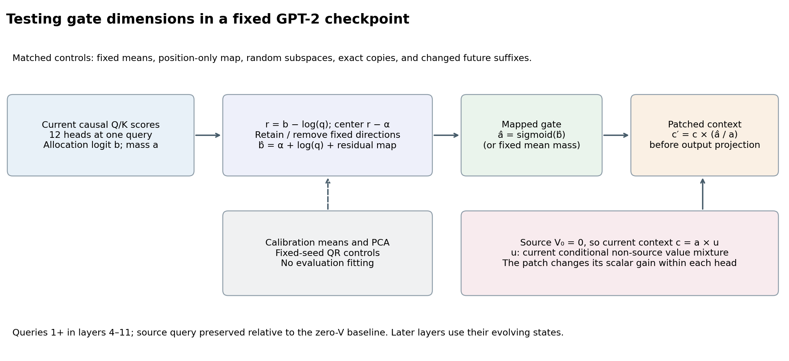
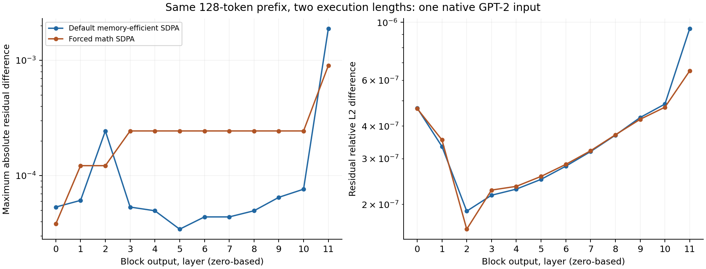
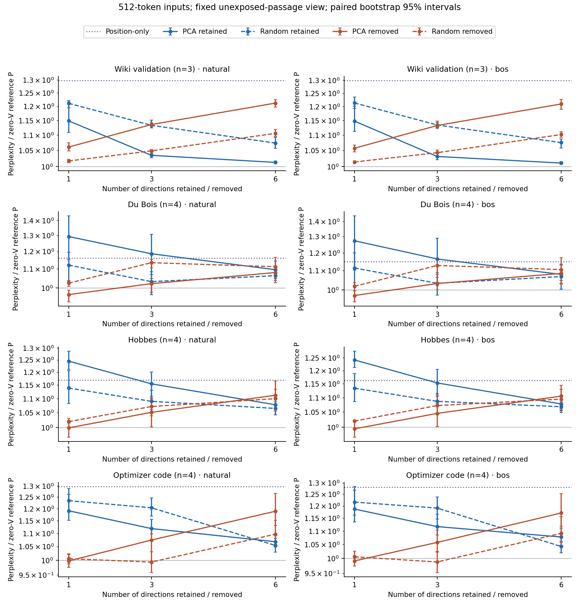
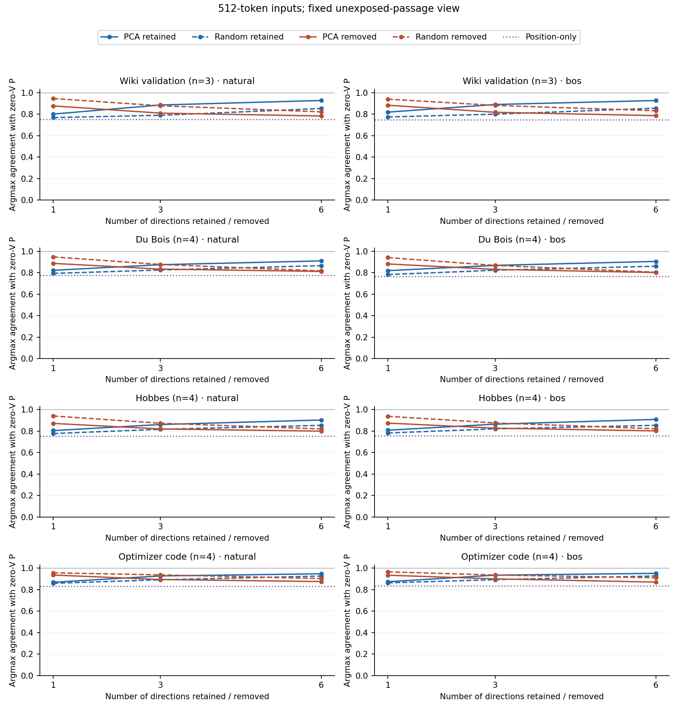
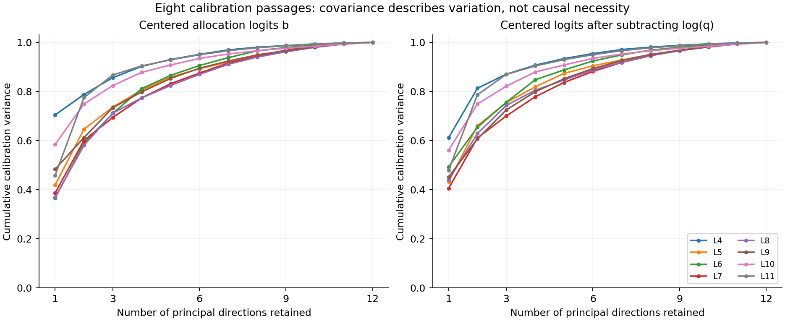

# Do the leading gate directions preserve GPT-2's computation?

Research continuation, 21 October 2026. GPT-2 revision
`75e09b43581151bd1d9ef6700faa605df408979f`, FP32/native SDPA;
all layer/head indices are zero-based.

**The leading covariance directions affect behavior, but do not provide a
faithful simple replacement.** Keeping one calibrated direction per layer
raises perplexity about 15–29% relative to the zero-source-value baseline.
Keeping six reduces the gap to about 1–10%, while changing roughly 5–10%
of argmax predictions. Matched random directions sometimes have lower loss
despite worse prediction fidelity. This is evidence about a defined
intervention in one checkpoint, not one universal underlying mechanism.

The report preserves two failed cross-length studies and their numerical
diagnostic. The completed experiment uses one physical shape throughout.
Independent numerical review passed; no previous failed result is relabeled
as successful.

## What the gate experiment tests

The earlier transfer screen did not find GPT-2 dependence on its selected
single large weight. Subsequent coordinate lesions identified conditional
regrowth and source-value pathways. This study isolates a related attention
allocation question in otherwise native upstream GPT-2. It does not apply
the original OLMo pulse or establish transfer of that exact mechanism.

After source values are zeroed in layers 4–11, a later query's head context
has the form `c = a × u`: `a` is total probability on non-source positions,
and `u` is their conditional value mixture. The preceding donor factorial
separated these factors. The present question is whether a simpler fixed map
can retain useful variation in the existing gates.

At each current query `q >= 1`, the model supplies 12 head allocation logits
`b = logsumexp(s_1, ..., s_q) - s_0`. In exact arithmetic, `a = sigmoid(b)`;
the code computes `b` from scores, avoiding a logit of rounded probabilities.
Here `q` also counts available non-source keys. A control subtracts `log(q)`
before centering. Eight natural-start calibration passages from Wiki test
and Hume determine the means and centered FP64 covariance/SVD. The 4,080
query vectors per layer come from eight passages and are correlated.
Leave-one-passage-out spectra and principal-angle cosines describe stability;
they do not select a rank.

Each layer centers the detrended vector by its own calibration mean `alpha`,
retains or removes PCA directions at the predeclared ranks 1, 3 and 6, and
restores `alpha + log(q)` before the sigmoid. Rank-matched QR controls use a
fixed random seed. Other controls use constant mean mass, constant mean
logits, a position-only map, and raw-logit PC1. These are separate maps per
layer, not a single shared scalar for the whole network.

The patch `c′ = c × (a_target/a_current)` preserves the current conditional
mixture locally. Earlier changes can alter later states and mixtures, so this
is not a fixed donor-trajectory decomposition. Gate projection preserves the
source query relative to zero-V baseline P. Zeroing V itself can change that
query relative to native C. Tiny denominator masses remain unclipped and are
checked against a stable conditional-softmax reconstruction.

The panel has four passages each from Wiki validation, Du Bois, Hobbes and
optimizer code. Natural/BOS variants replace only token 0. Calibration uses
disjoint Wiki-test/Hume passages and excludes earlier full extraction buffers;
evaluation used-token spans exclude 32 earlier spans per corpus. These splits
do not establish independence from pretraining data.

## Two failed execution-length checks remain part of the evidence

The first implementation passed independent CPU checks but stopped on the
pretrained model's first native 128/512 comparison. It consumed eight
calibration and 25 evaluation forwards, with 24 evaluation records appended.
Maximum final-normalized hidden drift was 0.00227356, above the original
absolute 0.001 limit. Maximum shared-target loss drift was 0.000162125;
argmax predictions agreed. This run remains failed, with frozen code and raw
partial outputs preserved.

Independent audit found five of 98,304 hidden entries above 0.001. The
largest was query 62, coordinate 430: 118.330078 versus 118.327805.
Whole-prefix relative L2 error was 1.62385e-6. Those small relative values
did not override the failed criterion or identify the discrepancy's cause.

A separately reviewed 18-forward native diagnostic crossed default and forced
math attention with repeated lengths, changed future suffixes, a padding-mask
control, and hook-free versus study-hook paths. All repeat, same-shape suffix,
padding and hook comparisons were exact in saved prefix states, logits and
losses. Default execution reproduced the failure. Forced math still exceeded
the old absolute hidden threshold, at 0.00106049. Mean cross-length FP64 KL
was 6.56508e-10 under default attention and 6.54261e-10 under math; predictions
agreed in both cases.

Both length pairs first diverged at layer 0's combined Q/K/V projection
(maximum 3.81470e-6), with identical input and preceding normalization.
Observed operators confirmed memory-efficient attention by default and math
attention under the explicit control. This supports execution-shape numerical
sensitivity in these configurations; it does not uniquely blame attention or
prove universal suffix invariance. PyTorch documents possible differences
between full-tensor and sliced computations and between attention backends.
Those facts motivate controls rather than establish this diagnosis alone.
[PyTorch numerical accuracy](https://docs.pytorch.org/docs/2.11/notes/numerical_accuracy.html),
[SDPA documentation](https://docs.pytorch.org/docs/2.11/generated/torch.nn.functional.scaled_dot_product_attention.html).

Independent audit verified all 18 diagnostic shards, 25 pairs, 276 FP64 score
comparisons, 192 context reconstructions and eight alignments to the failed
run; maximum saved-summary discrepancy was 1.42e-14.

A separately declared V2 retained all maps and conditions, added exact suffix
controls, and used post-failure relative hidden limits: 1e-4 per query and
1e-5 globally, with the original loss/context limits. It also failed, on the
first Wiki passage's BOS native baseline. Query 110 had relative L2 drift
1.0108874e-4, exceeding the local limit by 1.09%; it was the only query above
that limit. Global drift was 2.44156e-6, maximum loss drift 0.000191212, and
scored predictions agreed.

V2 consumed 90 forwards and saved 68 main records plus 21 suffix records in
10.591 seconds. Independent audit confirmed the failing C pair, 23 completed
natural-start prefix comparisons, all 21 completed suffix controls and 60
FP64 snapshot states; maximum reconstruction component error was 2.9832e-5.
The run did not reach its final parameter-integrity check. Its most recent
forward was P512, whereas the failing saved comparison was C; the audit used
the explicitly saved C pair. Neither failed run supplies a completed gate
result. There was no further threshold increase or automatic restart.

## The narrower fixed-shape study

The independently reviewed new design uses exactly 512 tokens in every model
forward. It retains all 21 conditions, ranks, maps and 32 input/start variants.
It reports targets 2–511 overall, early targets 2–127, and later targets
128–511. The early segment is a score view of a 512-token execution, not a
standalone 128-token run, an independent sample, or a matched-target test of
changing available history. Cross-length numerical validation remains open.

All 672 fixed-shape suffix controls remain: each condition on every longer
input rotates positions 128–511 while preserving positions 0–127. Prefix
hidden states, logits, gates, source Q/K/V, contexts and shared scoring must
be exact. Changed suffix targets are never scored. Attention, gate and stable
mixture reconstruction retain the original 1e-4 limits. Exact copy controls,
source identity relative to P, immutable maps and completed parameter checks
remain required. Any new failure stays a failure.

The first Wiki passage is exposed at both starts. Original n=4 tables are
accompanied by a fixed unexposed-passage view: the remaining three Wiki
passages and all four passages in each other corpus. Both views retain every
condition and contrast. Paired 2,000-resample bootstrap intervals use seed
20261021 and actual group sizes; they condition on the fit and selected
passages, with no multiple-comparison or population claim. The two views
are not independent datasets.

Successful prefix logit/context comparisons retain separate runtime equality
flags and hash/shape/dtype records; full arrays are saved only for fixed
snapshots and failures. An independent audit cannot recompute absent arrays.
Raw gate, source, prefix hidden and per-token metric tensors remain available.

The separate calibration-only rebuild performed eight forwards, with no
evaluation inference, in 3.614 seconds. Raw calibration and fitted maps were
byte-identical to the original; independent audit verified all 176 tensors
and 64 operation checks. This is same-machine reproducibility, not external
or cross-platform replication. The primary study uses the original maps.

## Causal gate results

The fixed512 study completed all 1,352 forwards: 680 main records (including
eight repeat/identity anchors) and 672 changed-suffix controls. Independent
saved-output review verified the per-token reductions, full and unexposed
tables, paired intervals, source identities and saved suffix arrays. The
first exposed Wiki passage is excluded from the main tables below; Wiki has
three passages and the other corpora four. Full n=4 results remain available.

The centered, position-detrended calibration vectors have substantial shared
variance: PC1 explains 40.47–61.12% across the eight layers, the first three
directions 70.02–87.04%, and the first six 88.14–95.44%. These percentages are
descriptive calibration measurements. The interventions show why they cannot
be read as percentages of a single causal mechanism.

Retaining only PC1 in each layer raises perplexity to 1.148–1.292 times the
zero-source-value baseline P, with only 80.07–87.40% argmax agreement. Keeping
six directions improves the range to 1.0105–1.0954, with 90.39–95.20%
agreement. These are ranges of eight corpus/start means, not uncertainty
intervals. Six directions per layer are already half the head space; this
does not demonstrate a faithful scalar replacement or a single shared
network-wide factor. Native-C comparisons are also retained: rank-six ratios
are 1.0156–1.1102 and agreement 88.92–94.56%.

The matched controls separate fidelity from loss. PCA retention has higher
agreement with P than the single fixed QR control in all 24 rank × corpus ×
start mean comparisons. Yet PCA rank-one retention has worse loss than QR
rank one on both book corpora at both starts; all four paired intervals for
that contrast are positive. Wiki and code show the opposite sign, with all
four paired intervals negative. At rank six, six of the eight mean loss
comparisons favor QR, but five of those six intervals include zero. A
single random basis and small samples do not establish a distribution over
random subspaces.

Removing PC1 is also informative. It worsens Wiki perplexity by 5.70–6.06%
relative to P, with paired delta-NLL intervals entirely positive. On Du Bois
it lowers perplexity by 2.72–3.24%, with both intervals entirely negative.
Hobbes and code have slightly lower mean loss but intervals spanning zero.
Despite these loss improvements, removing PC1 reduces agreement more than
removing one QR direction in all eight mean comparisons. Useful prediction
fidelity and lower empirical loss are distinct objectives here.

Simple frozen replacements are inadequate on this panel. Constant mean mass
produces ratios 1.102–1.226 relative to P; the position-only map gives
1.148–1.298. The latter's early-target ratios are 1.392–1.822, compared with
1.078–1.192 on later targets. Removing PC1 has early losses above P on all
eight means, whereas its later losses are below P on books and code. These
are within-execution position views of the same passages; they do not show
that changing context length or earlier history causes those differences.

P itself is close in average loss to native C on this panel (0.9956–1.0135
perplexity ratio), but only 94.84–98.19% of argmax predictions agree. Its
closeness in loss does not erase the zero-value intervention or justify
calling subsequent maps native-model replacements.

## What is established, and what remains a hypothesis

The intervention results establish that the specified calibrated gate
directions affect the outputs of this pinned checkpoint, with corpus- and
position-dependent loss effects. Centered variance alone fails to identify
a faithful low-dimensional replacement. The combination of high variance,
better prediction fidelity, and sometimes worse loss is a measured result;
it is not evidence that a direction is intrinsically good or harmful.

Several explanations remain open. Calibration-domain differences could make
a fixed mean or basis unsuitable elsewhere. Applying maps at eight layers
could compound small local changes. Large-variance directions could carry
native preferences that are imperfect on these passages. The results do not
separate these explanations or identify a single semantic feature. Fresh
calibration and layer-isolated interventions are the next discriminating
tests; no rank is to be selected and retested on the same held-out passages.

No speedup was tested: the patch still computes native attention and then
modifies its output. Teacher-forced loss and agreement do not establish
generation fidelity, an efficient replacement, or transfer of OLMo's exact
single-weight pulse to GPT-2.

## Numerical conditioning and audit limits

All 744 main checks and 10,240 main/control gate checks passed. Independent
review recomputed all 680 raw-record reductions, 672 saved suffix closures,
640 source identities and 40 predetermined FP64 attention snapshots. Maximum
FP64 snapshot reconstruction error was 2.9832e-5; the saved FP32 delivery
formula was exact. The largest runtime stable-conditional reconstruction
error was 4.7684e-5, below the unchanged 1e-4 guard. Current/fullrank and
repeat/identity closures remained exact, and final parameter/map integrity
checks completed.

This success has a material conditioning limit. The smallest current
non-source mass was 5.11798e-11 and the largest target/current gain was
1.9538970624e10 (Wiki window3, BOS, constant-mean-logit map, layer4).
That worst case lies outside the predetermined raw-QKV snapshot input; it
has passing runtime reconstruction checks, not a separate FP64 snapshot
reconstruction. No denominator clipping was used. Some target sigmoid outputs round to one;
the main active interventions contain 244,318 such head/query endpoints and
zero target zeros. Passing these checks on this checkpoint and machine does
not certify arbitrary precision, new inputs or kernels.

The reviewer used 1,211,524 KiB peak RSS and no model/GPU. Successful full
prefix logits and contexts are partly represented only by runtime equality
flags and independent hash/shape/dtype records. Saved raw snapshots verify a
fixed subset; absent arrays cannot be reconstructed by an audit. Bootstrap
intervals condition on the eight calibration passages and the small evaluation
panel, with no multiple-comparison correction or pretraining-independence claim.

## All predeclared maps

Perplexity ratios below use zero-value reference P on the identical input.
The exact-copy controls `current` and `fullrank` equal P; native C and their
full numerical records are retained in the data. All predeclared active maps
are shown. The perplexity figure shows paired bootstrap 95% intervals;
agreement panels show means. The raw tables
also include comparisons to native C, KL, agreement, and full n=4 views.

Natural starts:

| Map | Wiki (n=3) | Du Bois (n=4) | Hobbes (n=4) | Code (n=4) |
|---|---:|---:|---:|---:|
| Zero-V reference P | 1.0000 | 1.0000 | 1.0000 | 1.0000 |
| Fixed mean mass | 1.1948 | 1.1017 | 1.1221 | 1.1905 |
| Fixed mean logits | 1.2372 | 1.1356 | 1.1574 | 1.2332 |
| Position-only | 1.2974 | 1.1610 | 1.1694 | 1.2967 |
| Raw-logit PC1 | 1.1103 | 1.1774 | 1.1671 | 1.1802 |
| PCA retain 1 | 1.1483 | 1.2922 | 1.2447 | 1.1909 |
| PCA retain 3 | 1.0345 | 1.1861 | 1.1548 | 1.1185 |
| PCA retain 6 | 1.0124 | 1.0954 | 1.0776 | 1.0678 |
| QR retain 1 | 1.2112 | 1.1210 | 1.1389 | 1.2340 |
| QR retain 3 | 1.1329 | 1.0323 | 1.0899 | 1.2036 |
| QR retain 6 | 1.0736 | 1.0633 | 1.0647 | 1.0538 |
| PCA remove 1 | 1.0606 | 0.9676 | 0.9986 | 0.9978 |
| PCA remove 3 | 1.1356 | 1.0219 | 1.0510 | 1.0741 |
| PCA remove 6 | 1.2120 | 1.0801 | 1.1121 | 1.1890 |
| QR remove 1 | 1.0169 | 1.0244 | 1.0192 | 1.0058 |
| QR remove 3 | 1.0484 | 1.1345 | 1.0714 | 0.9939 |
| QR remove 6 | 1.1056 | 1.1117 | 1.0997 | 1.0968 |

BOS replacement at token0:

| Map | Wiki (n=3) | Du Bois (n=4) | Hobbes (n=4) | Code (n=4) |
|---|---:|---:|---:|---:|
| Zero-V reference P | 1.0000 | 1.0000 | 1.0000 | 1.0000 |
| Fixed mean mass | 1.2260 | 1.1027 | 1.1387 | 1.1822 |
| Fixed mean logits | 1.2713 | 1.1328 | 1.1722 | 1.2180 |
| Position-only | 1.2984 | 1.1483 | 1.1628 | 1.2800 |
| Raw-logit PC1 | 1.1105 | 1.1681 | 1.1658 | 1.1875 |
| PCA retain 1 | 1.1480 | 1.2729 | 1.2416 | 1.1869 |
| PCA retain 3 | 1.0309 | 1.1642 | 1.1531 | 1.1168 |
| PCA retain 6 | 1.0105 | 1.0790 | 1.0774 | 1.0771 |
| QR retain 1 | 1.2132 | 1.1135 | 1.1338 | 1.2159 |
| QR retain 3 | 1.1346 | 1.0333 | 1.0867 | 1.1909 |
| QR retain 6 | 1.0753 | 1.0679 | 1.0680 | 1.0423 |
| PCA remove 1 | 1.0570 | 0.9728 | 0.9946 | 0.9912 |
| PCA remove 3 | 1.1326 | 1.0321 | 1.0453 | 1.0571 |
| PCA remove 6 | 1.2095 | 1.0845 | 1.1052 | 1.1708 |
| QR remove 1 | 1.0138 | 1.0181 | 1.0197 | 1.0056 |
| QR remove 3 | 1.0428 | 1.1275 | 1.0721 | 0.9876 |
| QR remove 6 | 1.1020 | 1.1051 | 1.0945 | 1.0909 |

## Prior work and the limits of novelty

The gate algebra is established. Fu and colleagues explicitly derive the
non-source conditional mixture multiplied by a head gate under zero or
negligible sink-value contribution, including the gate’s sigmoid/log-sum-exp
expression, in §3.1 and Appendix B.2. Their source-value
zeroing experiments also precede this study; outcomes depend on which heads
are zeroed. We test fixed calibrated subspaces of these gates in a pretrained
checkpoint, rather than claim discovery of implicit gating.
[Attention Sink Forges Native MoE](https://arxiv.org/html/2602.01203v1).

Qiu and colleagues study explicit head-specific sigmoid gates after attention,
including query dependence and sparse gating. Zhou and colleagues study
learned low-rank and cross-head gates with synthetic sinks. These are relevant
precedents for simplifying or coupling gates; we do not reproduce their
training experiments or claim those architectural ideas as new.
[Gated Attention](https://arxiv.org/html/2505.06708v1),
[Hybrid Gated Attention](https://arxiv.org/html/2608.11805v1).

Reports8–10 distinguish established super-weight, massive-activation and
GPT-2 query-bias research from this project’s conditional-regrowth and source
K/V experiments. Massive Activations already separates source and non-source
attention contributions and tests synthetic zero-value alternatives. The
present intervention preserves the current conditional mixture locally while
retaining or removing calibrated gate directions; its outcome cannot by itself
identify one shared mechanism throughout the residual stream.
[Massive Activations](https://arxiv.org/html/2402.17762v2),
[GPT-2 attention-sink mechanism](https://arxiv.org/html/2604.14722v1).

A closely titled preprint, *Variance Geometry is Not Functional Geometry in
Transformer Residual Streams* (SSRN6886378), was located, but its primary
full text returned403. That comparison remains unresolved. Kernel-PCA
analyses of keys concern a different representation from the cross-head gate
vectors tested here. Our searched comparison supports careful attribution,
not a claim of priority or an exhaustive absence of similar work.
[Unresolved SSRN comparison](https://papers.ssrn.com/sol3/papers.cfm?abstract_id=6886378),
[Kernel-PCA attention analysis](https://arxiv.org/html/2406.13762v1).

## Reproduction and resource accounting

The local reproducibility package includes frozen experiment sources, exact
checkpoint and input hashes, both failed runs, raw private outputs, numerical
exports, protocols, and independent review notes. Scripts rebuild historical
calibration metadata with a tokenizer only, then run eight new GPT-2 calibration
forwards and 1,352 fixed512 forwards. Earlier model experiments and Llama weights
are unnecessary for that route. Exact input files must be obtained under their
own terms; model weights, corpora and private token/activation arrays are not
redistributed in the repository.

| Run | New forwards | Wall seconds | Peak allocated GPU GiB | Peak process RSS GiB |
|---|---:|---:|---:|---:|
| V1: failed | 33 | not recorded | not recorded | not recorded |
| Native numerical diagnostic | 18 | 19.274 | 0.611 | 2.020 |
| Calibration-only rebuild | 8 | 3.614 | 0.601 | 1.744 |
| V2: failed | 90 | 10.591 | 0.901 | 2.132 |
| Fixed512: completed | 1352 | 226.997 | 0.900 | 2.533 |

The gate investigation totals 1,501 production/diagnostic forwards through this
milestone; independent same-machine replays are counted separately. V1 did not
record its final wall/peak resources before failure. One local RTX3060Ti ran
one model at a time. Exact replays are hardware/runtime-conditional evidence,
not external replication; other kernels may expose numerical differences.

The standalone reproduction then completed 1,360 new forwards (eight calibration
and 1,352 study) in 258.179 driver seconds. Its numerical comparison matched all
680 records and 1,734,000 exported per-token values exactly. Private comparison
matched 123,828 saved tensors containing 546,996,560 elements, with 9,520 scalar
reductions independently recomputed across the reference and replay. Peak CPU
comparison RSS was 1.282 GiB. Successful full logits/contexts outside the fixed
snapshots remain absent, so this does not compare arrays that were never saved.

The first comparison stopped on a calibration bookkeeping-schema mismatch:
the rebuild records omit original phase/identity and check-count fields.
That failed comparison and its code remain preserved. An independently reviewed
compatibility fix validates the original constants and compares every shared
field, including all64 layer gate checks; it neither invents missing counters
nor reruns the model. Both numerical and private comparisons then passed.
The replay adds1,360 forwards to the1,501 production/diagnostic count;
CPU fixtures and metadata-only preparation use zero model forwards.

The private GitHub repository remains local because automatic approval review
denied its creation before execution. No remote or push was created, and no
publication retry or credential change occurred. The next proposed experiment
isolates PC1 removal at each layer, with a matched directional control and
position-only replacement, before separately crossing calibration means and
bases. Fresh-span eligibility and design review precede its execution. This
will test the removal sign and layer composition; it will not by itself explain
all rank-one retention loss. This report is a reviewed checkpoint, not a claim of complete
understanding.
