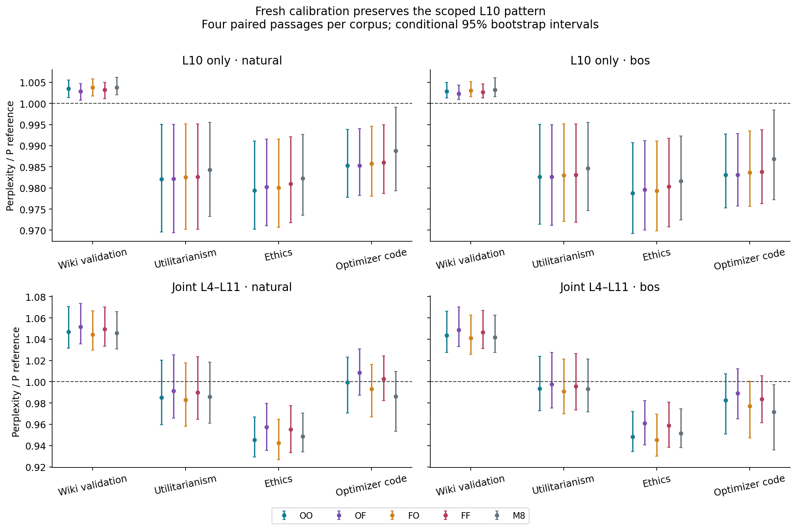
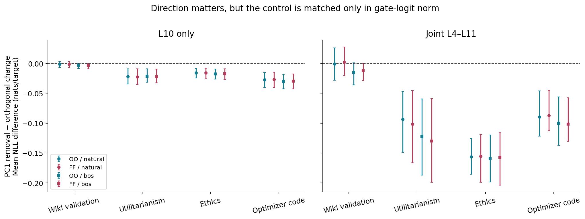
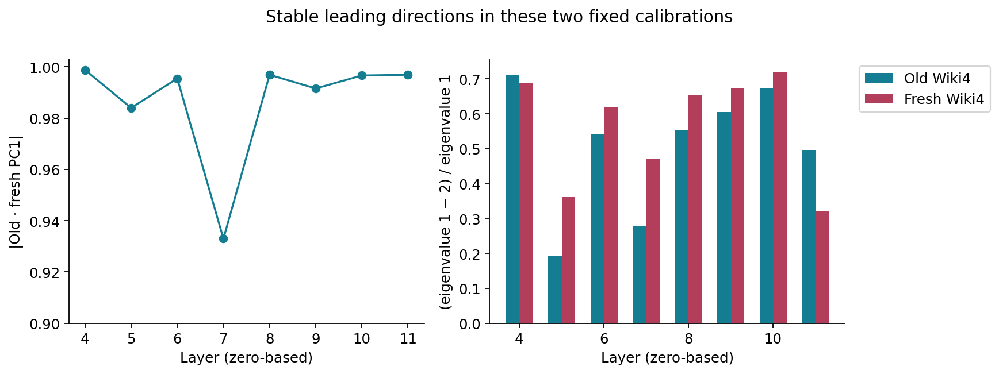
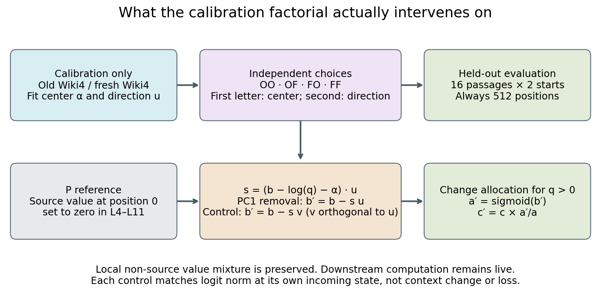

# Does the gate result survive fresh calibration?

Repository packaging update: safe numeric export, the NumPy-only auditor and standalone preparation review have now passed. See the [current audit/replay guide](GPT2_GATE_WIKI_CALIBRATION_QUICKSTART.md). The report below preserves the scientific snapshot and its historical pending-status statements; no second pretrained replay is claimed.

GPT-2 research checkpoint, 21 October 2026. This study extends the causal
super-weight investigation; useful questions remain and research continues.

The existing private repository is [jaykobdetar/superweight-research](https://github.com/jaykobdetar/superweight-research).
The preceding [output/loss analysis](https://github.com/jaykobdetar/superweight-research/blob/main/docs/GPT2_GATE_ADDITIVE.md)
explains why combined changes cannot be inferred from singleton losses.

## What the new experiment establishes

The layer-10 result survives a fresh calibration on these passages. Removing
the leading gate direction worsens Wiki validation loss and improves loss on
Utilitarianism, Ethics and optimizer code. That sign pattern holds for both
natural starts and a BOS replacement, for all four crossed Wiki-calibration
choices, and for the original mixed-calibration anchor. All 40 corresponding
conditional intervals exclude a perplexity ratio of one. These are correlated
comparisons on 16 passages, not 40 independent replications.

For natural starts, switching from old Wiki calibration to fresh Wiki
calibration changes the L10 perplexity ratios from **1.003560 to 1.003240** on
Wiki, **0.982135 to 0.982692** on Utilitarianism, **0.979451 to 0.980979** on
Ethics, and **0.985271 to 0.986016** on code. The reference, P, has source-token
values zeroed in layers 4–11; it is not the intact model. A ratio below one is a
loss improvement under this intervention boundary, not faithful output
preservation or evidence of better generated text.

The reference distinction changes the interpretation. On Ethics, fresh-fit
L10 removal gives perplexity ratios **1.000043 / 1.000783 relative to native
C** for natural/BOS starts, with both intervals including one. Its apparent
improvement over P mostly returns the mean loss toward C. Some other groups
beat C in loss, but those runs still combine source-value zeroing with the
gate change; they do not establish the effect of a gate-only change in the
intact model.

The matched orthogonal control matters. Across all 24 non-Wiki corpus/start/
calibration groups, L10 PC1 removal beats the orthogonal change, with each
paired interval below zero. The same is true for all 24 joint-layer groups.
Wiki is less decisive: only one of eight L10 and two of eight joint-layer
matched comparisons exclude zero in that direction. The control matches
gate-logit perturbation norm, not context-vector norm or semantic disruption.
This is evidence about the tested direction relative to this fixed control,
not proof that PC1 is unique among possible directions.

Jointly changing layers 4–11 gives a different result. All four Wiki-calibrated
PC1-removal choices harm Wiki and help Ethics for both starts, with intervals
excluding one. Utilitarianism and code retain intervals crossing one for all
four choices. Thus “removing this direction helps books” remains too broad.
For natural-start code, OO gives a ratio of 0.999304 and FF gives 1.002882,
while their argmax agreement with P is only 91.96% and 91.37%. Near-zero mean
loss change does not make either transformation an output-preserving
replacement.

## What changing the calibration actually changes

O and F each use four Wiki-test passages. We independently cross their
12-head centers and leading directions. In OO/OF/FO/FF, the first letter
selects the center and the second selects the direction. M8 is the earlier
four-Wiki/four-Hume fit, retained as a secondary anchor. OO is not M8, and M8
contrasts confound both corpus mixture and calibration sample count.

The old and fresh leading axes are close: absolute cosine ranges from
**0.932976 to 0.998835** across layers 4–11, and is **0.996647 at L10**.
These two fits have resolved leading eigenvalue gaps. This does not estimate
calibration-population stability; it is one comparison between two small,
fixed calibrations. A stable axis is also not a count of causal mechanisms.

The crossed interventions reveal a systematic difference between local and
joint effects. For L10 PC1 removal, changing only the center increases mean
loss at either direction in all eight corpus/start groups; all 16 intervals
exclude zero. The mean increases range from **0.000233 to 0.000729 nats per
target**. Changing centers jointly across layers 4–11 decreases mean loss in
all 16 comparisons, with mean changes from **−0.005942 to −0.001780**.
Changing directions jointly increases mean loss in all 16 comparisons; 12
intervals exclude zero. The eight L10 and eight joint center-by-direction
interaction means are positive, with intervals excluding zero. These are
finite interventions on a small panel, without multiple-comparison correction.

At a common incoming L10 state, the center swap has a simple identity:
the change in the proposed gate logits is
`((α_F − α_O) · u) u` for PC1 removal, or
`((α_F − α_O) · u) v` for the orthogonal control. It is a constant 12-head
offset across queries at that shared state. The runtime checks verify this
identity. The observed loss interactions can arise from the sigmoid,
downstream network and loss calculation; they do not identify an internal
feedback pathway. Joint-layer trajectories are different incoming states and
must not be substituted into this common-state identity.

## Findings, rejected explanations and remaining hypotheses

| Statement | Current status |
|---|---|
| The L10 Wiki-versus-other-source sign pattern requires the exact original mixed calibration. | Rejected on this panel: both four-Wiki calibrations and their crossed choices preserve it. |
| Calibration choice has no causal effect. | Rejected for these finite center/direction changes; their paired losses differ. |
| PC1 removal is interchangeable with an equal-logit-norm orthogonal change. | Rejected on the non-Wiki panel; downstream/context norm is not matched. |
| Joint PC1 removal is an output-preserving simplification. | Rejected: substantial argmax and distribution changes remain, even when loss is nearly unchanged. |
| A single leading covariance direction identifies one circuit. | Unsupported. Covariance, these interventions and their interactions do not establish uniqueness. |
| The L10 pattern also holds with native source values restored. | Open and the next prioritized causal test. |
| The result generalizes to generation, arbitrary prefixes, longer contexts or other checkpoints. | Open. No such claim is made by this batch. |

The next informative experiment restores source values while retaining a
precisely defined gate intervention. With native source value `v₀` and
conditional non-source mixture `u`, the local output is
`c = a u + (1−a) v₀`. Changing allocation to `a′` can be implemented as
`c′ = c + (a′−a)(u−v₀)`, with explicit rounding and identity checks.
Comparing that intervention with the current zero-value boundary would test
whether the scoped L10 effect survives in the intact computation. Local
source restoration and earlier-layer restoration should be separated; a
single all-at-once comparison would confound them. This is a prospective
proposal, not a result of the current study.

## Intervention and evaluation protocol

The checkpoint is `openai-community/gpt2`, revision
`75e09b43581151bd1d9ef6700faa605df408979f`, FP32 with the recorded SDPA backend.
All layer numbers are zero-based. Parameters are unchanged. The native model
is C; P sets the source-position value vector to zero in each attention layer
4–11. Query/key projections and non-source value vectors are not directly
patched, but they may change downstream. Gate edits preserve query zero
relative to P; P's source-value zeroing itself can change query zero versus C.

For each layer and query q>0, define non-source attention mass a and
`b = logit(a) = logsumexp(non-source scores) − source score`.
Calibration centers `r = b − log(q)` and fits its centered 12-dimensional
covariance/SVD. Each fit pools 510 queries from each of four calibration
passages, with covariance denominator 2,039. These queries are correlated;
they are not 2,040 independent samples. Leave-one-passage-out diagnostics use
the same fixed procedure and denominator 1,529. No direction or rank is
selected using the new evaluation losses.

For center α and normalized leading direction u, let
`s = (b − log(q) − α) · u`. PC1 removal sets `b′ = b − s u`.
Its matched control sets `b′ = b − s v`, where v is orthogonal to u,
constructed deterministically from the fixed QR seed. Both have the same
gate-logit perturbation norm at their own incoming state. The hook scales
the actual context by `sigmoid(b′)/a`, preserving its conditional non-source
mixture locally. Downstream computation remains live. All L10-only gate
intervention arms share P's incoming L10 state; joint-layer conditions need not.

There are 24 conditions: C, P, two identity controls, eight Wiki-calibration
PC1-removal arms, eight orthogonal arms, and four M8-anchor arms. The eight
arms per family cross four center/direction choices with L10-only or joint
L4–L11 application. Current/full-rank identities, native repeats and the
writer identity control are checked exactly against their references.

The four fresh calibration passages are Wiki-test windows selected before
evaluation. Sixteen exposure-separated evaluation passages comprise four
each from Wiki validation, Mill's Utilitarianism, Spinoza's Ethics, and joined
Adadelta/Adamax/ASGD source code. Corpus files, processed text, extraction
offsets, rejection history, token hashes and checkpoint identities are pinned
in the manifest. Natural starts and BOS replacement use the same 512 tokens
except for token zero; nothing is inserted or retokenized. The starts are not
matched across corpora or calibration panels. Two current natural starts were
seen in M8, none in O or F; one fresh-calibration start was seen in earlier
evaluation. The complete identity accounting remains local and reproducible.

Every forward executes exactly 512 positions. Main scores cover targets
2–511. Early targets 2–127 and later targets 128–511 are secondary views of
the same execution, not experiments at different context lengths. Each main
condition has a suffix control rotating positions 128–511; unchanged-prefix
logits, hidden states, attention/gate records and per-target quantities must
match exactly. The two earlier cross-length failures remain preserved and
are not reclassified as successful tests.

Uncertainty resamples the four paired passages in each corpus, with 2,000
shared bootstrap draws and seed 20261021. Intervals condition on the two
fixed calibrations; they estimate neither population calibration uncertainty
nor representative corpus uncertainty. The passages are not randomly sampled
from a defined corpus population. The many arms, starts and score views are
correlated, and no multiple-comparison adjustment is applied. All 576 group
summaries and 912 paired contrasts are retained, not just favorable ones.

## Failed branch and numerical audit correction

The original proposal required four fresh Wiki and four fresh Hume calibration
passages. Its tokenizer-only preflight failed before any pretrained forward:
the 212 Hume exclusion records merge to 20 intervals; the largest remaining
gap is 5,492 characters, shorter than the required 8,192-character buffer.
An independent full-gap audit confirmed that this was not merely a grid-search
failure. No exclusion was relaxed. The revised Wiki4-versus-Wiki4 design was
reviewed and frozen before its first model forward. The failure, original
proposal, retained Wiki windows, capacity proof and revised protocol remain
available.

After the successful model run, the original saved-state auditor failed on
exact direction reconstruction. The lossless NPZ representation preserved
matrix values but not tensor strides. Replaying the QR-column calculation
with the decoded row-major layout changed 13 FP64 control vectors by at most
1.1102230246251565e−16; their FP32 forms were all exactly unchanged.
Independent diagnosis showed that restoring only the 24 original QR matrix
layouts reproduced every saved direction, hash, scalar and geometry field
exactly. A separate, reviewed adapter performs that value-preserving layout
restoration before invoking the unchanged frozen auditor. No tolerance,
intervention, model output or original source was changed. The failed audit
and its log remain preserved.

## Complete primary perplexity tables

Each cell is perplexity relative to P, with its conditional paired 95%
bootstrap interval. Each corpus contains four paired passages. OO/OF/FO/FF
cross old/fresh Wiki4 centers and directions; M8 is a separately labeled
mixed-eight anchor. The same passages underlie all cells and both starts.

### PC1 removal — L10 only

| Corpus / start | OO | OF | FO | FF | M8 (secondary) |
|---|---:|---:|---:|---:|---:|
| Wiki / natural | 1.003560 [1.001426, 1.005560] | 1.002912 [1.000721, 1.004706] | 1.003823 [1.001763, 1.005784] | 1.003240 [1.001159, 1.004961] | 1.003844 [1.002022, 1.006228] |
| Wiki / bos | 1.002868 [1.001277, 1.004980] | 1.002365 [1.000958, 1.004373] | 1.003101 [1.001555, 1.005222] | 1.002658 [1.001308, 1.004647] | 1.003221 [1.001640, 1.006072] |
| Utilitarianism / natural | 0.982135 [0.969578, 0.995045] | 0.982204 [0.969380, 0.995041] | 0.982527 [0.970251, 0.995160] | 0.982692 [0.970226, 0.995186] | 0.984345 [0.973280, 0.995539] |
| Utilitarianism / bos | 0.982626 [0.971442, 0.995036] | 0.982612 [0.971162, 0.994976] | 0.982994 [0.972047, 0.995164] | 0.983074 [0.971924, 0.995142] | 0.984689 [0.974679, 0.995532] |
| Ethics / natural | 0.979451 [0.970190, 0.991131] | 0.980264 [0.971020, 0.991567] | 0.980029 [0.970721, 0.991573] | 0.980979 [0.971789, 0.992122] | 0.982235 [0.973497, 0.992654] |
| Ethics / bos | 0.978768 [0.969238, 0.990706] | 0.979642 [0.970050, 0.991167] | 0.979335 [0.969848, 0.991149] | 0.980339 [0.970794, 0.991720] | 0.981667 [0.972466, 0.992346] |
| Optimizer code / natural | 0.985271 [0.977735, 0.993867] | 0.985346 [0.978229, 0.994063] | 0.985806 [0.978062, 0.994568] | 0.986016 [0.978645, 0.994935] | 0.988793 [0.979361, 0.999080] |
| Optimizer code / bos | 0.983096 [0.975287, 0.992791] | 0.983142 [0.975774, 0.992848] | 0.983645 [0.975670, 0.993511] | 0.983824 [0.976261, 0.993734] | 0.986849 [0.977245, 0.998465] |

### PC1 removal — joint L4–L11

| Corpus / start | OO | OF | FO | FF | M8 (secondary) |
|---|---:|---:|---:|---:|---:|
| Wiki / natural | 1.046966 [1.031446, 1.070521] | 1.051687 [1.035486, 1.073513] | 1.044341 [1.029679, 1.066809] | 1.049624 [1.033403, 1.070213] | 1.045931 [1.030868, 1.065934] |
| Wiki / bos | 1.043524 [1.027572, 1.066215] | 1.048568 [1.033097, 1.070267] | 1.041027 [1.025908, 1.062629] | 1.046619 [1.031166, 1.067099] | 1.041942 [1.027634, 1.062524] |
| Utilitarianism / natural | 0.985359 [0.959724, 1.020186] | 0.991549 [0.965839, 1.025247] | 0.982867 [0.958268, 1.017630] | 0.989786 [0.964829, 1.023515] | 0.985965 [0.961090, 1.018528] |
| Utilitarianism / bos | 0.993518 [0.972697, 1.023837] | 0.997528 [0.975238, 1.027722] | 0.990921 [0.970032, 1.021425] | 0.995658 [0.973416, 1.026490] | 0.993222 [0.971874, 1.021472] |
| Ethics / natural | 0.945361 [0.929291, 0.967129] | 0.957460 [0.935543, 0.979891] | 0.942436 [0.926658, 0.964622] | 0.955246 [0.933512, 0.977487] | 0.948530 [0.933987, 0.970640] |
| Ethics / bos | 0.948438 [0.934376, 0.971979] | 0.961034 [0.940647, 0.982367] | 0.945482 [0.930057, 0.969591] | 0.958827 [0.938581, 0.980790] | 0.951596 [0.938047, 0.974551] |
| Optimizer code / natural | 0.999304 [0.970730, 1.023188] | 1.008564 [0.987468, 1.030964] | 0.993384 [0.966773, 1.016147] | 1.002882 [0.982267, 1.024318] | 0.986476 [0.953467, 1.009752] |
| Optimizer code / bos | 0.982772 [0.950985, 1.007556] | 0.989200 [0.965009, 1.012281] | 0.977080 [0.947143, 1.000587] | 0.983806 [0.961488, 1.005682] | 0.971825 [0.935944, 0.997438] |

### Orthogonal control — L10 only

| Corpus / start | OO | OF | FO | FF | M8 (secondary) |
|---|---:|---:|---:|---:|---:|
| Wiki / natural | 1.004840 [1.000823, 1.010599] | 1.004875 [1.000662, 1.010729] | 1.004736 [1.000681, 1.010627] | 1.004729 [1.000519, 1.010753] | 1.004414 [1.000210, 1.010457] |
| Wiki / bos | 1.006010 [1.001871, 1.011255] | 1.006018 [1.001958, 1.011361] | 1.005910 [1.001641, 1.011283] | 1.005878 [1.001647, 1.011391] | 1.005530 [1.001324, 1.010998] |
| Utilitarianism / natural | 1.004023 [1.003467, 1.004578] | 1.005350 [1.004577, 1.005776] | 1.003918 [1.003247, 1.004590] | 1.005183 [1.004365, 1.005749] | 1.005829 [1.004641, 1.006687] |
| Utilitarianism / bos | 1.003979 [1.002012, 1.005720] | 1.005302 [1.003789, 1.006818] | 1.003864 [1.001800, 1.005668] | 1.005129 [1.003452, 1.006809] | 1.005783 [1.003752, 1.007818] |
| Ethics / natural | 0.995048 [0.991068, 1.000279] | 0.996582 [0.993091, 1.000970] | 0.995025 [0.991062, 1.000220] | 0.996517 [0.993047, 1.000867] | 0.997716 [0.994849, 1.001193] |
| Ethics / bos | 0.995992 [0.992110, 1.000933] | 0.997559 [0.994028, 1.001803] | 0.995970 [0.992113, 1.000860] | 0.997494 [0.993997, 1.001678] | 0.998743 [0.995876, 1.002041] |
| Optimizer code / natural | 1.012338 [1.008835, 1.017929] | 1.013726 [1.009754, 1.019471] | 1.011800 [1.008409, 1.017420] | 1.012976 [1.009148, 1.018778] | 1.010679 [1.006981, 1.016697] |
| Optimizer code / bos | 1.012999 [1.008822, 1.018585] | 1.014330 [1.009816, 1.020019] | 1.012455 [1.008217, 1.018111] | 1.013569 [1.009171, 1.019372] | 1.011234 [1.006540, 1.017569] |

### Orthogonal control — joint L4–L11

| Corpus / start | OO | OF | FO | FF | M8 (secondary) |
|---|---:|---:|---:|---:|---:|
| Wiki / natural | 1.047720 [1.028655, 1.074229] | 1.047721 [1.029701, 1.072410] | 1.047308 [1.030135, 1.072448] | 1.047461 [1.030856, 1.071299] | 1.046620 [1.029977, 1.070859] |
| Wiki / bos | 1.059663 [1.036831, 1.082998] | 1.059820 [1.037506, 1.082614] | 1.058994 [1.037784, 1.080638] | 1.059142 [1.037916, 1.080802] | 1.057528 [1.037340, 1.078109] |
| Utilitarianism / natural | 1.081936 [1.051486, 1.118384] | 1.095539 [1.057583, 1.141045] | 1.082866 [1.053699, 1.119823] | 1.095402 [1.057810, 1.140454] | 1.101528 [1.063955, 1.150306] |
| Utilitarianism / bos | 1.122708 [1.081909, 1.178614] | 1.134456 [1.088743, 1.188996] | 1.122727 [1.080165, 1.181215] | 1.133893 [1.086903, 1.191175] | 1.138336 [1.089332, 1.198968] |
| Ethics / natural | 1.105236 [1.084256, 1.126622] | 1.116611 [1.091549, 1.142249] | 1.104377 [1.083955, 1.124970] | 1.115483 [1.090960, 1.140558] | 1.113271 [1.089562, 1.133180] |
| Ethics / bos | 1.111937 [1.074942, 1.142330] | 1.123680 [1.084428, 1.159209] | 1.110808 [1.072721, 1.141888] | 1.122307 [1.082442, 1.158841] | 1.119247 [1.077519, 1.151481] |
| Optimizer code / natural | 1.092744 [1.071119, 1.111175] | 1.092850 [1.072979, 1.112728] | 1.095459 [1.072738, 1.113540] | 1.094344 [1.073592, 1.114044] | 1.093148 [1.071205, 1.110022] |
| Optimizer code / bos | 1.086095 [1.063825, 1.102388] | 1.087791 [1.064793, 1.105576] | 1.088476 [1.065005, 1.105884] | 1.088905 [1.065061, 1.107390] | 1.086185 [1.062496, 1.102663] |

## Independent audit and resource accounting

The study completed **1,548 forwards**: four fresh calibration,
776 main/anchor forwards and 768
suffix controls. The original eight calibration forwards were reused, not
repeated. Execution took **262.573 seconds** on one RTX 3060 Ti.
Peak allocated/reserved GPU memory was **0.900/0.982 GiB**,
and peak host RSS **2.163 GiB**. Calibration maps
froze before evaluation, and before/after parameter, map and precision checks
passed. The four fresh forwards, not the evaluation outcomes, determined F.

Independent CPU review recomputed 32 full and 128 leave-one-out fresh spectra,
384 subspace-cosine comparisons, 4,032 summary-metric groups, 912 paired
contrasts and 162,432 norm-summary reductions. Those saved statistics matched
exactly. The audit verified all 776 main records, 768 suffix controls, 1,128
main checks, 11,808 gate checks and 3,136 layer norm states. Eleven fixed L10
attention states were reconstructed from full saved arrays; other successful
closures rely on recorded runtime comparisons and fingerprints.

A separate CPU FP64 check loaded only the tied embedding tensor and checked
44 actual GPU logit rows from those 11 P/singleton states. The inherited
conservative dot-product error bound passed. Maximum absolute logit difference
was **0.000377515**, maximum sampled NLL difference
**0.000245419**, and maximum bidirectional KL
**3.58e-09**. There were **0**
sampled argmax mismatches. This is a sampled readout audit, not a second
pretrained execution, full-query validation or exact CPU/GPU identity. No
complete second pretrained replay of T18 has yet been performed.

The observed minimum non-source mass was **3.16103e-12**,
and the maximum recorded scaling ratio was **3.16353e+11**.
All prospective 1e−4 context guards passed, with maximum conditional-context
error **3.69549e-05**. These large ratios
make numerical scope material: the fixed 11 raw snapshots do not cover every
extreme state, and the checks do not establish stability on arbitrary inputs,
longer contexts or other devices. No clipping or outcome-based tolerance
increase was applied.

The numerical audit peaked at 1.006 GiB host RSS and
the single-tensor readout audit at 1.413 GiB. They used
no GPU and no model forwards. Raw outputs, frozen sources, failed preparations,
failed audit and reviewed adapter remain locally preserved.

## Reproduction and evidence scope

The local reproducibility bundle contains the exact source freeze, input and
checkpoint hashes, seeds, 24 intervention definitions, selection/rejection
history, per-target measurements, calibration fits, sampled attention states,
actual GPU readout rows, and independent audits. The private repository
contains the reviewed research through the preceding report; this study's
safe numerical export and standalone preparation wrapper are being reviewed
for its next update. Do not treat that packaging work as a completed replay.

Model weights, source corpora, token IDs, private configuration and raw
hidden/logit payloads are excluded from repository publication. Lawful local
inputs must match their pinned hashes. An existing validated M8 reference
avoids old model experiments; the separate eight-forward bootstrap is not the
earlier full gate study. Its current preparation requires a Llama tokenizer
but no Llama weights. A GPT-2-only bootstrap is proposed separately and is not
yet delivered. The standalone metadata contract preserves all 561 historical
duplicate hashes and explicitly distinguishes inherited attestations from
checks performed in a fresh reconstruction.

Use the manifest and source hashes as the authoritative experimental record.
The next scientific test is the native-source-value boundary experiment
described above; its design must be frozen and reviewed before execution.

## Relation to established work and limits of novelty

The original [Super Weight paper](https://arxiv.org/html/2411.07191v2)
establishes extreme sensitivity to individual weights and their relation to
super activations. This study's GPT-2 gate experiment is a follow-up to a
larger causal investigation; it is not a new discovery of super weights and
does not reclassify every large GPT-2 activation as the same mechanism.

[Massive Activations](https://arxiv.org/html/2402.17762v2), particularly
sections 4.2–4.3 and Appendix B.4, already studies implicit attention biases
and explicit alternatives. The allocation/value decomposition and the role
of source values are established context. [Fu et al.](https://arxiv.org/html/2602.01203v1)
derive the sigmoid/log-sum-exp form of the implicit gate and analyze related
attention variants. That algebra is not a novelty claim here.

The [GPT-2 attention-sink study](https://arxiv.org/html/2604.14722v1)
analyzes learned query bias, positional transformations and key structure
through causal interventions. It explicitly distinguishes mechanism from
function and limits architectural generalization. The present calibration
factorial instead tests finite changes to empirically fitted centers and
directions under an explicit zero-source-value boundary. Its contribution is
the measured, scoped pattern and its falsification controls—not discovery of
attention sinks, a new PCA method, or proof of a universal circuit.

The four primary texts were rechecked for this report. The repository's
broader [novelty review](https://github.com/jaykobdetar/superweight-research/blob/main/docs/NOVELTY.md)
and preceding reports retain further related work and unresolved access
limitations. We have not established that no prior study contains this exact
factorial; no first-result or priority claim is made. Low rank, stable axes,
loss gains and cross-model activation similarities remain distinct from a
validated common causal mechanism.
