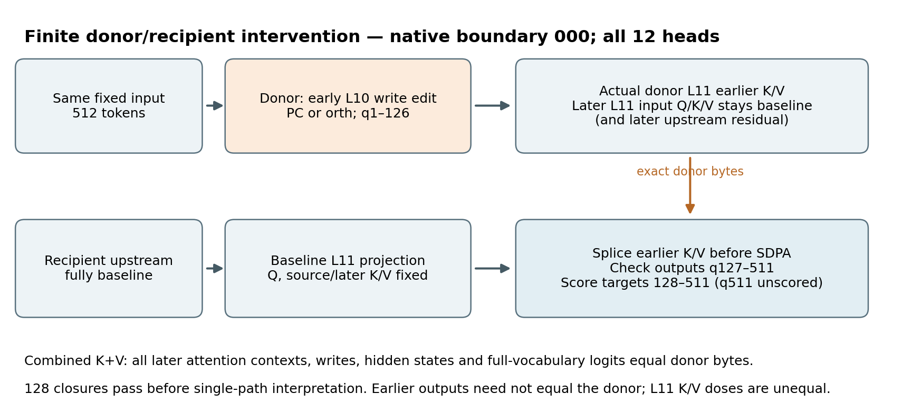
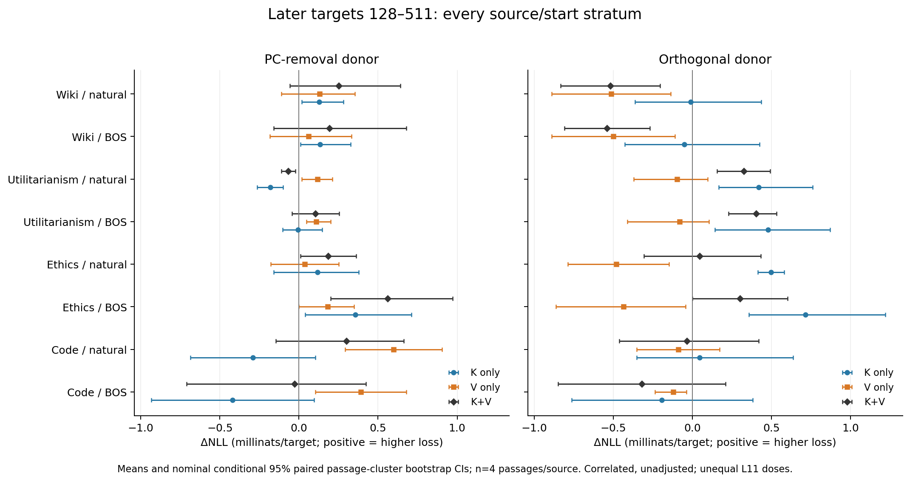
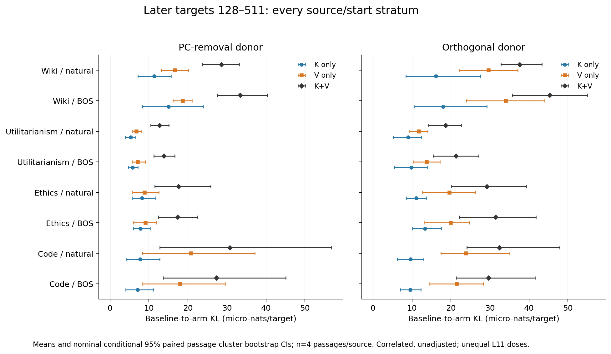
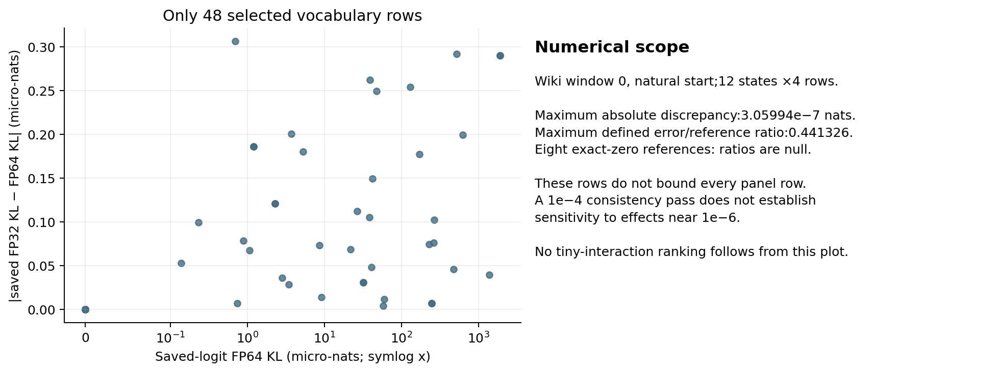

# Report 18 — earlier L11 keys and values transmit a chosen early-write perturbation

**Reviewed results from one completed 776-forward panel. Total acquisition includes 27 preserved failed-prefix returns. A second full-panel model replay is unperformed.**

The completed T22 panel finds finite later-output consequences from transplanting either earlier keys or earlier values into a baseline GPT-2 recipient. Both directions and all eight source/start strata show positive mean baseline-to-recipient KL for both single paths. Combined key+value recipients reproduce their actual donors byte-for-byte at every later context, projected attention write, block/final hidden state and full-vocabulary logit. All 128 required closure events pass. Signed NLL effects differ across directions, paths and passages; distributional change is not uniformly a loss increase or improvement. These results identify transmission of these chosen finite perturbations, not intrinsic key/value importance or native-task necessity.

## What was intervened on

We used the pinned GPT-2 checkpoint in FP32 SDPA, batch 1, no cache, and physical length 512. Layer indices are zero-based: L11 is the final attention block. Sixteen fresh passages—four each from Wiki validation, Utilitarianism, Ethics and Python optimizer code—were paired with natural and token 0-only BOS-replacement starts. The accepted panel has 32 identities; freshness concerns the declared 777-hash experimental history and source-span/calibration-buffer exclusions, not GPT-2 pretraining overlap. Selection made 831 decisions, accepting 16 and rejecting 815, before outcomes.

The two donors reuse one frozen T18 fit: PC-removal and one fixed orthogonal direction. Full L10 projected-write proposals supply the existing querywise FP64 interpolation recipe; the actual rounded edits are copied only at earlier queries 1–126. The two L10 donor write changes are approximately norm matched. Their resulting L11 key and value changes are **not** dose matched. Across 64 MAIN donor records (32 identities×2 directions;128 K/V RMS values), active earlier V/K RMS ratios range 1.27769–1.59731. These 64 dose comparisons differ from the 64 MAIN/SUFFIX PC–orth L10 matching pairs. The fit originated in a different calibration world with source-position values zeroed at L4–L11; no native refit or direction ensemble was added here.



A recipient follows the complete baseline upstream trajectory and retains every query vector. Only earlier L11 K, V, or both are copied from the corresponding actual donor; source 0 and later K/V remain baseline. Thus the recipient does not rerun the early-write edit. Each input has 12 scientific arms, MAIN then a fixed rotated-SUFFIX control per arm. Both directions and variants must pass combined-KV closure before any single-path arm is interpreted. Natural passage 0 additionally receives unhooked-repeat and identity-writer anchors. The retained study comprises 384 MAIN,384 SUFFIX and 8 anchor forwards, with no calibration forwards.

## Distributional transmission and signed loss

All 32 K-only/V-only later-KL stratum means and their nominal 95% intervals are positive; all 128 underlying passage values are positive. Means range from 5.33481e−6 to3.39704e−5 nats/target. Here KL means the frozen FP32 scorer's baseline-to-arm divergence, not a redefined metric. This supports finite distributional transmission through both transplanted paths under the fixed recipient conditions.



NLL supplies a more qualified picture. Among 32 single-path stratum means,17 are positive and 15 negative;15 intervals include zero. PC value transplants raise mean later NLL in all eight strata, whereas orthogonal value transplants lower it in all eight. Key effects change sign across sources and starts. For example, natural Utilitarianism has opposite PC key/value signs, and natural Ethics has opposing orthogonal key/value signs; their combined effects can cancel substantially. The complete 16-row table below includes all K/V/KV NLL results, including weak and reversed effects. A negative NLL difference is a lower loss on these targets, not a general benefit claim.



V mean KL exceeds K mean KL in all 16 direction/stratum comparisons, but only 8 of16 nominal K−V intervals exclude zero. The natural L11 doses differ, so neither this ordering nor a larger response identifies intrinsic V dominance. All 19 fixed coefficient definitions are retained across three views and three metrics. The 128 co-primary comparisons include single-path effects, K−V and factorial interactions in later NLL/KL; all are exported. Of 64 primary NLL intervals,26 exclude zero;46 of64 primary KL intervals exclude zero. In total 72 of128 exclude zero and 56 include it—descriptive counts, not a study-success criterion. Nonadditivity in loss or KL can arise from attention, MLP/normalization and probability/loss nonlinearities, and cancellation; it is not a mediation fraction or a newly isolated physical mechanism.

## Numerical evidence and what it does not certify

The independent saved-array numerical audit passed 33,933 arrays and all frozen statistics/control checks. The projection audit passed 28 relations over 18,087,936 coordinates: natural L10 projections and L11 original c_attn/context projections, with explicit FP32 arithmetic assumptions. Transplanted QKV is checked as a byte splice, never misrepresented as the output of the unchanged projection. The readout audit passed 12 states and 48 selected full-vocabulary rows. These checks corroborate the declared implementation and saved evidence, not the whole-model causal interpretation.



For those 48 rows, saved FP32 KL versus stable FP64 KL computed from the **saved GPU logits** differs by at most 3.05994e−7 nats. The maximum defined absolute-error/reference ratio is0.441326; eight exact-zero references have null ratios. This arithmetic comparison is distinct from the separate FP64 hidden×embedding readout reconstruction. A 1e−4 saved-metric consistency pass does not establish sensitivity at 1e−6, and selected rows do not bound every unsaved panel row. Signed canonical values are retained without clipping. We therefore avoid ranking very small interactions, treating a small/zero effect as absence, or assigning whole-panel resolution from these diagnostics.

## Uncertainty, provenance and preserved failures

Each source contributes only four passage clusters. The 2,000 paired bootstrap draws use seed 20261021 and the same passage indices across starts, arms, views, metrics and contrasts. Intervals are nominal, correlated, conditional on the one fixed fit and unadjusted for multiplicity. There is no any-one-interval success rule, calibration-fit uncertainty estimate, equivalence test or independent-replication interpretation. Starts share text; directions share the same construction; the four sources are not four interchangeable population replications. Every contrast and paired-start row retains all four passage values.

The completed A/B segments took 308.9699s and 308.8087s. Maximum observed segment RSS was 2,461,524 KiB and GPU allocated peak 1,145,661,440B, under prospectively reviewed 4 GiB primary-process cap and R0=2240 MiB admission and 6 GiB preload host headroom. Both final parameter/source/precision guards pass. The retained panel is776 forwards, while cumulative acquisition is803: two preserved resource-stopped prefixes contributed 1 and 26 returns, followed by a clean 776-forward panel. Failed prefixes are not reused as scientific samples or retroactively given missing final guards.

A separate exact replay compared the completed first input against the preserved 26-forward prefix: all 1,366 saved numeric-array occurrences match byte-for-byte, and 26 recorded full-hidden/full-vocabulary-logit fingerprints match exactly. The first comparator failed because its expected anchor phase was wrongly labeled MAIN; the reviewed one-literal correction used `anchor`, preserved the failure, and did not change equality criteria or rerun the model. An independent N-acceptance harness also had a preserved schema overconstraint; its correction required no N rerun. These are infrastructure failures, not failed scientific hypotheses. Older infrastructure evidence also has explicit gaps: a tiny-CPU fixture left an unfinished 10-call raw prefix unsaved, and the first writer witness did not save rejected 4,385,576-byte ordinary entropy. Neither is missing retained-panel output. The scientific record instead leaves uniform loss benefit, intrinsic path dominance, native-pulse/task necessity and calibration-world transfer unsupported or untested.

## Optional selected-context analysis — accepted descriptive scope

A separately pre-ledgered calculation covers only the predetermined Wiki 0 natural panel: both directions,12 heads and 385 later queries (9,240 cells). Independent saved-array auditing accepted 313 arrays,308 field checks over 32,076,120 coordinates and 1,464 summary fields, including recomputation of the saved delta-attention×delta-value product. It did not independently regenerate primitive softmax or captured SDPA. The established identity `(Ckv−Ck)−(Cv−Cb)=(Ad−Ab)(Vd−Vb)` describes the reconstructed context factorial, with actual-minus-reconstructed residuals explicitly retained.

Median measured four-arm residual-sum/product ratios are 0.003237 (PC) and 0.002400 (orth), but maxima exceed 100,000: the smallest cells remain unresolved. Captured-interaction relative diagnostics have 2 PC and 3 orth exact-zero denominators. The named baseline-reference allocation/conditional-mixture decomposition has typical actual relative residuals near 2e−5, but two zero denominators per direction and some tiny-signal rows have relative residuals near 1. Term medians and their ratio are not causal fractions; this supplies no new gate intervention or unique attribution. All descriptive summaries are exported; private activation arrays were not opened for this report.

## Relation to prior work and open tests

K/V and path patching are established in [Interpretability in the Wild](https://arxiv.org/html/2211.00593v1) and [Localizing Model Behavior With Path Patching](https://arxiv.org/html/2304.05969v1); [activation-patching best practices](https://arxiv.org/html/2309.16042v2) already emphasize metric/method dependence. [The Super Weight](https://arxiv.org/html/2411.07191v2), [Massive Activations](https://arxiv.org/html/2402.17762v2), [sink/gate work](https://arxiv.org/html/2602.01203v3) and [GPT-2 sink circuitry](https://arxiv.org/html/2604.14722v1) provide related activation/gating context. The primary URLs were rechecked before this report; this is not an exhaustive novelty search. T22's candidate contribution is this fixed-fit, fresh-panel finite transmission evidence with exact donor/recipient closure and disclosed numerical/provenance limits—not a new patching or attention-algebra method.

Fresh native calibration, independently fixed direction controls and held-out tests of any proposed gate-versus-mixture intervention remain open. No head was isolated, no rank-one mechanism established, and no original native pulse, task necessity, universal transfer, generation fidelity or speed claim was tested. Publication and Library delivery remain separate from this review candidate.

## Comprehensive appendix

The prose and figures use rounded display values. CSV/JSON tables preserve the frozen numbers and passage vectors. No primary, sign-reversed, zero-crossing or paired-start result is omitted.

### All later K/V/KV NLL effects

Units: millinats/target (1e−3 nats). Mean [nominal 95% CI]; n=4 passage clusters. Positive is higher loss.

|Source|Start|Direction|K only|V only|K+V|
|---|---|---|---:|---:|---:|
|Wiki|natural|PC|+0.128 [+0.017, +0.281]|+0.130 [-0.111, +0.355]|+0.252 [-0.057, +0.641]|
|Wiki|natural|orth|-0.012 [-0.363, +0.434]|-0.514 [-0.889, -0.139]|-0.519 [-0.834, -0.204]|
|Wiki|bos|PC|+0.133 [+0.009, +0.327]|+0.060 [-0.185, +0.333]|+0.193 [-0.160, +0.678]|
|Wiki|bos|orth|-0.051 [-0.428, +0.424]|-0.500 [-0.891, -0.110]|-0.540 [-0.809, -0.270]|
|Utilitarianism|natural|PC|-0.181 [-0.265, -0.101]|+0.116 [+0.019, +0.211]|-0.069 [-0.112, -0.023]|
|Utilitarianism|natural|orth|+0.419 [+0.167, +0.760]|-0.098 [-0.371, +0.096]|+0.323 [+0.155, +0.492]|
|Utilitarianism|bos|PC|-0.007 [-0.104, +0.146]|+0.109 [+0.047, +0.200]|+0.105 [-0.044, +0.253]|
|Utilitarianism|bos|orth|+0.477 [+0.141, +0.871]|-0.080 [-0.411, +0.104]|+0.404 [+0.229, +0.533]|
|Ethics|natural|PC|+0.116 [-0.159, +0.379]|+0.037 [-0.178, +0.253]|+0.185 [+0.009, +0.362]|
|Ethics|natural|orth|+0.497 [+0.414, +0.580]|-0.481 [-0.787, -0.148]|+0.046 [-0.306, +0.432]|
|Ethics|bos|PC|+0.357 [+0.039, +0.711]|+0.182 [-0.002, +0.348]|+0.561 [+0.201, +0.973]|
|Ethics|bos|orth|+0.713 [+0.357, +1.221]|-0.437 [-0.864, -0.044]|+0.301 [+0.000, +0.602]|
|Code|natural|PC|-0.291 [-0.687, +0.105]|+0.597 [+0.291, +0.903]|+0.300 [-0.146, +0.663]|
|Code|natural|orth|+0.046 [-0.352, +0.635]|-0.090 [-0.352, +0.172]|-0.036 [-0.462, +0.418]|
|Code|bos|PC|-0.421 [-0.933, +0.097]|+0.391 [+0.103, +0.680]|-0.029 [-0.711, +0.425]|
|Code|bos|orth|-0.194 [-0.763, +0.380]|-0.122 [-0.238, -0.039]|-0.320 [-0.849, +0.209]|

### Complete machine-readable results

|Table|Rows|Coverage|
|---|---:|---|
|[All primary comparisons](../results/l11_key_value_donor_report/tables/all_128_primary.md) · [CSV](../results/l11_key_value_donor_report/tables/all_128_primary.csv) · [JSON](../results/l11_key_value_donor_report/tables/all_128_primary.json)|128|All later co-primary estimates, CIs and four passage values|
|[All contrasts](../results/l11_key_value_donor_report/tables/all_1368_contrasts.csv) · [JSON](../results/l11_key_value_donor_report/tables/all_1368_contrasts.json)|1368|19 definitions ×4 sources ×2 starts ×3 views ×3 metrics; all passage values|
|[All paired-start rows](../results/l11_key_value_donor_report/tables/all_684_paired_start_rows.csv) · [JSON](../results/l11_key_value_donor_report/tables/all_684_paired_start_rows.json)|684|BOS-minus-natural interactions; all passage values|
|[Window metrics](../results/l11_key_value_donor_report/tables/window_metrics.csv)|1152|Every arm/input/view, three metric columns|
|[Anchor views](../results/l11_key_value_donor_report/tables/anchors.csv)|24|Both anchor kinds, four natural passage 0 inputs, three views|
|[Arm metric summaries](../results/l11_key_value_donor_report/tables/all_864_arm_metric_summaries.csv)|864|All means/CIs/passage values; [288 wide JSON summaries](../results/l11_key_value_donor_report/tables/all_288_arm_summaries.json) also include transforms|
|[Gate](../results/l11_key_value_donor_report/tables/gate_norm_window_summaries.json), [write](../results/l11_key_value_donor_report/tables/write_norm_window_summaries.json), [L11](../results/l11_key_value_donor_report/tables/l11_norm_window_summaries.json) norms|1152 each|Every window/arm/view; source and active-early scopes retained|
|[Matching diagnostics](../results/l11_key_value_donor_report/tables/matching_quality.json)|64|Both variants,32 inputs; approximate actual donor matching|
|[All MAIN L11 doses](../results/l11_key_value_donor_report/tables/all_64_MAIN_L11_dose_records.csv)|64|Two donor directions×32 identities; K/V RMS and V/K ratio,128 individual RMS values|
|[Selected KL errors](../results/l11_key_value_donor_report/tables/selected_48_KL_error_rows.csv)|48|Typed scalar diagnostics only; no predictions/logits|
|[Optional context summaries](../results/l11_key_value_donor_report/tables/optional_context_all_descriptive_summaries.csv)|244|All accepted descriptive summary fields; no activation arrays|

### Optional context summary, accepted descriptive scope

Each direction has 4,620 head/query cells. Captured-interaction denominators are zero in2 PC/3 orth cells; gate actual-delta denominators in2 cells per direction. These are distinct counts. Undefined ratios are excluded from finite summaries and counted explicitly.

|Direction|Arm residual sum/product median; max|Actual-product relative error median; max|Allocation L2 median|Mixture L2 median|Gate actual relative residual median; undefined|
|---|---|---|---:|---:|---|
|PC|0.00323681; 331451|0.000173529; 379.795|0.00304995|0.0143434|2.26519e-05; 2|
|orth|0.00239986; 104805|0.000128891; 1.86919|0.00354126|0.0165824|2.05186e-05; 2|

### Rebuild and integrity

The command below records the completed local JSON-only report rebuild. Its pinned inputs include private audit metadata, so it is not a standalone public reproduction command. See the [audit and reproduction guide](GPT2_L11_KEY_VALUE_DONOR_REPRODUCING.md) for public-package readiness and the separate model-replay status. The frozen review candidate, original builder and exact table/figure inventory are retained in [the report artifacts](../results/l11_key_value_donor_report/candidate.md); their historical candidate status is preserved as provenance.

```bash
python -B pulse_transfer/l11_key_value_donor_report_candidate_v4/build_report.py --root pulse_transfer --out pulse_transfer/report18_rebuild_v1
```

The builder accepts only the hash-pinned JSON/text inputs recorded in `build_manifest.json`; it does not decode a raw NPZ, load a tokenizer/checkpoint/model, change frozen sources, or publish anything. `claims.json` records exact claim counts/scales for independent review. `file_inventory.json` commits every candidate file except itself. This report builder is not the separate full scientific reproduction workflow.

