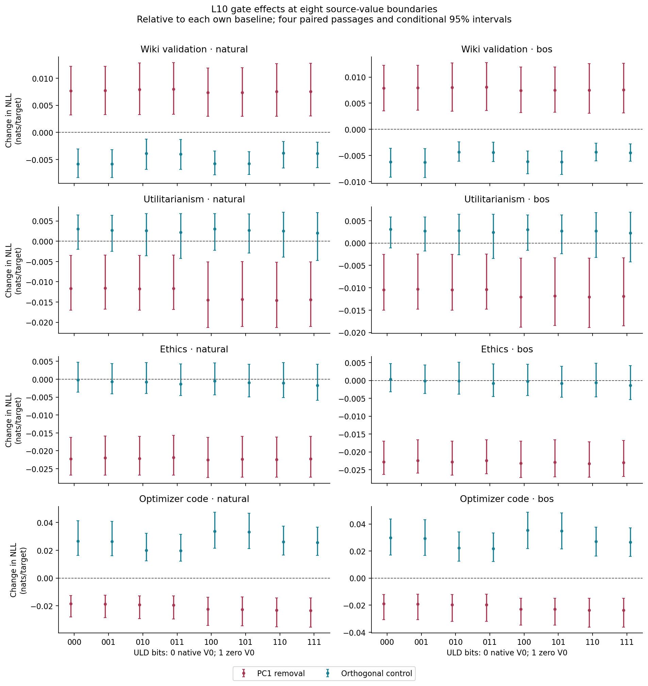
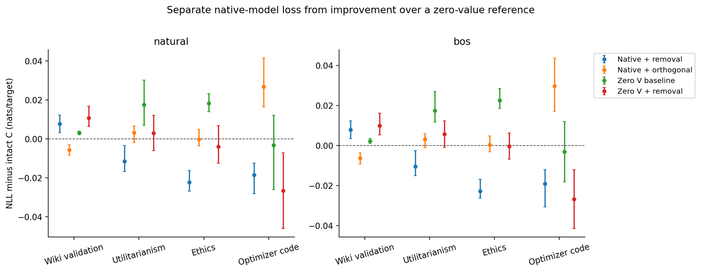
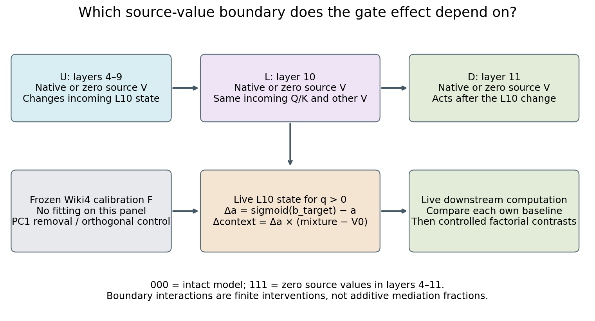

# Does the gate effect depend on zero source values?

GPT-2 research checkpoint, 21 October 2026. T19 in the continuing super-weight
investigation. [Repository](https://github.com/jaykobdetar/superweight-research).

## The effect survives in intact GPT-2

The layer-10 gate result does **not require zero source values** on this panel.
Applying the frozen leading-direction removal to intact GPT-2 worsens Wiki
validation loss and improves loss on Utilitarianism, Ethics and optimizer
code. All eight native-model corpus/start intervals exclude a perplexity
ratio of one. This rejects the explanation that these gains can only be a
repair of damage caused by source-value zeroing. It does not establish a
universally beneficial edit, a unique direction, or better generated text.

| Source | Native removal / C, natural start | Native removal / C, BOS replacement |
|---|---:|---:|
| Wiki validation | 1.007745 [1.003211, 1.012300] | 1.007944 [1.003560, 1.012348] |
| Utilitarianism | 0.988448 [0.983178, 0.996525] | 0.989617 [0.985116, 0.997499] |
| Ethics | 0.977970 [0.973556, 0.983903] | 0.977516 [0.974066, 0.983211] |
| Optimizer code | 0.981577 [0.972227, 0.987494] | 0.981151 [0.969821, 0.988064] |

The result extends across the entire value-boundary factorial: all 16 Wiki
boundary/start comparisons have loss increases, and all 48 non-Wiki
comparisons have decreases, with their conditional intervals excluding one.
These 64 correlated comparisons reuse 16 passages and one fitted operation;
they are not 64 independent replications. The study is a verified composite
of an interrupted prefix and two completed recovery segments. An exact
70-forward continuity replay passed; the original missing final checks are
described below rather than retrospectively declared successful.

The fixed orthogonal control separates the tested direction from a generic
equal-logit-norm change. At the intact boundary, removal beats that control
on all six non-Wiki corpus/start groups, with each paired interval below zero.
On Wiki the comparison reverses: the orthogonal operation improves loss,
while PC1 removal worsens it, and both paired intervals favor the control.
The leading covariance axis is therefore not a generally preferable edit.
Only one fixed orthogonal direction is tested; uniqueness is not established.

## Values modify the effect without creating its sign

Source values still matter. For natural-start code, the removal effect is
−0.018595 nats per target at the intact boundary and −0.023382 at the all-zero
boundary. Their paired difference is −0.004787 [−0.007191, −0.002088]. The BOS
endpoint difference is −0.004633 [−0.006304, −0.002739]. At otherwise intact
settings, upstream L4–9 zeroing changes the code effect by −0.003866 natural
and −0.003832 BOS; local L10 zeroing changes it by −0.000689 and −0.000670.
Each of those four intervals excludes zero. The downstream L11 differences
are smaller and have intervals spanning zero. These are controlled finite
effect differences, not percentages of a mediated pathway.

Across all settings of the other factors, code's eight upstream interaction
intervals are negative; seven of eight local intervals are negative. Wiki
factor intervals all span zero. Other sources contain smaller but detectable
interactions, including downstream changes on Ethics. Thus the sign's
persistence does not imply that source values or the altered upstream state
are functionally irrelevant, or that all three factors are interchangeable.
All first-, second- and third-order contrasts remain in the numerical record.

The causal-order checks make the local comparison interpretable. At a shared
upstream state, changing the local source V leaves incoming L10 Q/K,
non-source V and the gate coefficient exactly unchanged; changing L11 leaves
the delivered L10 state unchanged. The direct native-minus-zero context delta
matches the value contribution identity within the frozen bound. Later
network computation remains live. These checks distinguish a direct value
contribution from a changed incoming computation; they do not identify a
minimal circuit or make later loss responses additive.

## Loss gains are not faithful replacement

Native PC1 removal retains only **95.88–98.28%** argmax agreement with intact
GPT-2 across the eight groups, with mean reference-to-trial KL
**0.003225–0.004175 nats per scored query**. Improved book/code loss therefore
coexists with changed predictions and distributions. No generation experiment,
speedup or output-preserving compression is established.

The numerical controls also have a practical limit. Delta and older scaling
arithmetic passed the prospectively frozen context and loss criteria, but
their full hidden states and logits are not byte-identical. The observed
mass can reach one and slightly exceed it by FP32 rounding; no clipping was
introduced. The complete raw states cover eight predetermined L10 snapshots
on one Wiki input. Other conditions retain runtime comparisons, diagnostics
and fingerprints, not full independent attention reconstruction.

## What is established, and what remains open

| Claim | Status after this batch |
|---|---|
| Non-Wiki gains require source-value zeroing. | Rejected on the native and crossed boundaries tested here. |
| All gains merely repair damage from zeroing source values. | Rejected for native book/code removal on these passages. |
| Values and upstream state do not affect the gate operation's loss effect. | Rejected for several controlled contrasts, most clearly code. |
| Removing the leading direction is universally helpful. | Rejected: it harms Wiki, where the orthogonal control helps. |
| The operation faithfully replaces the intact computation. | Rejected by prediction/distribution changes; no speedup was tested. |
| A stable leading covariance axis is one unique mechanism. | Unsupported; neither low rank nor this factorial establishes uniqueness. |
| The result transfers to generation, arbitrary prefix histories or longer contexts. | Open; this is reset-window teacher forcing at 512 positions. |

The next useful competing explanation is perturbation magnitude after the
gate. The existing control matches logit norm, but the observed mean native
context changes are about 4–11% larger for PC1 removal than for the orthogonal
operation. A norm-matched pair would test that alternative while retaining
the original arms. The output projection is anisotropic, so matching context
norm alone does not match the residual-stream attention write; the immediate
design priority is matching that actual post-projection write. A preliminary idea was
written before T19 efficacy was inspected; its finite-precision caveat and
simpler allocation-space interpolation are preserved. Native-specific
calibration and additional control directions remain separate questions.
None of these proposed follow-ups is a result of the current batch.







## What was intervened on

This is a GPT-2 follow-up in the broader super-weight investigation. All layer
numbers are zero-based. The pinned checkpoint is `openai-community/gpt2`,
revision `75e09b43581151bd1d9ef6700faa605df408979f`, evaluated in FP32 with the
recorded SDPA backend. The prescribed interventions do not edit parameters.
Both completed recovery segments passed before/after parameter checks; the
interrupted original process lacks its final check, as detailed below. Each
forward executes exactly 512 physical positions with caching disabled.

Three independently controlled source-value boundaries form eight settings:

| Bit | Bit 0 | Bit 1 |
|---|---|---|
| U, upstream layers 4–9 | Native projected source V | Zero projected source V |
| L, local layer 10 | Native projected source V | Zero projected source V |
| D, downstream layer 11 | Native projected source V | Zero projected source V |

The source is token position zero, across all heads. `000` is intact GPT-2;
`111` has source values zeroed in layers 4–11. Native values come from each
condition's live trajectory, not a clean donor. The intervention directly
changes only the specified V slices. Later queries, keys and non-source values
can respond to the altered computation.

At L10, every boundary has a baseline, an exact current control, removal of the
frozen leading gate direction, and a matched orthogonal change. The center and
directions are the fresh four-Wiki calibration F from Report14; no calibration
or direction was fitted to these new evaluation passages. This tests transfer
of that particular fitted operation across value boundaries. It does not test
the best possible native-model calibration.

For query q>0, let b be the 12-head difference between non-source log-sum-exp
attention score and source score, and let a be the summed reconstructed
non-source softmax probability. Let m be the conditional non-source value
mixture and v0 the live source value. With frozen center alpha and unit leading
direction u, the removal coefficient is
`s = (b - log(q) - alpha) dot u`. Removal changes b to `b - s*u`; the control
changes it to `b - s*v`, for a fixed orthogonal unit vector v. These changes
have matched gate-logit norm at their own incoming state. Their context-vector
norms are not matched.

The delivered attention context is
`c_actual + (sigmoid(b_target) - a) * (m - v0)`.
The conditional mixture is computed from a separately normalized non-source
distribution. This avoids division by a tiny non-source probability mass.
The gate edit leaves query zero unchanged. Source-value zeroing can itself
change query zero relative to intact GPT-2. An exactly unchanged gate uses an
exact no-change bypass, with no near-zero threshold, clipping or epsilon.

Two additional arms at `111` implement the older scaling arithmetic on the
same local state. They are an arithmetic bridge within this study, not a
second execution of the older explicit-mask protocol. Before execution, the
reviewed hard limits were context maximum error 1e-4, all scored target-loss
differences 1e-3 nats, and absolute passage-mean loss difference 1e-5 nats.
Current, source, incoming/delivered causal-order fingerprints and suffix
controls require exact equality. The separate direct local-value delta
identity uses the prospectively bounded 1e-4 reconstruction criterion.
Any hard failure stops the accepted batch and preserves the compared states;
no outcome-based input exclusion or tolerance increase is allowed.

This implementation computes the native attention context and diagnostics
before applying the defined change. It is a causal probe, not a faster model
or a demonstrated replacement of the upstream computations. Runtime savings
and faithful generation are not established by its loss comparisons.

## Evaluation, uncertainty and causal scope

Sixteen fresh passages comprise four each from Wiki validation,
Utilitarianism, Ethics and optimizer code. A deterministic selection and
rejection ledger excludes prior evaluation spans and complete calibration
buffers. Each passage has its natural first token and a paired BOS replacement
of token zero only. Tokens are neither inserted nor retokenized. This isolates
the replacement on the same suffix, but the natural identities are not
balanced across sources or drawn from a defined token population. The passages
are held out from this investigation's calibration and prior evaluation
exposures; overlap with GPT-2's original pretraining is unknown.

Each boundary's primary effect is its intervention NLL minus its own baseline
NLL, scoring targets 2–511. Effects relative to intact C, KL and argmax
agreement are reported separately. Early targets 2–127 and later targets
128–511 are secondary views of the same forward, not different context-length
experiments. Every scientific condition has a second 512-position forward
with tokens 128–511 rotated. All unchanged-prefix outputs and diagnostics
must agree exactly. Direct unhooked and historical writer-identity anchors
are checked on the natural first passage from each source.

The 64 predeclared contrasts include within-boundary effects, removal minus
orthogonal control, endpoint effect differences, all controlled single-factor
interactions, and second- and third-order factorial interactions. They are
finite intervention contrasts. They are not additive mediation percentages,
unique pathways, or counts of causal mechanisms. Common-state checks separate
the direct local V change from an upstream change in the gate computation;
later network responses remain live.

Paired bootstrap intervals use four passage clusters per source, 2,000 draws
and seed 20261021. The same resampled passage indices are reused across arms
and paired starts. Intervals condition on the one frozen F calibration. The
passages are deterministic rather than a random population sample, and the
many contrasts and score views are correlated. There is no adjustment for
multiple comparisons or estimate of population calibration uncertainty.
Loss improvement does not establish output fidelity or generation quality.

## Attribution

The original [Super Weight paper](https://arxiv.org/html/2411.07191v2)
establishes single-weight sensitivity and super activations.
[Massive Activations](https://arxiv.org/html/2402.17762v2), including Appendix
B.4, studies implicit attention biases and explicit alternatives.
[Fu et al.](https://arxiv.org/html/2602.01203v1) derive related implicit gate
algebra, and the [GPT-2 attention-sink study](https://arxiv.org/html/2604.14722v1)
tests query bias and positional/key structure causally. The allocation/value
identity, sigmoid gate and PCA procedure are established context. This batch
adds a controlled comparison of one frozen fitted operation across native and
zero-source-value boundaries, with explicit numerical and matched controls.
It does not claim discovery of sinks, a universal super-weight mechanism or
priority for this exact factorial. The repository's broader novelty comparison
retains the preceding primary-source review and access limitations.
The earlier GPT-2 candidate did not reproduce OLMo's catastrophic single-weight
loss effect. These GPT-2 gate/value results concern a related computation in
this checkpoint; similar activation sizes or gate effects do not establish
transfer of the original OLMo pulse mechanism.

## An interrupted execution and a reviewed recovery

The first worker did not finish. Its terminal session disappeared after the
journal recorded 1,110 model returns, of which 1,109 completed their scoring
and observation steps. Sixteen complete Wiki/Utilitarianism shards, accounting
for 1,092 forwards, had been committed and independently hash-checked. The
next Ethics group had 18 uncommitted model returns. Their raw arrays were
lost with process memory; the available journal and fingerprints are retained.
There is no Python failure capsule or final manifest. Host/GPU checks found
no remaining worker and a kernel OOM query returned no entries. The cause
remains unknown. We do not classify the interruption as a passed or failed
scientific criterion.

A prospectively reviewed recovery completed a 70-forward replay of
the preselected Wiki window-zero natural input before any new evaluation.
Every scientific payload array, scalar, dtype, shape, fingerprint, diagnostic
and check order matched the original committed shard exactly. The entire NPZ
file also had an identical SHA256 digest. No alternative anchor or tolerance
was used. The remaining Ethics and code panels then completed in two bounded,
sequential segments with their own complete before/after guards. A separate
verified composite preserves the original bytes and the
identities of all execution segments; the original interrupted directory is
never rewritten or marked complete.

The original process's final source/input/calibration, parameter-version/hash
and precision checks did not execute and cannot be recovered. Retrospective
source checks and an exact
compatibility replay provide narrower continuity evidence; they do not make
the missing guards exist. Each successful recovery segment has its own final
checks. All results must therefore be described as a composite execution,
with these limitations explicit, rather than one uninterrupted run.

The completed panel contains 2,184 retained scheduled forwards. The cumulative
actual count is 2,272 model returns: the retained panel, 70 compatibility
forwards, and 18 uncommitted original returns. The independent audit verified
the actual journals and counts. All 34 available hidden/logit fingerprints
from the first 17 uncommitted-group forward records also matched recovery
exactly. This additional integrity check does not recover their raw arrays
or establish the unprocessed eighteenth return's output.




## Independent audit and observed resources

The independent numerical audit verified all 32 retained shards and 71,688
saved-array identities, every original/recovery journal, and all 4,040
runtime controls. It independently regenerated 64 contrast definitions and
one shared 2,000-by-four bootstrap index matrix. All 3,264 window rows, 816
group summaries, 1,536 contrasts, 768 paired-start contrasts and 3,276 norm
rows passed. The summary, contrast and paired-start comparisons were
bit-exact; the separately frozen independent-reduction policy was not relaxed.

All eight predetermined full L10 attention snapshots were independently
reconstructed. Every scalar in the stored FP32 delivery formula matched
exactly: 3,145,728 comparisons. Independent FP64 context reconstruction
differed by at most 9.149e-6. These are eight saved states from one Wiki input;
ordinary conditions have runtime comparisons and fingerprints rather than
full independent attention-state reconstruction.

Across all 64 arithmetic bridges, maximum delivered-context drift was
9.298325e-6, maximum scored target-loss drift 1.068115e-4 nats, and maximum
absolute passage-mean loss drift 9.680402e-7. Each is below its original hard
criterion. Maximum recorded full-hidden and full-logit drift was 0.000542
and 0.000626 respectively. Algebraic equivalence is not byte identity. Exact
current, source, order, anchor and suffix controls retained exact requirements.

A separate CPU readout audit decoded only the tied embedding tensor and
checked 32 actual full-vocabulary GPU rows across the eight saved arms. The
maximum GPU-versus-FP64 readout difference was 0.000205061, within the
prespecified conservative FP32 dot-product bound. Recomputed sampled NLL/KL
errors were at most 4.39833e-7 / 5.31745e-7 nats. All 32 sampled CPU/GPU argmax
comparisons agreed. This is a sampled readout audit, not a second pretrained
execution or reconstruction of all vocabulary rows at all queries.

The first readout attempt stopped before decoding weights or reading numeric
readouts because it assumed the model's logical embedding name was the raw
safetensors key. Header inspection established the actual `wte.weight` key.
A preserved auditor version changed exactly three key/label strings,
without changing a threshold, metric or schema. Independent source and header
review accepted that correction before interpreting the successful result.
The author had started the corrected CPU audit before the prepare-only review
message arrived; that chronology and the failed attempt remain recorded.
No model rerun was needed.

| Execution | Model returns | Retained study forwards | Wall seconds | Peak host RSS, GiB | GPU allocated / reserved, GiB |
|---|---:|---:|---:|---:|---:|
| Interrupted original | 1,110 | 1,092 | ≥423.217 | ≥2.866 | ≥0.990 / ≥1.074 |
| Recovery A | 616 | 546 | 237.804 | 2.850 | 0.990 / 1.074 |
| Recovery B | 546 | 546 | 207.942 | 2.860 | 0.990 / 1.074 |

The original row gives lower bounds observed at its last complete checkpoint,
not a fabricated final peak or total wall time. Recovery A includes 70
compatibility forwards; those are excluded from its retained-study column.
There is no claimed aggregate final peak or uninterrupted execution duration.
All model segments ran sequentially on the existing RTX 3060 Ti, with 16 GB
host RAM. No additional model was loaded concurrently.

The numerical audit took 30.021 seconds and peaked at 0.942 GiB host RSS. The
readout audit took 4.977 seconds and peaked at 0.946 GiB, using one CPU thread.
Neither performed a model forward or GPU computation. The retained 32 raw
input shards occupy 361.081 MiB before additional provenance, source, token
and analysis files.

Preparation also had failures that remain preserved: an interrupted sizing
fixture, a layout that exceeded the complete-output allowance, and rejected
portable-package drafts. The corrected evidence layout and bounds were
reviewed before pretrained execution. The interrupted model run, its
available evidence, unavailable uncommitted arrays, all preparation failures
and the original missing final guards remain distinct from successful checks.
No prior weight-value sweep was repeated by this batch.

## Complete primary boundary table

Cells are perplexity ratios with conditional paired 95% bootstrap intervals.
Each source has four passages, reused across boundaries and paired starts.
ULD bits are 0 for native source V and 1 for zero source V. Baselines differ
across rows. Ratios relative to intact C are therefore shown separately.
The full numerical export retains every prespecified contrast, secondary
early/later score view, paired-start interaction, and individual passage value.


### Wiki validation / natural

| ULD | Removal / own baseline | Orthogonal / own baseline | Removal / intact C |
|---|---:|---:|---:|
| 000 | 1.007745 [1.003211, 1.012300] | 0.994191 [0.991674, 0.996920] | 1.007745 [1.003211, 1.012300] |
| 001 | 1.007782 [1.003286, 1.012298] | 0.994165 [0.991702, 0.996848] | 1.007951 [1.003405, 1.012517] |
| 010 | 1.007978 [1.003297, 1.012935] | 0.996100 [0.993180, 0.998778] | 1.008662 [1.004040, 1.014275] |
| 011 | 1.008003 [1.003356, 1.012996] | 0.996032 [0.993193, 0.998678] | 1.008900 [1.004256, 1.014469] |
| 100 | 1.007397 [1.002949, 1.011944] | 0.994268 [0.992202, 0.996547] | 1.009548 [1.004881, 1.014479] |
| 101 | 1.007422 [1.002998, 1.012001] | 0.994239 [0.992236, 0.996448] | 1.009719 [1.005407, 1.014486] |
| 110 | 1.007600 [1.002977, 1.012809] | 0.996171 [0.993455, 0.998322] | 1.010448 [1.005551, 1.016708] |
| 111 | 1.007619 [1.003019, 1.012863] | 0.996108 [0.993484, 0.998217] | 1.010648 [1.006262, 1.016760] |


### Wiki validation / bos

| ULD | Removal / own baseline | Orthogonal / own baseline | Removal / intact C |
|---|---:|---:|---:|
| 000 | 1.007944 [1.003560, 1.012348] | 0.993792 [0.990910, 0.996395] | 1.007944 [1.003560, 1.012348] |
| 001 | 1.007989 [1.003659, 1.012338] | 0.993736 [0.990792, 0.996336] | 1.007660 [1.003423, 1.011914] |
| 010 | 1.008062 [1.003504, 1.012822] | 0.995663 [0.993902, 0.997642] | 1.008401 [1.003708, 1.013802] |
| 011 | 1.008092 [1.003586, 1.012869] | 0.995576 [0.993827, 0.997576] | 1.008136 [1.003585, 1.013175] |
| 100 | 1.007489 [1.003205, 1.011969] | 0.993837 [0.991540, 0.995872] | 1.009748 [1.004793, 1.015362] |
| 101 | 1.007530 [1.003292, 1.012024] | 0.993781 [0.991424, 0.995828] | 1.009440 [1.005185, 1.014579] |
| 110 | 1.007561 [1.003077, 1.012656] | 0.995635 [0.993984, 0.997323] | 1.010178 [1.004855, 1.017069] |
| 111 | 1.007592 [1.003151, 1.012711] | 0.995549 [0.993941, 0.997239] | 1.009889 [1.005258, 1.016340] |


### Utilitarianism / natural

| ULD | Removal / own baseline | Orthogonal / own baseline | Removal / intact C |
|---|---:|---:|---:|
| 000 | 0.988448 [0.983178, 0.996525] | 1.003034 [0.998037, 1.006459] | 0.988448 [0.983178, 0.996525] |
| 001 | 0.988538 [0.983368, 0.996609] | 1.002732 [0.997463, 1.006429] | 0.988132 [0.982566, 0.996284] |
| 010 | 0.988323 [0.983115, 0.996540] | 1.002592 [0.996435, 1.006844] | 0.989677 [0.984401, 0.996956] |
| 011 | 0.988398 [0.983280, 0.996616] | 1.002209 [0.995714, 1.006799] | 0.989392 [0.983825, 0.996568] |
| 100 | 0.985647 [0.978947, 0.994954] | 1.003048 [0.997775, 1.006808] | 1.002066 [0.992272, 1.011956] |
| 101 | 0.985790 [0.979192, 0.995032] | 1.002682 [0.997100, 1.006750] | 1.001699 [0.992447, 1.011037] |
| 110 | 0.985564 [0.978965, 0.994826] | 1.002527 [0.996066, 1.007126] | 1.003325 [0.993700, 1.013043] |
| 111 | 0.985685 [0.979181, 0.994889] | 1.002066 [0.995218, 1.007050] | 1.002988 [0.993904, 1.012154] |


### Utilitarianism / bos

| ULD | Removal / own baseline | Orthogonal / own baseline | Removal / intact C |
|---|---:|---:|---:|
| 000 | 0.989617 [0.985116, 0.997499] | 1.003059 [0.998893, 1.005870] | 0.989617 [0.985116, 0.997499] |
| 001 | 0.989737 [0.985337, 0.997561] | 1.002747 [0.998198, 1.005865] | 0.989507 [0.984474, 0.997701] |
| 010 | 0.989595 [0.985105, 0.997482] | 1.002784 [0.997396, 1.006482] | 0.990439 [0.985915, 0.997206] |
| 011 | 0.989713 [0.985308, 0.997553] | 1.002397 [0.996525, 1.006485] | 0.990372 [0.985418, 0.997388] |
| 100 | 0.988040 [0.981340, 0.996627] | 1.003027 [0.998381, 1.006311] | 1.004963 [0.997666, 1.012314] |
| 101 | 0.988242 [0.981722, 0.996694] | 1.002683 [0.997624, 1.006310] | 1.004830 [0.997886, 1.011823] |
| 110 | 0.988015 [0.981298, 0.996615] | 1.002710 [0.996750, 1.006874] | 1.005776 [0.998808, 1.012793] |
| 111 | 0.988202 [0.981654, 0.996692] | 1.002268 [0.995788, 1.006878] | 1.005684 [0.999051, 1.012362] |


### Ethics / natural

| ULD | Removal / own baseline | Orthogonal / own baseline | Removal / intact C |
|---|---:|---:|---:|
| 000 | 0.977970 [0.973556, 0.983903] | 0.999802 [0.996347, 1.004739] | 0.977970 [0.973556, 0.983903] |
| 001 | 0.978250 [0.973560, 0.984228] | 0.999362 [0.995933, 1.004347] | 0.977136 [0.972273, 0.982808] |
| 010 | 0.978148 [0.973604, 0.984152] | 0.999246 [0.995982, 1.004689] | 0.979930 [0.973862, 0.987744] |
| 011 | 0.978412 [0.973597, 0.984481] | 0.998670 [0.995410, 1.004234] | 0.979036 [0.972545, 0.986577] |
| 100 | 0.977720 [0.972947, 0.983922] | 0.999525 [0.995631, 1.004597] | 0.995358 [0.987221, 1.004975] |
| 101 | 0.977956 [0.972976, 0.984182] | 0.999021 [0.995112, 1.004153] | 0.994376 [0.986475, 1.003380] |
| 110 | 0.977818 [0.973036, 0.983959] | 0.998971 [0.994888, 1.004695] | 0.997039 [0.988405, 1.007955] |
| 111 | 0.978026 [0.973042, 0.984206] | 0.998301 [0.994157, 1.004159] | 0.995991 [0.987600, 1.006703] |


### Ethics / bos

| ULD | Removal / own baseline | Orthogonal / own baseline | Removal / intact C |
|---|---:|---:|---:|
| 000 | 0.977516 [0.974066, 0.983211] | 1.000325 [0.996841, 1.004767] | 0.977516 [0.974066, 0.983211] |
| 001 | 0.977889 [0.974451, 0.983512] | 0.999841 [0.996366, 1.004367] | 0.976473 [0.973482, 0.981744] |
| 010 | 0.977492 [0.973893, 0.983207] | 0.999877 [0.996194, 1.005111] | 0.979462 [0.974914, 0.986937] |
| 011 | 0.977841 [0.974260, 0.983515] | 0.999221 [0.995510, 1.004608] | 0.978364 [0.973885, 0.985336] |
| 100 | 0.977079 [0.973229, 0.983190] | 0.999772 [0.995825, 1.004515] | 0.999395 [0.993003, 1.005828] |
| 101 | 0.977414 [0.973427, 0.983508] | 0.999214 [0.995290, 1.004010] | 0.998247 [0.992450, 1.004078] |
| 110 | 0.977021 [0.973332, 0.983024] | 0.999409 [0.995415, 1.004834] | 1.000935 [0.993798, 1.008124] |
| 111 | 0.977326 [0.973506, 0.983328] | 0.998667 [0.994666, 1.004211] | 0.999729 [0.993193, 1.006308] |


### Optimizer code / natural

| ULD | Removal / own baseline | Orthogonal / own baseline | Removal / intact C |
|---|---:|---:|---:|
| 000 | 0.981577 [0.972227, 0.987494] | 1.027012 [1.016459, 1.042275] | 0.981577 [0.972227, 0.987494] |
| 001 | 0.981482 [0.971962, 0.987617] | 1.026585 [1.016250, 1.041621] | 0.980000 [0.968877, 0.987353] |
| 010 | 0.980901 [0.971147, 0.987114] | 1.020285 [1.012485, 1.032761] | 0.985450 [0.974260, 0.992276] |
| 011 | 0.980789 [0.970875, 0.987210] | 1.019854 [1.012242, 1.032048] | 0.983823 [0.971203, 0.991779] |
| 100 | 0.977789 [0.966430, 0.986315] | 1.034299 [1.021727, 1.048636] | 0.972127 [0.953283, 0.988939] |
| 101 | 0.977662 [0.966068, 0.986456] | 1.033811 [1.021516, 1.047862] | 0.970131 [0.951244, 0.988340] |
| 110 | 0.977030 [0.965486, 0.985732] | 1.026407 [1.016667, 1.037993] | 0.975696 [0.957455, 0.993435] |
| 111 | 0.976889 [0.965132, 0.985840] | 1.025939 [1.016448, 1.037276] | 0.973660 [0.954918, 0.992769] |


### Optimizer code / bos

| ULD | Removal / own baseline | Orthogonal / own baseline | Removal / intact C |
|---|---:|---:|---:|
| 000 | 0.981151 [0.969821, 0.988064] | 1.030218 [1.017286, 1.044644] | 0.981151 [0.969821, 0.988064] |
| 001 | 0.981131 [0.969756, 0.988218] | 1.029792 [1.017012, 1.044079] | 0.979153 [0.967458, 0.985876] |
| 010 | 0.980494 [0.968555, 0.988021] | 1.022549 [1.012518, 1.034644] | 0.984838 [0.972550, 0.991461] |
| 011 | 0.980453 [0.968440, 0.988177] | 1.022124 [1.012263, 1.034045] | 0.982754 [0.969997, 0.989885] |
| 100 | 0.977399 [0.965893, 0.985121] | 1.035960 [1.022147, 1.049961] | 0.972515 [0.957812, 0.985359] |
| 101 | 0.977362 [0.965734, 0.985311] | 1.035510 [1.021877, 1.049325] | 0.970217 [0.955396, 0.983786] |
| 110 | 0.976679 [0.964500, 0.985128] | 1.027371 [1.016428, 1.038474] | 0.976038 [0.961905, 0.989622] |
| 111 | 0.976617 [0.964312, 0.985287] | 1.026936 [1.016197, 1.037824] | 0.973661 [0.959375, 0.987969] |

## Reproduction, release contents and limits

Two paths are provided. The numerical path needs NumPy 1.26.4 and no model,
source corpus, tokenizer or GPU. From the repository root, run:

```bash
python -B scripts/audit_native_value_results.py
```

This checks the exact 83-file numerical release and recomputes all 3,264 window
rows, 816 summaries, 1,536 contrasts, 768 paired-start contrasts and 3,276 norm
rows from the exported arrays. The same 2,000-by-four bootstrap indices and
seed 20261021 are used. On the author machine this took 14.994 seconds with
0.102 GiB peak RSS. All loss/KL/agreement statistics, intervals and contrasts
matched exactly. The largest norm-aggregate difference between the NumPy and
original Torch reductions was 7.106e-15, below the unchanged independent policy
of 1e-10 absolute plus 1e-12 relative for norms. This is numerical reanalysis
of the restricted export, not another pretrained execution or a rerun of the
private full-attention/readout audit.

`results/gate_native_value/` contains 32 NPZ/JSON input pairs, aggregate analysis,
scalar controls, sanitized audit views and explicit interruption provenance:
83 files, 244,621,310 bytes, including 41,632 numeric arrays. The export's
`export.json` SHA256 is
`13b21a7c807447bd6b6a831dd75a8847f75ddef14ea35866d6fc2d0bb7b41e13`.
It preserves per-target loss, KL, agreement and norm arrays. It excludes input
and prediction token IDs, source text, weights, QKV, mixtures/contexts, hidden
states, full-vocabulary readouts and full per-query gates. Those omissions
prevent reconstruction of those private tensors from the public package;
their original hashes remain commitments rather than a replacement for the
unavailable contents. Original private evidence remains stored locally.

The model path uses the immutable 35-file package under
`results/gate_native_value_reproduction/`. It contains the frozen scientific
source closure, safe selection/history metadata and exactly three original
small T18 reference files: aggregate calibration manifest, maps and directions.
No old T18/T11 model experiment, calibration refit or Llama loading is required.
Historical exposure and exclusion commitments are inherited attestations;
preparation does not newly audit unavailable historical streams.

Supply lawful exact-byte copies of Wiki validation, Utilitarianism, Ethics,
and the pinned `adadelta.py`, `adamax.py` and `asgd.py` sources. Source and
tokenizer hashes are in the package's `metadata/data_manifest.template.json`.
The checkpoint is `openai-community/gpt2` revision
`75e09b43581151bd1d9ef6700faa605df408979f`, FP32. The original runtime was
Python 3.12.3, Torch 2.11.0+cu130, Transformers 4.57.6 and NumPy 1.26.4.
Weights and source corpora are obtained separately under their own terms.
The repository guide provides source links and the configuration keys.

Create a private configuration, reconstructed inputs, staging and logs outside
the immutable package. From the repository root, using fresh destinations:

```bash
python -B results/gate_native_value_reproduction/experiments/pulse_transfer/native_value_portable_draft.py rebuild \
  --config inputs.local.json --package results/gate_native_value_reproduction \
  --out .reproduce-native-inputs
python -B results/gate_native_value_reproduction/experiments/pulse_transfer/native_value_portable_draft.py stage-replay \
  --config inputs.local.json --package results/gate_native_value_reproduction \
  --inputs .reproduce-native-inputs --out .reproduce-native-model
```

These commands prepare a later run; they launch zero model forwards. The
stage's preparation record supplies the exact model command. Rebuild rechecks
all 382 candidates, 366 rejections and 16 accepted windows, canonical token
bytes, BOS identity and historical-scan commitments. Stage independently
rechecks the reconstructed inputs and changes only the runner's six input-file
hashes. Output-containment guards reject attempts to create private outputs
inside the immutable package or replay inputs. Bytecode creation is disabled.
The tokenizer-only reconstruction and staging were rehearsed locally; a second
2,184-forward pretrained replay has **not** been performed.

A fresh successful model run performs 2,184 scientific forwards, with its own
source/parameter/precision guards. It does not reproduce the original lost
process or retroactively establish its missing final guards. The historical
result has 2,184 retained scientific forwards and 2,272 actual returns after
continuity overhead and discarded uncommitted work. On this machine the two
recovery segments took about four and three-and-a-half minutes. Allow an
8 GiB GPU, 16 GiB host memory and at least 2 GiB free reserve in addition to the
checkpoint, dependencies, source files and new evidence. Timing is hardware
specific. Run one model worker; keep CPU review jobs near 3 GiB or less.

The frozen full-raw analyzer expects complete local model output; it cannot
read the restricted public NPZ layout directly. Full replay comparison must
include the newly generated raw metrics, snapshots, controls, guards and
calibration/source identities. The numerical-only public auditor checks the
available release and states the omitted checks explicitly. Neither path is
an independent external replication until another researcher runs and reviews it.
