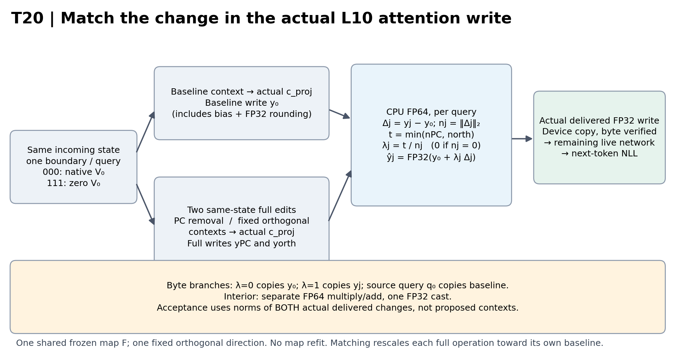
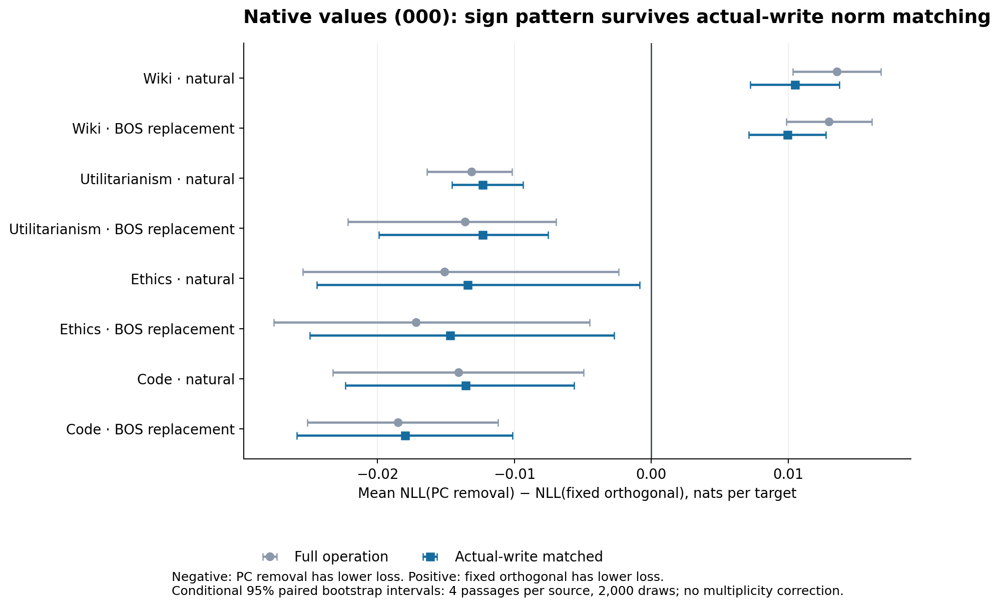
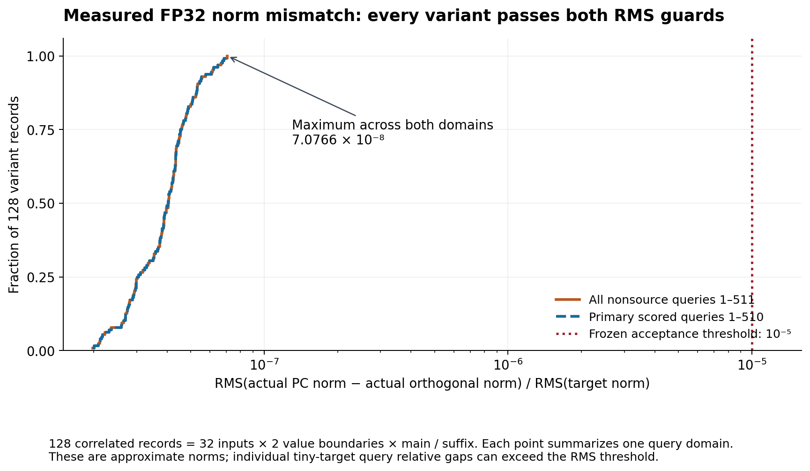

# Report 16 — GPT-2 gate edits after matching the actual attention-write change

**T20 · 21 October 2026.** Completed panel with independent numerical, sampled projection/readout and scientific reviews. Research-only release preparation is recorded separately in the release manifest.

The native-value experiment retains the same source-dependent contrast after matching the norm of the **actual L10 post-`c_proj` write change**: PC removal has higher next-token loss than one fixed orthogonal operation on Wiki, and lower loss on Utilitarianism, Ethics, and Code. All eight source/start conditional 95% intervals exclude zero. The largest measured relative RMS norm gap over 128 main/suffix variant records and both acceptance domains is **7.0766 × 10⁻⁸**, below the frozen **10⁻⁵** threshold.

**The full-window signs are not position-uniform.** Under native values, Wiki natural is +0.048987 nats/target early but −0.002160 later (later interval includes zero); Ethics natural is +0.011688 early and −0.021683 later, with both intervals excluding zero. These score partitions come from the same all-query intervention. They do not isolate early-versus-later causal support.

The measured contrast remains after this tight, approximate scalar norm control. **These two fixed operations have different observed effects at nearly equal write-change norms; an exact amplitude-only null is not proven excluded.** It does not establish direction-independent effects, identify a unique causal direction, or quantify mediation. The eight contrasts share passages, a fitted map, and an orthogonal control; they are **eight correlated strata, not eight independent replications**.

## What was intervened on

T20 uses the frozen GPT-2 model, L10 gate map `F`, PC direction `u`, and one fixed orthogonal direction `v` inherited from T18/T19. No calibration fit or direction selection used T20 outcomes. Layer numbers here are zero-based. For the two full operations, the frozen gate arithmetic removes the same fitted coefficient along `u` or `v` (`b − s u` or `b − s v`); the resulting gate changes the actual attention context using the native-value formula from T19. The causal mask is preserved. This remains a whole-attention-output operation assembled across heads, not an isolated attention head or single residual coordinate.

T20 adds a control at the **actual output of L10 `c_proj`**, before its write continues through the live network. For each input, boundary, variant, and query, cache the baseline projected write `y₀` and the two corresponding same-state full projected writes `yPC` and `yorth`, including native projection bias and FP32 rounding. Compute in CPU FP64:

```
Δj = yj − y₀                         nj = ||Δj||₂
 t = min(nPC, north)                 λj = t / nj  (0 when nj = 0)
ŷj = FP32(y₀ + λj Δj),               j ∈ {PC, orth}
```

The norm is over all 768 coordinates of one query's **change from its own baseline write**. It is not the norm of the absolute write, the pre-projection context, or the residual stream. For interior `λ`, the implementation uses separately grouped FP64 multiplication and addition followed by one FP32 cast. At `λ=0` it copies baseline bytes, at `λ=1` full-operation bytes; source query 0 copies baseline bytes. The delivered device tensor is checked bytewise. Each matched forward must first reproduce its corresponding full-operation proposed context/write and incoming state before interpolation. This prevents an accidental baseline-context match or a cache from another trajectory.



*Figure 1. The operation matches a querywise scalar target using the two actual full `c_proj` outputs, then delivers a rounded FP32 write to the remaining live network. Proposed full contexts and proposed full writes are retained separately from actual delivered writes. Norm acceptance checks both actual matched arms. The schematic abbreviates the frozen gate computation; it does not replace projection with CPU arithmetic.*

The primary boundary **000** preserves native source-position value vectors at L4–L11. The secondary boundary **111** zeros only source-position `V₀` in all heads at L4–L11, preserving source Q/K and the mask. Each boundary runs on its own trajectory. The labels retain the T19 grouping of upstream L4–L9, local L10, and downstream L11 value conditions, but T20 measures only the two endpoints. It cannot estimate the full U/L/D factorial or its interactions.

## Panel and statistical estimand

There are four fresh accepted 512-token passages from each of four source strata: Wiki validation, Utilitarianism, Ethics, and optimizer-source Code. For each passage, the **natural** and **BOS replacement** versions differ only at physical token 0; BOS is not inserted, and the other 511 token positions are identical. Input selection and inherited-history exclusions were frozen before execution. The input audit independently reconstructed 444 candidates: 16 accepted and 428 rejected, yielding 32 passage/start inputs. Rejection counts concern eligibility, not model effects. The inherited first-token membership information that was unavailable was explicitly not used as a retrospective selection rule.

For each of the 32 inputs, both value boundaries run six arms: baseline, exact current/no-op, full PC removal, full fixed orthogonal operation, and their two write-matched versions. Each arm has a main and future-suffix control forward. That gives **384 main + 384 suffix + 8 native anchor = 776** forwards. The eight anchors comprise unhooked repeats and hooked identity-write checks at the four natural-start Wiki/Utilitarianism/Ethics/Code passage-0 inputs. All use physical length 512 without KV caching. Suffix controls preserve the first 128 input positions and rotate the future suffix; their saved prefix writes and logits must be byte-exact to the corresponding main forward. They do not add independent passages to the effect estimates.

The primary view scores targets **2–511** from query rows **1–510**, 510 targets per passage. Earlier targets 2–127 and later targets 128–511 are secondary partitions of the same execution. A reported contrast is the equal-passage mean of the paired per-passage NLL difference, in **nats per target**. Lower NLL is better prediction of the observed continuation. It is neither generated-text quality nor an accuracy claim.

Every interval below is a **conditional 95% passage-cluster paired bootstrap interval**, using four passages per source, 2,000 resamples, and seed 20261021. The same passage-index draws are reused across starts, arms, and boundaries. The bootstrap-index SHA256 is `9e2a313244e72f2bfb4300e2497a4b8590cc189411863bdabed15b4922e2d4bc`. These intervals condition on this source panel, one fixed fitted `F`, and one fixed orthogonal direction. They omit uncertainty from map fitting, calibration selection, direction selection, and broader corpus sampling. No multiplicity adjustment is applied; individual intervals are not a simultaneous eight-stratum confidence statement.

## Primary native-value result

Define the contrast as **NLL(PC removal) − NLL(fixed orthogonal)**. Positive values favor the orthogonal operation; negative values favor PC removal. The full operations replicate the earlier same-source sign pattern on fresh passages. After actual-write norm matching, all eight mean signs remain and all eight conditional intervals still exclude zero. This is a fresh within-project panel replication, not an independent external replication.

| Source | Start | Full PC − orth | Write-matched PC − orth |
|---|---|---:|---:|
| Wiki | natural | +0.013551 [+0.010348, +0.016755] | +0.010476 [+0.007229, +0.013724] |
| Wiki | bos | +0.012981 [+0.009843, +0.016119] | +0.009919 [+0.007102, +0.012736] |
| Utilitarianism | natural | -0.013135 [-0.016390, -0.010159] | -0.012329 [-0.014560, -0.009369] |
| Utilitarianism | bos | -0.013595 [-0.022162, -0.006944] | -0.012316 [-0.019907, -0.007559] |
| Ethics | natural | -0.015100 [-0.025464, -0.002400] | -0.013438 [-0.024444, -0.000859] |
| Ethics | bos | -0.017183 [-0.027573, -0.004511] | -0.014707 [-0.024956, -0.002704] |
| Code | natural | -0.014105 [-0.023256, -0.004954] | -0.013568 [-0.022335, -0.005638] |
| Code | bos | -0.018516 [-0.025113, -0.011190] | -0.017995 [-0.025892, -0.010148] |



*Figure 2. Native 000 full-view (targets 2–511) paired contrasts before and after matching actual projected-write-change norms. Points show equal-passage means; bars show conditional 95% bootstrap intervals from four passage clusters per source. Starts share passages; full and matched operations share frozen `F` and the same orthogonal control. The figure compares the two interventions; it does not show their separate effects versus baseline. Units are nats per target.*

Matching changes effect size, so the result does not imply amplitude is irrelevant. For example, the Wiki natural contrast decreases from +0.013551 to +0.010476 nats per target. Matched-minus-full contrasts are correlated secondary comparisons, not mediation fractions. The magnitude control is deliberately conservative: it scales each proposed change inward to the smaller of the two same-query full-change norms; it does not search for an amplitude that maximizes a desired outcome.

The matched-minus-full change in the **PC-minus-orth contrast** is shown below. Wiki and Ethics intervals exclude zero for both starts; Utilitarianism and Code intervals include zero. Thus the persistent signs do not establish norm irrelevance. These changes have no interpretation as mediated proportions.

| Source | Start | Matched contrast − full contrast |
|---|---|---:|
| Wiki | natural | -0.003075 [-0.003623, -0.002570] |
| Wiki | bos | -0.003062 [-0.003683, -0.002437] |
| Utilitarianism | natural | +0.000806 [-0.000671, +0.002111] |
| Utilitarianism | bos | +0.001278 [-0.000734, +0.002799] |
| Ethics | natural | +0.001662 [+0.000900, +0.002424] |
| Ethics | bos | +0.002476 [+0.001650, +0.003136] |
| Code | natural | +0.000537 [-0.001559, +0.002298] |
| Code | bos | +0.000521 [-0.000672, +0.002183] |

The source averages also hide a negative result. **Ethics passage 0 reverses the aggregate contrast:** matched PC-minus-orth NLL is +0.004200 nats/target for natural start and +0.002586 for BOS replacement; the full-operation contrast is also positive at that passage. The other three Ethics passages make the aggregate negative. Direction ranking is therefore not uniform even within this four-passage source stratum.

Separate comparisons with baseline prevent the operation contrast from being mistaken for universal benefit. Below is the exponentiated paired mean NLL difference, **matched-PC perplexity / native-baseline perplexity**. Ratios above 1 mean worse likelihood. The interval is the exponentiated paired-bootstrap NLL interval, not a ratio of independently averaged perplexities.

| Source | Start | Matched PC / native baseline perplexity |
|---|---|---:|
| Wiki | natural | 1.004697 [1.001273, 1.007685] |
| Wiki | bos | 1.004644 [1.001793, 1.007503] |
| Utilitarianism | natural | 0.993892 [0.988668, 0.999144] |
| Utilitarianism | bos | 0.994523 [0.987531, 1.001302] |
| Ethics | natural | 0.983374 [0.971958, 0.993325] |
| Ethics | bos | 0.982860 [0.971574, 0.992863] |
| Code | natural | 0.989972 [0.987117, 0.993936] |
| Code | bos | 0.988519 [0.986269, 0.992415] |

Wiki is harmed by the matched PC operation relative to baseline. Utilitarianism BOS has a ratio below 1 at the mean, but its interval includes 1. Ranking better than the orthogonal operation is consequently not equivalent to demonstrating a baseline improvement in every stratum.

## Position and start dependence are retained results

Early/later contrasts partition scored targets under the **same intervention at all nonsource queries**. Early contains 126 targets (2–127), later 384 targets (128–511); the full mean is their target-count-weighted combination. These are score windows, not independently randomized intervention supports.

| Source | Start | Early targets 2–127 | Later targets 128–511 |
|---|---|---:|---:|
| Wiki | natural | +0.048987 [+0.035348, +0.062625] | -0.002160 [-0.007610, +0.003944] |
| Wiki | bos | +0.046752 [+0.035458, +0.058045] | -0.002167 [-0.006895, +0.003611] |
| Utilitarianism | natural | -0.001336 [-0.011470, +0.007321] | -0.015936 [-0.020781, -0.011519] |
| Utilitarianism | bos | -0.007491 [-0.034010, +0.010753] | -0.013900 [-0.015995, -0.011804] |
| Ethics | natural | +0.011688 [+0.001455, +0.029989] | -0.021683 [-0.033526, -0.010786] |
| Ethics | bos | +0.009959 [-0.003020, +0.028174] | -0.022801 [-0.034433, -0.012076] |
| Code | natural | +0.030961 [-0.019064, +0.089374] | -0.028179 [-0.042965, -0.016510] |
| Code | bos | +0.023744 [-0.015238, +0.071041] | -0.031691 [-0.047020, -0.018979] |

Ethics natural has a supported early/later sign reversal; Wiki's later negative mean has an interval containing zero. Code natural also has a positive early mean with a wide interval and negative later contrast. Therefore an aggregate source label does not explain when the difference arises. The current data cannot distinguish an early write's downstream consequences from contributions of later writes. Even an eventual later-only write intervention could propagate among later positions through L11, so it would not be a query-local effect.

Agreement of signs across natural/BOS starts likewise does not establish invariance or equivalence. The paired start interaction below is **(BOS PC−orth) − (natural PC−orth)**, using shared passage clusters. Intervals exclude zero on Wiki, Ethics and Code, while Utilitarianism's includes zero.

| Source | BOS-minus-natural matched contrast |
|---|---:|
| Wiki | -0.000557 [-0.001147, -0.000127] |
| Utilitarianism | +0.000012 [-0.006939, +0.006016] |
| Ethics | -0.001269 [-0.002075, -0.000462] |
| Code | -0.004427 [-0.007583, -0.001868] |

These secondary timing, start and amplitude comparisons use the same unadjusted conditional intervals and correlated data as the primary table. A prospective support-factorial study is an open follow-up, not a result of T20 and not launched here.

## Actual norm quality, including the suffix control

For each of 128 correlated variant records (32 inputs × 2 boundaries × main/suffix), let `rPC,q` and `rorth,q` be the saved norms of the **actual delivered** changes and `tq` the target norm. The frozen guard evaluates

`RMS(rPC − rorth) / RMS(t) ≤ 10⁻⁵`

on both all nonsource queries **1–511** and the primary scored queries **1–510**. All 128 records pass both guards, as well as the querywise analytic rounding-budget checks. The maximum is **7.0695652 × 10⁻⁸** for all nonsource queries and **7.0766055 × 10⁻⁸** for primary scored queries. These are measured residual mismatches, not exact norm equality.



*Figure 3. Empirical cumulative distributions of the actual relative RMS gaps, one domain summary per variant record. The two curves nearly coincide. The frozen acceptance threshold is shown on the same logarithmic axis. The plot is not a pooled distribution of all individual query gaps and does not treat suffix variants as independent observations.*

The largest absolute per-query gap is **2.713760 × 10⁻⁶** activation-norm units. The largest positive-target per-query relative gap is **4.623847 × 10⁻⁴**, larger than the RMS threshold because very small target changes amplify relative error. No positive-target write change rounded completely to zero in either matched arm. These facts are compatible with passing the aggregate RMS and analytic guards. No measured or proven downstream-sensitivity bound converts the remaining norm discrepancies into an NLL-error bound; an exact amplitude-only null would require that extra assumption. T20 supplies a strong finite-precision magnitude control, rather than a mathematical proof that every possible amplitude explanation has been excluded.

## Secondary zero-value endpoint

The 111 endpoint retains the same eight mean signs and intervals excluding zero. Its paired difference from 000 asks whether the **operation contrast** changes under this endpoint value policy; it is not the effect of zeroing V alone, nor a factorial decomposition. The endpoint-difference intervals exclude zero for both Wiki starts, Utilitarianism BOS, and Code natural, while including zero in the other four strata. These are correlated, unadjusted secondary comparisons.

| Source | Start | 111 matched PC − orth | (111 − 000) matched contrast |
|---|---|---:|---:|
| Wiki | natural | +0.008006 [+0.002968, +0.011568] | -0.002471 [-0.004427, -0.000829] |
| Wiki | bos | +0.007532 [+0.003050, +0.010950] | -0.002387 [-0.003992, -0.001377] |
| Utilitarianism | natural | -0.012756 [-0.014300, -0.010118] | -0.000428 [-0.001579, +0.000986] |
| Utilitarianism | bos | -0.013572 [-0.020930, -0.009213] | -0.001255 [-0.002211, -0.000403] |
| Ethics | natural | -0.014171 [-0.024766, -0.000657] | -0.000733 [-0.002079, +0.000613] |
| Ethics | bos | -0.014861 [-0.024203, -0.002250] | -0.000154 [-0.001669, +0.001361] |
| Code | natural | -0.017773 [-0.027291, -0.007664] | -0.004205 [-0.007144, -0.001474] |
| Code | bos | -0.019668 [-0.024483, -0.012592] | -0.001673 [-0.004693, +0.001718] |

Every full or matched effect is scored against the baseline from the same incoming value boundary when a boundary-relative effect is requested. Comparisons with the native reference `C` are stored separately. Mixing the 111 baseline with native `C` would change the estimand; the analyzer and independent numerical audit check both definitions. Early/later partitions and paired start interactions are retained in the analysis, with the same dependence and small-panel limits as the primary result.

## Execution, checks, and bounded audit evidence

T20 completed its two preplanned sequential segments on their first model execution: **A 388 forwards in 169.1745 s; B 388 in 164.0627 s**. All 776 planned forwards returned and were fully processed. There was no T20 model rerun or interrupted-segment recovery. Segment A's peak process RSS was 2,158,468 KiB (about 2.059 GiB); B's was 2,151,104 KiB. Each recorded 1,063,744,000 bytes of peak allocated GPU memory (1.064 decimal GB), with 1,161,822,208 bytes reserved. These are individual segment maxima, not inferred simultaneous or end-to-end resource measurements, and the timings do not imply an inference speedup.

The same pinned GPT-2 parameter hash was recorded before and after each segment, parameter versions remained unchanged, and each segment's final precision settings matched its initial settings. The run used FP32, SDPA, highest float32 matmul precision, and CUDA matmul TF32 disabled. Inputs, frozen source files, runtime, storage limits, predecessor linkage, and checkpoint/journal chains were checked. No calibration forward occurred in T20.

Three independently implemented CPU audits passed on their first execution against the complete T20 data:

- **Numerical audit:** verified 29,584 arrays across 64 raw shards; recomputed the 1,152 window rows, 288 summaries, 648 contrasts, 324 paired-start records, 128 matching-quality records, and shared bootstrap results. Saved actual-write norm reconstructions and 6,144 target/lambda/rounding-budget entries compared exactly under the audit's representation; the selected matched actual writes also reproduced the CPU interpolation recipe byte-for-byte; bounded FP64 reconstructions of native gate/context arithmetic need not be byte-identical to FP32. All 384 suffix, 320 source-q0, 64 current, four native-repeat, and four native-identity control records passed. Full 512-logit controls include the otherwise unscored final query.
- **Projection audit:** checked 12 predetermined snapshot states, with actual unedited and proposed-full contexts through the actual L10 projection (24 comparisons; 9,437,184 projection coordinates). It read only the two L10 projection tensors, reconstructed `context @ weight + bias`, and checked finite-precision enclosures. Full FP32 native GEMM arithmetic and absence of nonfinite GPU intermediates are stated assumptions; those intermediates are not observable in a saved-output audit. This does not reconstruct every unsaved model state.
- **Readout audit:** checked 12 predetermined states × four full-vocabulary rows = 48 rows (queries 1, 126, 127, 510), using only the tied embedding tensor on CPU. Maximum saved-NLL discrepancy was 5.4968 × 10⁻⁷ and maximum saved-KL discrepancy 3.8179 × 10⁻⁷. Maximum native-FP32 versus CPU-FP64 logit drift was 3.5864 × 10⁻⁴, within the stated dot-product bound; all 48 sampled argmaxes agreed. These selected rows are evidence about the saved readout, not proof of argmax agreement at every query or in a generated continuation.

The snapshot/readout panel was predetermined **Wiki passage 0, natural start**, across six arms and both boundaries. These 12 states are not additional passages or a broad survey of all contexts. The saved interpolation reconstruction establishes that the intended write was delivered in this panel; the whole-panel norm and control checks cover the saved per-query diagnostics elsewhere. No new pretrained model was loaded for this report or its plots.

Preparation was not failure-free. The [preserved failure ledger](GPT2_POST_WRITE_NORM_FAILURES.md) records hook-harness failures, the original too-small failure-storage cap, scanner/redaction and fixture metadata errors, the full-512 logit-control correction, and their prospective closures. Those failures were addressed before the corresponding authorized actual run/audit; they were not hidden by loosening outcome thresholds. The [hypothesis ledger](GPT2_POST_WRITE_NORM_HYPOTHESES.md) separates observations, supported scope, and untested alternatives. The [independent scientific review](../reviews/post_write_norm_matching/report16_scientific_review.json) requires ten scope limits; the report incorporates each, including timing reversals, start interactions and magnitude sensitivity.

## Interpretation and prior work

The established observation is a source-dependent difference between two finite interventions after a tight actual-write magnitude control. A plausible hypothesis is that the resulting write directions interact differently with subsequent network computations. T20 does not measure that Jacobian, establish direction effects independent of amplitude, identify which later component explains the loss difference, or show that the PC is unique among alternative directions. One fixed orthogonal operation is a limited comparator, not a sampled directional null distribution. No mediation fraction, universal benefit, fidelity, free-running generation, long-context improvement, or deployment speedup follows.

Implicit gate algebra and first-token value interventions have precedents in [Fu et al., §3.1 and Appendix B](https://arxiv.org/html/2602.01203v3). [Ran-Milo et al., Appendix B.1](https://arxiv.org/html/2604.14722v1) already use direction-component swaps with a matched scalar. T20's narrower estimand matches the actual whole L10 projected-write-change norm querywise for a fixed PC/orthogonal pair at two value endpoints. It makes no priority claim; see the [project novelty comparison](NOVELTY.md).

## Reproduction status and evidence bindings

The [audit/replay guide](GPT2_POST_WRITE_NORM_REPRODUCING.md) gives the runnable commands. The release retains139 safe numeric files (19,824 arrays) and a41-file source/metadata reconstruction package. The independent export review compares every approved array and all64 ledgers with the private original and checks the typed audit summaries. Metadata rebuilding and staging use the existing pinned sources without historical model runs, Llama loading or a calibration refit. This is current-machine preparation validation; no full second776-forward pretrained replay or general portable full-raw replay comparator is claimed.

Run `python -B scripts/audit_post_write_norm_results.py` from repository root for NumPy-only safe-array reanalysis. The [public plotting adapter](../scripts/build_post_write_norm_figures.py) rebuilds the three figures and exact tables from the frozen saved analysis with `python -B scripts/build_post_write_norm_figures.py --out .reproduce-write-figures`. It adapts only paths/input bindings/font-cache placement from the reviewed local builder; it does not rerun statistical or model experiments. The original diagram-layout versions, private history scan and all failed fixtures remain preserved locally. The release manifest distinguishes canonical private commitments, safe export identities and reviewer evidence. The linked public audit summaries omit prediction IDs and therefore have different hashes from the private original audits below.

| Bound evidence | SHA256 |
|---|---|
| [Completed analysis](../results/post_write_norm_matching/post_write_norm_analysis.json) | `3fa2df289866b3e6e1914c21372f70a1da9c7ae99f213c4039935b0dd45c31eb` |
| Canonical private composite manifest | `bb46a4f94e7276e79563a9962b1977298fd915667b4b7dbce64ef402a2279164` |
| Raw numeric inventory (bound by manifest/audits) | `6e03399366029c1f12491262a2402e0d00aeedebda7c39a88e4239a69c23d087` |
| Independent numerical audit (private original) | `8c3f3b2ec20f5adafcfe1aee1fc0b76fc3b2e192cca612b75626a41904738e10` |
| Independent projection audit (private original) | `203b5bd1d158eb21ac6a6d70f2f39384ec7e769a75a2464cda9326c7b5bf23f3` |
| Independent saved-readout audit (private original) | `a205c4c89a9216b7372330f741f0ae0f26f3324d29eb39667593e22c32d2a061` |
| [Frozen prospective protocol](../results/post_write_norm_reproduction/experiments/pulse_transfer/GPT2_POST_WRITE_NORM_MATCHING_PROPOSAL.md) | `e562fd57097228fb3348d8a7d564010456651c9dd6bde4540496a11bae338aff` |

The inherited map digest is `8b0ca7a45d01258d92bfd20069e4cd915437d8ce8a5175dda9ed4c17098fe2c8`; the GPT-2 revision is `75e09b43581151bd1d9ef6700faa605df408979f` and recorded parameter hash `2eaf003b11dbb54c7fe511397a4c77d8fc734983b8dbf66794eed8e546073527`. Reproduction must retain those bindings and the original mask/precision/branching semantics. This report contains aggregate results and source hashes, not model weights, token sequences, prediction IDs, or raw hidden/QKV/logit arrays.
