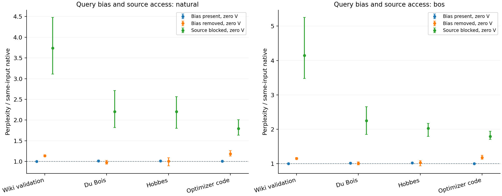
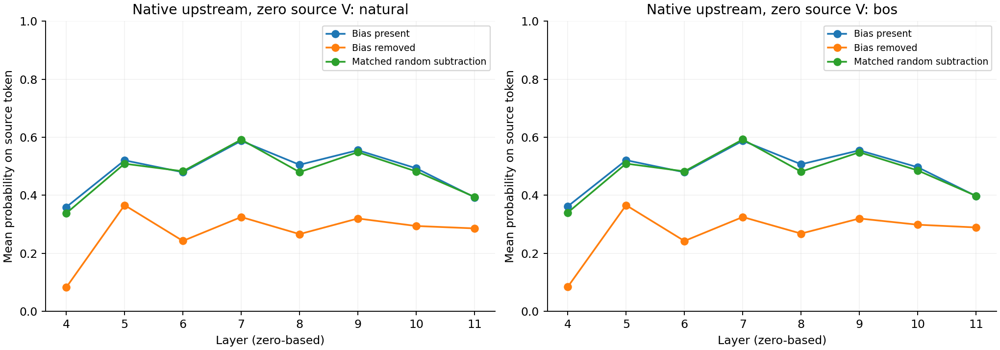
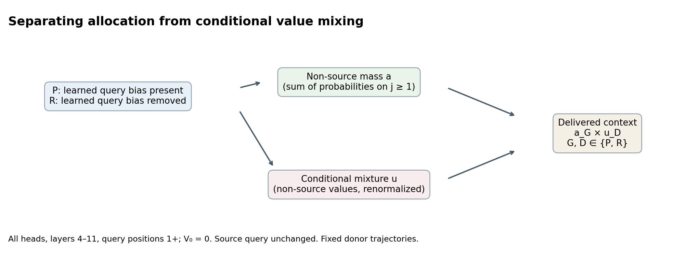
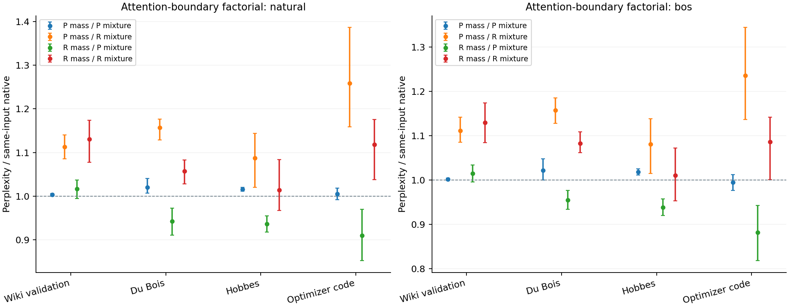

# What does GPT-2's query bias change after source values are removed?

Research continuation, 21 October 2026. Two fresh, sequential experiments
follow the reviewed coordinate-regrowth and source-value experiments. The
model is `openai-community/gpt2`, revision
`75e09b43581151bd1d9ef6700faa605df408979f`, FP32 with native SDPA. Indices
are zero-based. These results concern specified activation interventions
under teacher forcing; they do not establish faithful generation, speedup,
a universal mechanism, or a novel discovery of attention sinks.

The main result is a separation of two effects: using the bias-removed value
mixture generally raises loss, whereas its non-source allocation can lower
loss on books and code when paired with the bias-present mixture. Their
combination can hide these opposing changes. This is a causal result for the
defined donor-boundary intervention; it is not a natural mediation percentage.

## Query bias and retained source access

Removing learned query bias reduced source attention allocation, but did not reproduce the damage caused by blocking source access. Its loss effects depended on the corpus, starting token, and preceding lesion. These results support a conditional role for query bias; they do not establish that attention allocation alone mediates the loss changes.

The experiment used the pinned GPT-2 checkpoint in FP32 with SDPA, on sixteen fresh 512-token passages: four each from Wiki validation, Du Bois, Hobbes, and optimizer code. Each passage had natural and BOS starts with an identical scored suffix. Actual used spans were disjoint from all twenty-four earlier spans per corpus. **C** denotes the native upstream computation; **E** erases source0 residual coordinates447/138 after layer2; **B** additionally blocks their source0 MLP writes at layer3. All query/value/mask interventions occur in layers4–11. The factorial sets source0 V to literal zero and crosses learned-query-bias subtraction at positions1+ with source access open or blocked. Source0 Q is unchanged by the query-bias hook; zero-value changes in earlier layers can still alter its later trajectory. A fixed signed-permutation subtraction supplies a per-head norm-matched control.

The table gives PPL ratios relative to each input's original native C baseline. Each range spans four corpus means, calculated from paired mean NLL differences; it is not a confidence interval. “Bias present” and “bias removed” both retain source access and set source V to zero. The blocked condition also has zero source V and retains learned query bias.

| Upstream world and intervention | Natural start | BOS start |
|---|---:|---:|
| C, no intervention | 1.000 | 1.000 |
| E, no additional intervention | 1.013–1.088 | 1.059–1.397 |
| B, no additional intervention | 4.793–13.248 | 12.544–198.979 |
| C, zero V, bias present | 1.005–1.017 | 1.003–1.018 |
| C, zero V, bias removed | 0.979–1.187 | 1.006–1.177 |
| C, source blocked | 1.793–3.738 | 1.789–4.146 |
| E, zero V, bias present | 1.037–1.081 | 1.035–1.202 |
| E, zero V, bias removed | 0.980–1.198 | 0.945–1.219 |
| E, source blocked | 1.795–3.839 | 1.812–4.617 |
| B, zero V, bias present | 1.040–1.100 | 1.082–1.214 |
| B, zero V, bias removed | 1.051–1.269 | 0.960–1.300 |
| B, source blocked | 1.795–3.839 | 1.812–4.617 |

In C with zero V and source access open, removing learned bias increased mean NLL on Wiki by 0.124 nats naturally and 0.136 with BOS, and on code by 0.165 and 0.160. All four paired bootstrap intervals excluded zero. Conversely, it improved natural Du Bois by 0.0375 nats, with its interval below zero. In B/BOS, Du Bois and Hobbes improved by 0.119 and 0.132 nats, respectively. The preregistered interaction, `(removed−present)_blocked − (removed−present)_open`, was negative for C Wiki/code at both starts but positive for C natural Du Bois. E/B conditions also produced mixed signs. There is no universal beneficial bias-removal effect, uniform interaction, or additive mediation fraction.

Source allocation was measured at the scored query positions1–510, which predict targets2–511. Uniformly averaging across those queries, twelve heads, eight treated layers, and sixteen passages, C zero-V source mass fell from **0.4865 to 0.2726** after bias removal naturally, and from **0.4881 to 0.2740** with BOS. The randomized subtraction left those averages at 0.4782 and 0.4796. Substantial source allocation therefore survived removal. These averages describe allocation, not causal importance. With V0=0, the source's weighted vector contribution was exactly zero regardless of its probability mass; retained mass instead changes the weighting of non-source values. Query-bias subtraction also changes the conditional mixture of those values, so mass changes alone cannot explain the outcome.

Near-native loss did not imply faithful outputs. C zero-V with bias present retained 95.49–97.89% argmax agreement naturally and 95.39–97.65% with BOS. Removing bias reduced agreement to **73.24–90.20%** and **74.02–89.75%**, respectively; mean KL from native predictions was 0.150–0.300 and 0.156–0.303 nats. The fixed randomized control had generally smaller open-arm effects on Wiki/code, but was not inert or uniformly less harmful. It is one matched direction, not a randomization significance test. All confidence intervals use four paired windows per corpus/start, 2,000 bootstrap resamples, and seed20261021; they are descriptive and unadjusted for multiple comparisons.

Independent review replayed all **776 records, 192 summary groups, and 672 paired contrasts**. Eight repeat/identity controls were exact on saved per-token loss, KL and argmax; native-versus-explicit causal-mask token losses had zero drift. Source Q/K/V equality across zero-V query/mask arms passed, as did all source-blocking and literal-zero checks. E/B blocked-source saved per-token loss, KL and argmax were exactly equal in all 96 input/query-mode comparisons, an expected architectural closure rather than a new mechanism. All twelve frozen raw attention snapshots independently reconstructed in FP64: maximum actual-context error was `1.01e-5`; the maximum runtime reconstruction error over all arms was `2.48e-5`, below the frozen `1e-4` tolerance. Saved bias vectors matched the checkpoint, and the random control seed and multisets were verified. Full logits were not retained, so the audit reaggregated saved losses/KL/predictions rather than regenerating them.

The 776-forward run took **74.52 seconds**, with recorded peak GPU allocation **768,470,528 bytes** and process peak RSS **2,628,888 KiB**. Parameters and version counters remained unchanged. Independent review used no model or GPU and peaked at **1,399,780 KiB RSS**.

This is a scoped functional extension of prior work, not discovery of GPT-2 query-bias or attention-sink mechanisms. Ran-Milo et al.'s [*A Mechanistic Account of Attention Sinks in GPT-2*](https://arxiv.org/html/2604.14722v1), already credited in Report8, studies the query-bias route. The unresolved question here is how much the present intervention changes allocation versus the conditional non-source mixture; the current factorial establishes effect modification by source access, not mediation or a unique circuit.

Supporting evidence: [independent numerical review](../reviews/pulse_transfer/gpt2_query_source_numerical_review.md), [audit results](../reviews/pulse_transfer/gpt2_query_source_numerical_audit.json), and replay script (`review/gpt2_query_source_numerical_audit.py`, private raw bundle).

## Separating allocation from the conditional non-source mixture

With source V0=0, attention at a later query is mathematically
`c = a × u`, where `a = Σ(j≥1) p_j` is non-source probability mass and `u`
is the value mixture conditional on attending a non-source token. Query-bias
removal can change both. The next experiment collects donors P (bias present)
and R (bias removed), then crosses their mass and mixture states at every
attention output before c_proj in L4–11. Each pair is applied to both P and R
recipients. The duplicate recipient is a closure control, not another sample.
Upstream coordinates are native; the E/B lesions from the preceding experiment
are not used in this second factorial.

The implementation uses actual native SDPA donor context `c_D × (a_G/a_D)`.
Exact diagonals copy `c_D`. Non-source mass is summed directly, avoiding
subtraction from one. Independently computed conditional softmax mixtures
check division and amplified error at every treated layer and query. The
predeclared absolute tolerance is1e-4; no mass clipping or silent kernel
changes are allowed. Query0 remains untouched. Fixed donor contexts may
create a trajectory absent from native computation; the factorial identifies
effects at this defined boundary, not additive natural mediation fractions.

The eighth panel uses fractions(.125,.325,.525,.725), disjoint actual token
spans from all28 prior spans/corpus. There are four fresh512-token passages
per corpus, natural/BOS starts, targets2–511 scored, with the same paired
bootstrap protocol. PPL ratios below are relative to native C on each input.

Natural starts:

| Intervention | Wiki validation | Du Bois | Hobbes | Optimizer code |
|---|---:|---:|---:|---:|
| P mass / P mixture | 1.0031 | 1.0205 | 1.016 | 1.0052 |
| P mass / R mixture | 1.1127 | 1.1567 | 1.0869 | 1.2588 |
| R mass / P mixture | 1.0166 | 0.94219 | 0.93613 | 0.90973 |
| R mass / R mixture | 1.1301 | 1.0578 | 1.0144 | 1.1181 |
| P, source blocked | 3.6204 | 2.6246 | 2.3681 | 1.7103 |
| R, source blocked | 3.5801 | 2.6372 | 2.379 | 1.8369 |

BOS starts:

| Intervention | Wiki validation | Du Bois | Hobbes | Optimizer code |
|---|---:|---:|---:|---:|
| P mass / P mixture | 1.0021 | 1.0219 | 1.0181 | 0.99489 |
| P mass / R mixture | 1.1114 | 1.1578 | 1.0809 | 1.236 |
| R mass / P mixture | 1.0151 | 0.95514 | 0.93888 | 0.88181 |
| R mass / R mixture | 1.13 | 1.0827 | 1.0105 | 1.086 |
| P, source blocked | 3.6453 | 2.6796 | 2.3207 | 1.6532 |
| R, source blocked | 3.6288 | 2.6753 | 2.3199 | 1.7776 |

Separating non-source attention mass from its conditional value mixture exposed opposing effects of query-bias removal. In this fixed zero-source-value experiment, the bias-removed mass donor generally improved loss on books and code, while the bias-removed mixture donor worsened it. The result is a conditional factorial finding, not an additive mediation account of the native model.

This batch used native upstream GPT-2 computation, with **no E/B coordinate or writer lesions**. In zero-based layers4–11, source0 V was set to zero. Donor **P** retained learned query bias; donor **R** removed it from Q at positions1+. For each treated layer/head/query, non-source mass was `a=sum(j>0,pj)` and conditional non-source mixture was `u`. Hence attention context was approximately `a*u`, as checked against native SDPA. The intervention delivered the saved mixture-donor context `c_D*(a_G/a_D)`, copying diagonal donors exactly. Query0 remained untouched. Donors came from their own unpatched SDPA forward trajectories under the assigned Q/V conditions on the same input; crossed trajectories need not correspond to any native run.

Use **mass-first notation** throughout: `Y_PR` means P mass with R mixture; `Y_RP` means R mass with P mixture. All four pairs were delivered into both P and R recipients. The recipient duplicates produced exact matching outputs and final-hidden hashes, so they are controls, not additional observations.

The eighth fresh panel contained four 512-token passages per corpus, each with natural/BOS starts and identical scored suffixes. Actual used spans excluded all twenty-eight earlier passages per corpus. Every arm scored targets2–511. Table ranges span four corpus means, each expressed as the exponential of paired mean NLL difference from its own original native C baseline; they are not confidence intervals.

| Condition | Natural PPL ratio | BOS PPL ratio |
|---|---:|---:|
| `Y_PP`: P mass, P mixture | 1.003–1.020 | 0.995–1.022 |
| `Y_RR`: R mass, R mixture | 1.014–1.130 | 1.011–1.130 |
| `Y_PR`: P mass, R mixture | 1.087–1.259 | 1.081–1.236 |
| `Y_RP`: R mass, P mixture | 0.910–1.017 | 0.882–1.015 |
| P query bias, source blocked | 1.710–3.620 | 1.653–3.645 |
| R query bias, source blocked | 1.837–3.580 | 1.778–3.629 |

At either fixed mixture, replacing P mass with R mass improved mean NLL in Du Bois, Hobbes, and code at both starts; all twelve corresponding paired intervals were below zero. Wiki's mass effects were slightly harmful with intervals crossing zero. Conversely, replacing P mixture with R mixture worsened every corpus/start mean at either mass, with fifteen of sixteen intervals above zero; Hobbes/BOS at P mass was the exception. `Y_RP` beat the complete R donor in all eight corpus/start means. `Y_PR` was worse than the complete P donor in all eight, and worse than R in six, excluding Wiki.

The full interaction, `Y_RR−Y_RP−Y_PR+Y_PP`, had mixed signs: 17 positive and 15 negative individual-window values. Three group intervals excluded zero—positive Hobbes at both starts, negative natural Du Bois. These results do not justify a universal sign, an additive mediation percentage, or a unique repair pathway. Intervals use paired n=4 windows, 2,000 bootstrap resamples and seed 20261021, without multiple-comparison correction. Natural/BOS starts are paired variants; the experiment does not estimate broad population effects.

R donors had greater non-source mass on average: 0.5125→0.7279 naturally and 0.5111→0.7267 with BOS, uniformly averaged over scored queries/heads/layers/passages. R/P mass ratios exceeded one in 95.12% of scored entries. This is not universal at every head/query. Median gain was 1.442 and 95th percentile 4.916; maximum gain was **6.79 million**, with minimum positive mass **3.31e-12**. No mass floor or clipping was used. Direct conditional-softmax diagnostics remained within the fixed 1e-4 error bound, including these extreme cases.

Improved loss did not restore native predictions. `Y_RP` agreement was **80.93–90.10%** naturally and **80.05–90.00%** with BOS, with KL 0.0824–0.1560 and 0.0823–0.1686 nats. In comparison, `Y_PP` agreement was 94.85–97.35% and 94.56–96.96%. Same-input donor patches are diagnostic interventions, not usable input-independent replacements or evidence of faithful generation.

Independent CPU review reproduced all **520 records, 128 summaries, 256 contrasts and 64 paired summaries**, plus 840 saved checks and 3,840 mixture-layer checks. All 328 specified output/final-hidden-hash closures passed; native/explicit-mask token losses had zero drift. Thirty-two donor files were checked sequentially, including exact mixture arithmetic. All twenty frozen Q/K/V/context states reconstructed in FP64 with maximum native-context error **8.11e-6**; all sixteen patched snapshot contexts exactly matched the specified donor arithmetic. The largest runtime conditional-mixture discrepancy was 3.62e-5, below tolerance. Final-hidden closures were checked from recorded hashes; full hidden tensors and full logits were not retained for independent regeneration.

The run took **55.54 seconds**, with peak GPU allocation **768,470,528 bytes** and process peak RSS **2,312,288 KiB**. Parameters remained unchanged. Independent review used no model/GPU and peaked at **1,062,016 KiB RSS**.

Query-bias/sink mechanisms, attention-output decomposition, and zero-valued allocation have close primary precedents. The [focused prior-art review](../reviews/pulse_transfer/gpt2_query_mixture_prior_art.md) distinguishes those established ideas from this specific donor factorial without claiming priority. Supporting evidence: [numerical review](../reviews/pulse_transfer/gpt2_query_mixture_numerical_review.md), [audit results](../reviews/pulse_transfer/gpt2_query_mixture_numerical_audit.json), and replay code (`review/gpt2_query_mixture_numerical_audit.py`, private raw bundle).

## Prior work and novelty limits

Reviewed 21 October 2026 using the primary HTML versions below, their relevant methods/appendices, and the existing Report8/NOVELTY discussion. **The inspected papers establish the neighboring mechanisms and decomposition. I did not identify an explicit donor allocation × conditional non-source mixture factorial at the attention-output boundary under literal V0=0 in those sections. This is a bounded reading result, not a claim that the intervention is new.** No model, GPU, or publication action was used.

### Ran-Milo, Ofek and Mendel, arXiv:2604.14722v1

[Sections3.1, 3.2.1, 3.2.6/Table1, 5.3–5.4 and AppendixB.1](https://arxiv.org/html/2604.14722v1) establish a learned-query-bias/positional-MLP/key circuit. Their interventions nullify query bias, alter positional signals, disable MLPs, or ablate key-projection coordinates. The EPE swap changes an MLP-output direction; it is not a patch of attention allocation independently from the conditional non-source mixture. Sections5.3–5.4 acknowledge residual sinks and leave downstream functional benefit/cost unresolved. The enumerated experiments do not report the proposed V0=0 output-factorial.

Important comparison limits: query bias is nullified in every layer. Their attention analysis excludes the first three and final layers, using a one-based 4–11 range; our zero-based4–11 includes the final block. Their allocation metric uses the latter half of 40-token prompts. Our position-restricted later-layer intervention and queries1–510 therefore are not a matched replication of their statistic. Query-bias reduction of a sink, residual allocation after removal, and architecture dependence must already receive credit. The targeted loss/fidelity measurements and proposed factor crossings are the scoped investigation here.

### Sun, Chen, Kolter and Liu, arXiv:2402.17762v2

[Section4.2, Eq(2), Figure8 and AppendixB.3](https://arxiv.org/html/2402.17762v2) explicitly split attention output into weighted value contributions from massive-activation tokens and from other tokens. Their analysis describes approximately constant additive updates from the former. This precedes a claim of discovering source/non-source output decomposition.

[Section4.3, Eq(3), and AppendixB.4, Eqs(6)–(8), Figures37–38](https://arxiv.org/html/2402.17762v2) examine trained attention variants: learned extra K/V vectors, an extra zero-K/zero-V slot (identified as softmax-off-by-one), added query/key features, and a constant additive value update. The latter three alternatives did not eliminate massive activations during their pretraining. Zero-valued probability allocation is therefore already represented, not a new conceptual mechanism. These are architectural training comparisons, not the proposed fixed-checkpoint donor factorial. Eq(2) uses unnormalized weighted sums; the described analyses do not independently transplant source mass and the renormalized non-source mixture from query-bias-present/removed runs. Do not reinterpret their negative training result as testing or refuting our conditional intervention.

### Exact distinction and reporting boundary

For our single-source case, define `a0=p0` and `u=sum(j>0, pj/(1−p0) * vj)` at a query with an available non-source key. Ordinary attention algebra gives `Y=a0*v0+(1−a0)*u`; imposing `v0=0` gives `Y=(1−a0)*u`. This identity is elementary regrouping, not a research contribution. A zero value can still alter the total weighting of other values because its probability remains in the normalization. Query-bias removal can change both factors.

The prospective experiment's precise operation is to replace one factor with a frozen same-input donor from a different query-bias world while preserving or separately replacing the other, at the pre-output-projection attention context. Reconstruction/diagonal controls, bidirectional crossings, and the joint donor test distinguish an operational causal patch from a descriptive decomposition. They do not automatically yield additive mediation percentages, a unique functional explanation, or an input-independent replacement. The same-input donor carries information from the evaluation run.

Report this as a **targeted functional extension using a specified factor intervention**, with no priority claim. Cite both papers at the mechanism and decomposition, not only in a general related-work list. The result can answer the finite factorial question even if a closer antecedent exists.

This check examined substantive intervention definitions and appendices, rather than using missing keywords as evidence. Both requested papers were accessible. It did not exhaust author repositories, all cited literature, later revisions, or other publications; it cannot establish absence elsewhere. Existing [Report8](TRANSFER.md) already credits these sources. AppendixB.4's zero-K/zero-V control is particularly close to the present estimand.

The earlier reports' super-weight, massive-activation, conditional-reserve,
coordinate-regrowth and source-K/V comparisons remain applicable. These two
experiments are targeted mechanism tests on one pinned GPT-2 checkpoint.
Different estimands alone do not establish priority.

## Reproducibility and remaining limits

Exact protocols are `GPT2_QUERY_SOURCE.md` and `GPT2_QUERY_MIXTURE.md`.
Scripts, model/input hashes, source revisions, seeds, fresh-panel manifests,
per-token metrics, raw donors, frozen raw attention snapshots and all controls
are retained locally. Private input/prediction IDs, raw activation donors,
weights and copyrighted corpora are excluded from the numerical repository
export. Full vocabulary logits are not retained; saved KL can be reaggregated
but not independently reconstructed from logits. The second experiment also
hashes the complete final normalized hidden state to check exact donor closures.

| Batch | Forwards | Wall seconds | Peak GPU GiB | Peak process RSS GiB |
|---|---:|---:|---:|---:|
| gpt2_query_source_run | 776 | 74.52 | 0.716 | 2.507 |
| gpt2_query_mixture_run | 520 | 55.54 | 0.716 | 2.205 |

These batches total 1296 forwards and
130.05 recorded worker seconds.
One local RTX3060Ti ran one model at a time. Independent reviews used CPU and
no pretrained model. Small paired panels, one random control direction,
conditional bootstrap intervals, reused corpus sources and intervention-induced
trajectories limit generalization. Low loss and reduced attention allocation
do not imply unchanged outputs or one underlying mechanism. The continuous
research ledger distinguishes established results from prospective follow-ups.

The private GitHub creation was denied before execution. No remote repository
or push occurred; local research and reviewed deliverables remain available.
