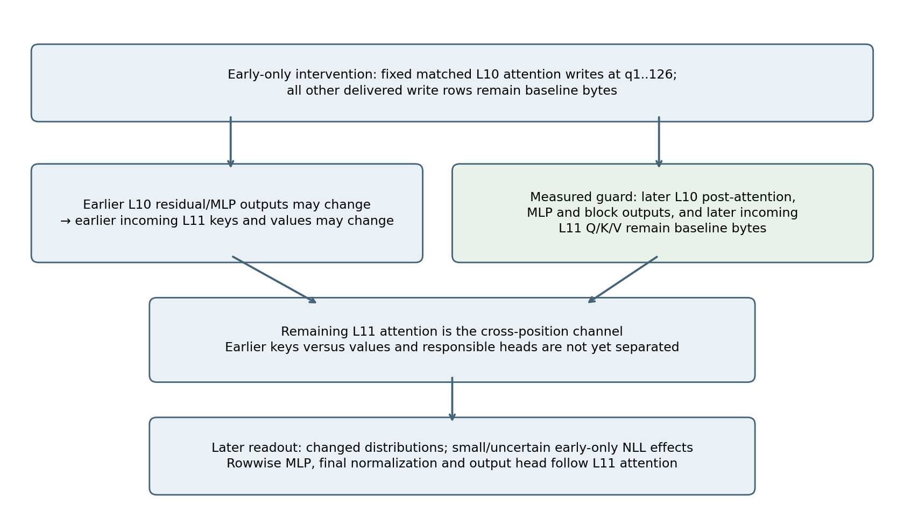
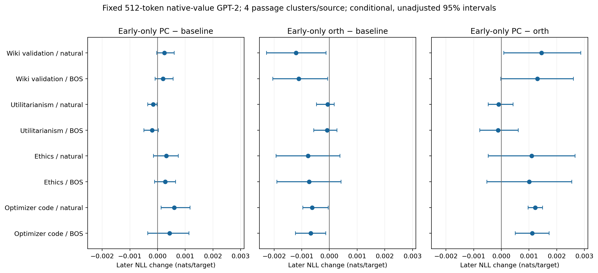
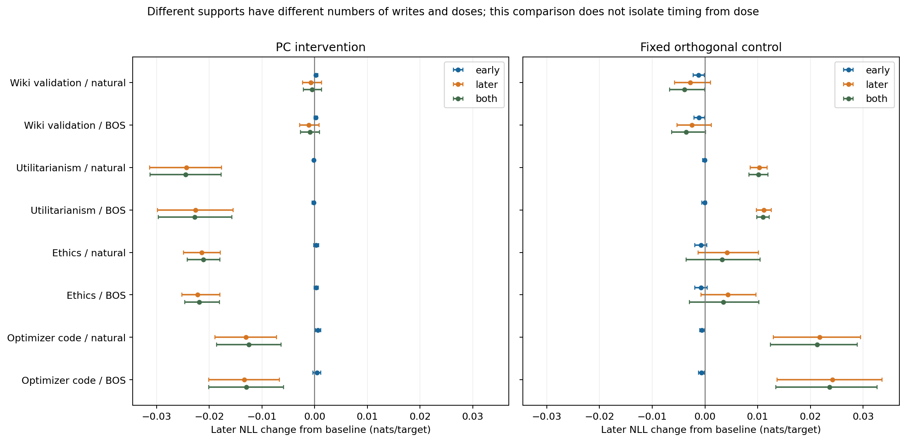

> Repository packaging update — 2026-10-22. The scientific body below is the reviewed Report 17 snapshot. Its publication-hold and pending-portable statements describe that earlier snapshot. The user has since authorized publication of completed Reports 16/17. The 45-file metadata package, 75-file restricted numerical package, NumPy reanalysis, one tokenizer-only reconstruction and private replay staging have now passed their recorded reviews. No second 648-forward model replay was performed. See [reproduction](GPT2_QUERY_WRITE_TIMING_REPRODUCING.md) and the [failure ledger](GPT2_QUERY_WRITE_TIMING_FAILURES.md). This packaging update changes no scientific values or claims.

# Report 17 — Which write positions change later predictions?

Scientifically reviewed. GPT-2 transfer study T21; this is not a new intervention on the original OLMo super-weight. Repository publication is paused; this local report does not claim a new remote commit.

Early-only L10 write edits changed later-token distributions while the later L10 computation and later incoming L11 queries, keys and values remained baseline bytes. Under the fixed GPT-2 architecture and the recorded guards, this identifies a cross-position consequence through the remaining L11 attention block. It does not yet separate earlier keys from values or identify a unique head or direction.

The later NLL changes from early-only edits were small and often uncertain. Larger later NLL changes occurred under later-support edits in the Utilitarianism, Ethics and code panels. Supports have unequal query counts and perturbation doses, so these comparisons are not transmission fractions or an isolated timing-versus-dose experiment.

## What was tested

Layers use zero-based indices: L10 is the eleventh block, and L11 is the twelfth and final block. A write here means the 768-coordinate attention output after its output projection, before it is added to that position's residual stream. PC names the fixed leading direction from the earlier calibration; it is not fitted on this evaluation panel.

Each attention head allocates mass between position zero and the other allowed positions. Let b be their log mass ratio, log(nonsource mass/source mass). For nonsource query q, the calibrated scalar is s = dot(b − log(q) − alpha, u). The PC gate proposal subtracts s·u; the control subtracts the same s·v for one fixed orthogonal unit direction v. Native value vectors and the unchanged output projection turn these gate proposals into full write proposals. CPU FP64 interpolation, followed by one FP32 cast, shortens their write changes toward the same per-query minimum-norm target. The support intervention then copies subsets of those fixed arrays. Exact implemented precision, endpoint copies and rounding budgets are defined by the frozen scripts.

The same checkpoint, native source values, frozen calibration F, PC direction and one fixed orthogonal control as Report 16 were used. Four fresh passages per source were paired with natural and BOS starts. All runs used the same physical 512-token shape. Early support edits query writes 1..126; later edits 127..511; both edits 1..511. Source q0 and every inactive delivered row copy baseline bytes. The two full matched FP32 write arrays were computed once per variant; support choices copy subsets without refitting or renormalizing them.

The full view scores targets 2..511; early targets 2..127; later targets 128..511. The primary comparisons were later-view early-only PC−baseline, orth−baseline and PC−orth, in every source/start stratum. Ten arms, main/rotated-suffix runs, and eight native identity/repeat anchors required 648 forwards. All 648 completed in their first executions with all final guards; there was no model rerun or calibration fit.

The diagram combines recorded runtime guards with the architecture's single remaining attention block. All-query guard fingerprints/flags are runtime evidence; only the predetermined 200 timing-row vectors, ten full snapshot states and 40 vocabulary rows were retained for independent raw reconstruction. Do not read the diagram as a full saved reconstruction of every unsaved node.

## Primary results: early-only effects on later NLL

Values are nats/target with conditional, unadjusted 95% paired bootstrap intervals. Four passage clusters/source, 2,000 shared PCG64 resamples, seed 20261021. Negative differences mean lower loss. Nine of 24 primary intervals exclude zero; these correlated comparisons are not 24 independent replications. Intervals crossing zero do not establish absence or equivalence.

| Source | Start | PC − baseline | Orth − baseline | PC − orth |
| --- | --- | --- | --- | --- |
| Wiki validation | natural | +0.00024319 [-0.00003021, +0.00059711] | -0.00120984 [-0.00226768, -0.00012390] | +0.00145302 [+0.00009369, +0.00286479] |
| Wiki validation | bos | +0.00019799 [-0.00008513, +0.00055808] | -0.00110840 [-0.00204662, -0.00006556] | +0.00130639 [-0.00001957, +0.00260470] |
| Utilitarianism | natural | -0.00015730 [-0.00035548, -0.00002375] | -0.00006337 [-0.00046848, +0.00017400] | -0.00009393 [-0.00046959, +0.00042579] |
| Utilitarianism | bos | -0.00019558 [-0.00049585, +0.00003058] | -0.00008061 [-0.00056726, +0.00026903] | -0.00011497 [-0.00077882, +0.00061178] |
| Ethics | natural | +0.00031936 [-0.00014456, +0.00074752] | -0.00077652 [-0.00192976, +0.00037671] | +0.00109588 [-0.00047494, +0.00266671] |
| Ethics | bos | +0.00027265 [-0.00010614, +0.00065143] | -0.00073428 [-0.00189294, +0.00042037] | +0.00100693 [-0.00052651, +0.00254037] |
| Optimizer code | natural | +0.00059792 [+0.00013099, +0.00117033] | -0.00062184 [-0.00095851, -0.00004165] | +0.00121976 [+0.00097116, +0.00149285] |
| Optimizer code | bos | +0.00043485 [-0.00035423, +0.00113030] | -0.00067545 [-0.00122300, -0.00012789] | +0.00111030 [+0.00049887, +0.00172173] |

For natural-start code, the PC early-only effect was +0.00059792 [0.00013099,0.00117033], while the orth effect was −0.00062184 [−0.00095851,−0.00004165]. Their paired difference was +0.00121976 [0.00097116,0.00149285]. These are controlled consequences on this finite panel, not evidence of a universal benefit.

## Distribution changes and the larger later-support effects

Every one of the 64 early-only passage/start/direction conditions had positive recorded mean later KL from baseline. Source/start mean KL ranged from 1.15e−5 to 5.82e−5 nats. KL and agreement were planned secondary metrics; they show distribution shifts when mean NLL differences cancel. They are not an independent population test, and unsaved full vocabulary distributions were not independently reconstructed. On Ethics/BOS/PC-early, all later argmax predictions were unchanged despite positive KL.

| Source | Start | Early edit | Mean later KL | Conditional95% interval | Mean argmax agreement |
| --- | --- | --- | --- | --- | --- |
| Wiki validation | natural | PC | 2.5870188e-05 | 1.6255214e-05 … 3.5485161e-05 | 0.99414062 |
| Wiki validation | natural | orth | 5.3035453e-05 | 2.8542187e-05 … 8.56139e-05 | 0.99544271 |
| Wiki validation | bos | PC | 2.7575254e-05 | 1.7323165e-05 … 3.8753372e-05 | 0.99804688 |
| Wiki validation | bos | orth | 5.8176363e-05 | 3.2599849e-05 … 8.6924239e-05 | 0.99739583 |
| Utilitarianism | natural | PC | 1.1458523e-05 | 7.6224748e-06 … 1.4521298e-05 | 0.99869792 |
| Utilitarianism | natural | orth | 1.7227196e-05 | 1.2963959e-05 … 2.1490432e-05 | 0.99869792 |
| Utilitarianism | bos | PC | 1.4176393e-05 | 9.3627127e-06 … 1.8158564e-05 | 0.99804688 |
| Utilitarianism | bos | orth | 2.0812598e-05 | 1.4715701e-05 … 2.6184492e-05 | 0.99674479 |
| Ethics | natural | PC | 1.7854193e-05 | 1.3617653e-05 … 2.3411523e-05 | 0.99804688 |
| Ethics | natural | orth | 2.4184616e-05 | 1.7605133e-05 … 3.0370048e-05 | 0.99804688 |
| Ethics | bos | PC | 1.6239696e-05 | 1.2317957e-05 … 2.0161436e-05 | 1.00000000 |
| Ethics | bos | orth | 2.7085289e-05 | 1.8032654e-05 … 3.6480784e-05 | 0.99934896 |
| Optimizer code | natural | PC | 2.5579915e-05 | 1.9734659e-05 … 3.0523688e-05 | 0.99804688 |
| Optimizer code | natural | orth | 4.009959e-05 | 3.3701761e-05 … 4.702113e-05 | 0.99674479 |
| Optimizer code | bos | PC | 2.7432526e-05 | 2.3217409e-05 … 3.1647643e-05 | 0.99869792 |
| Optimizer code | bos | orth | 4.8038141e-05 | 3.7374081e-05 … 5.7892727e-05 | 0.99674479 |

| Source | Start | PC early | PC later | PC both | Orth early | Orth later | Orth both |
| --- | --- | --- | --- | --- | --- | --- | --- |
| Wiki validation | natural | +0.00024319 [-0.00003021, +0.00059711] | -0.00076274 [-0.00232846, +0.00133914] | -0.00047533 [-0.00212320, +0.00129427] | -0.00120984 [-0.00226768, -0.00012390] | -0.00276445 [-0.00576520, +0.00108769] | -0.00390332 [-0.00674486, -0.00001831] |
| Wiki validation | bos | +0.00019799 [-0.00008513, +0.00055808] | -0.00112760 [-0.00283921, +0.00086784] | -0.00089885 [-0.00268810, +0.00089041] | -0.00110840 [-0.00204662, -0.00006556] | -0.00250768 [-0.00529548, +0.00117193] | -0.00355544 [-0.00634010, +0.00007514] |
| Utilitarianism | natural | -0.00015730 [-0.00035548, -0.00002375] | -0.02431878 [-0.03128199, -0.01763048] | -0.02445624 [-0.03121356, -0.01774180] | -0.00006337 [-0.00046848, +0.00017400] | +0.01027149 [+0.00855182, +0.01182546] | +0.01017293 [+0.00836300, +0.01198285] |
| Utilitarianism | bos | -0.00019558 [-0.00049585, +0.00003058] | -0.02257386 [-0.02977932, -0.01546014] | -0.02274635 [-0.02967527, -0.01570170] | -0.00008061 [-0.00056726, +0.00026903] | +0.01115336 [+0.00973001, +0.01257671] | +0.01102906 [+0.00980946, +0.01218619] |
| Ethics | natural | +0.00031936 [-0.00014456, +0.00074752] | -0.02139806 [-0.02487438, -0.01792174] | -0.02108074 [-0.02416465, -0.01799683] | -0.00077652 [-0.00192976, +0.00037671] | +0.00418685 [-0.00131418, +0.01013802] | +0.00325188 [-0.00354031, +0.01046824] |
| Ethics | bos | +0.00027265 [-0.00010614, +0.00065143] | -0.02219706 [-0.02515161, -0.01794574] | -0.02190843 [-0.02463354, -0.01805313] | -0.00073428 [-0.00189294, +0.00042037] | +0.00432304 [-0.00075892, +0.00970375] | +0.00347266 [-0.00295479, +0.01024611] |
| Optimizer code | natural | +0.00059792 [+0.00013099, +0.00117033] | -0.01306676 [-0.01893289, -0.00720063] | -0.01250777 [-0.01861140, -0.00640414] | -0.00062184 [-0.00095851, -0.00004165] | +0.02171082 [+0.01300062, +0.02952560] | +0.02124525 [+0.01238149, +0.02887595] |
| Optimizer code | bos | +0.00043485 [-0.00035423, +0.00113030] | -0.01338681 [-0.02008919, -0.00668443] | -0.01298984 [-0.02010030, -0.00587937] | -0.00067545 [-0.00122300, -0.00012789] | +0.02418211 [+0.01363398, +0.03360518] | +0.02365361 [+0.01344426, +0.03262171] |

Natural-start code illustrates a sign reversal across supports: PC early-only increased later NLL by 0.00059792, while PC later-only reduced it by 0.01306676 [−0.01893289,−0.00720063]. This rules out a uniform-sign description for those interventions. It does not assign a percentage of the combined effect to either route.

Later-only edits can propagate between later positions through L11 attention. They are not a purely query-local condition. Their larger observed effects cannot be attributed to timing alone because later support contains 385 physical writes versus 126 early writes, with different total doses.

## Nonadditivity and fresh-panel limits

The secondary finite interaction is NLL(both)−NLL(early)−NLL(later)+NLL(baseline). Nonzero values can result from nonlinear attention, residual computation, readout or loss. They are not mediation fractions; a zero-crossing interval does not imply absent transmission.

| Source | Start | PC interaction | Orth interaction | PC interaction − orth interaction |
| --- | --- | --- | --- | --- |
| Wiki validation | natural | +0.00004423 [+0.00001159, +0.00007687] | +0.00007097 [+0.00000037, +0.00014401] | -0.00002674 [-0.00007219, +0.00001871] |
| Wiki validation | bos | +0.00003076 [+0.00001101, +0.00005051] | +0.00006064 [-0.00001049, +0.00015303] | -0.00002988 [-0.00009766, +0.00003573] |
| Utilitarianism | natural | +0.00001984 [-0.00002429, +0.00009182] | -0.00003519 [-0.00007174, +0.00001288] | +0.00005503 [-0.00001498, +0.00013520] |
| Utilitarianism | bos | +0.00002309 [-0.00001387, +0.00007346] | -0.00004368 [-0.00007056, -0.00001513] | +0.00006677 [+0.00001140, +0.00012214] |
| Ethics | natural | -0.00000204 [-0.00003200, +0.00004581] | -0.00015845 [-0.00037096, +0.00004096] | +0.00015641 [-0.00001782, +0.00035252] |
| Ethics | bos | +0.00001598 [-0.00004551, +0.00011564] | -0.00011609 [-0.00032114, +0.00003903] | +0.00013207 [+0.00002203, +0.00029384] |
| Optimizer code | natural | -0.00003894 [-0.00016273, +0.00007038] | +0.00015627 [+0.00002145, +0.00024225] | -0.00019521 [-0.00023061, -0.00015980] |
| Optimizer code | bos | -0.00003788 [-0.00019884, +0.00010755] | +0.00014695 [+0.00002003, +0.00023727] | -0.00018483 [-0.00024196, -0.00009469] |

For comparison with Report 16's full-write intervention, the fresh-panel full-view PC−orth mean signs repeated: positive Wiki, negative the other three sources. Wiki intervals now cross zero. This is a fresh input check conditional on the same F/directions, not an independent calibration or second hardware/model replay.

| Source | Start | Both-support full-view PC − orth |
| --- | --- | --- |
| Wiki validation | natural | +0.00649445 [-0.00003670, +0.01229965] |
| Wiki validation | bos | +0.00542406 [-0.00088135, +0.01060914] |
| Utilitarianism | natural | -0.02475245 [-0.02882511, -0.02067978] |
| Utilitarianism | bos | -0.02367513 [-0.02631710, -0.02105722] |
| Ethics | natural | -0.01629522 [-0.02051275, -0.01227006] |
| Ethics | bos | -0.01682178 [-0.02166887, -0.01244736] |
| Optimizer code | natural | -0.02241783 [-0.03189751, -0.01293816] |
| Optimizer code | bos | -0.02584554 [-0.04018577, -0.01194723] |

## Norm matching, controls and uncertainty

The maximum relative RMS matched-norm gap across both acceptance domains was 6.906689988e-08, below the prespecified 1e−5 limit. Across all inputs, main/suffix variants and supports, the largest positive-target pointwise relative gap over nonsource queries 1..511 was 0.002431434507 (about 0.243%). Matching is approximate, including rounding at tiny targets; no downstream sensitivity bound was proved. The result does not logically rule out every exact amplitude-only explanation of a directional contrast.

Native/current/identity, source and suffix controls passed. Early-only edits left every later L10 post-attention/MLP/block row and incoming L11 Q/K/V row at baseline bytes. Later-only edits preserved the earlier hidden/logit prefix. Independent N checked 192 support pairs, 384 RMS domains, 25,128 arrays, 10 full interpolation snapshots and 200 sampled timing rows. All saved statistics and bootstrap results matched exactly. P checked 7,864,320 projection coordinates; R checked 40 full-vocabulary rows. All three passed on their first actual attempts.

This is one checkpoint, one F fit and one orthogonal direction, with four passages/source and paired, dependent starts/arms/views. The 95% intervals are conditional and unadjusted. No familywise significance, calibration uncertainty, generation quality, output fidelity, unique circuit, full-model replacement or cross-model mechanistic identity is established. No second full pretrained replay was performed.

## Negative results, failed preparation and hypotheses

- The primary NLL question did not yield a uniform effect: 15 of 24 conditional intervals include zero. That is imprecision, not evidence that the early route is absent.
- Early-only PC edits are not uniformly helpful: natural code loss increased, despite a beneficial later-only PC edit.
- A uniform-sign or purely early-transmission account of all later loss changes is inadequate for this panel. The relative sizes across supports are not dose-controlled.
- The initial 384MiB failure-storage allowance failed before any pretrained run. The complete 831,398,069-byte synthetic failure blob was preserved and round-trip verified. A prospectively reviewed 1GiB cap, conservative 933,758,516-byte upper bound and unchanged 3GiB process limit were used. No evidence was truncated or deleted; no scientific threshold changed.
- Development-only audit/layout issues and reviewer bookkeeping mistakes were preserved separately. The model study and all actual N/P/R audits had no failed execution or selective rerun.

Established here: controlled cross-position consequences under explicit guards, alongside support-, direction- and source-dependent finite loss effects. Still hypotheses: which earlier L11 keys versus values transmit the change, which heads carry it, whether PC is distinctive among an orthogonal ensemble, and how it depends on a native/fresh calibration.

## Relation to existing research

Super-weight and massive-activation studies already establish important early-token and attention-related phenomena. Prior work on attention sinks and direction/magnitude controls prevents claiming a new generic direction-versus-magnitude distinction. We also do not claim that gates or multiple sink mechanisms were discovered here.

The candidate contribution is the specific held-out GPT-2 support intervention and causal-guard record, following the earlier norm-control experiments, with explicit timing/readout distinctions and preserved negative results. It extends this research chain; it does not establish priority over all activation-patching or circuit work. Original primary sources: [Super Weight](https://arxiv.org/html/2411.07191v2), [Massive Activations](https://arxiv.org/html/2402.17762v2), [GPT-2 attention-sink direction controls](https://arxiv.org/html/2604.14722v1), and [sink/gate analysis, v3](https://arxiv.org/html/2602.01203v3). The previously reviewed novelty addendum retains the detailed comparison and historical coordinate correction; no original-paper coordinate is silently relabelled.

## Reproduction and audit checkpoint

Checkpoint: openai-community/gpt2, revision 75e09b43581151bd1d9ef6700faa605df408979f; model.safetensors SHA-256 248dfc3911869ec493c76e65bf2fcf7f615828b0254c12b473182f0f81d3a707. Runtime: Python 3.12.3, torch 2.11.0+cu130, transformers 4.57.6, numpy 1.26.4, CUDA 13.0. RTX 3060 Ti 8GiB, driver 595.99.02; FP32, highest matmul precision, TF32 matmul off. F digest 8b0ca7a45d01258d92bfd20069e4cd915437d8ce8a5175dda9ed4c17098fe2c8; torch/bootstrap seed 20261021.

Protocol: GPT2_QUERY_WRITE_TIMING_PROPOSAL_v4.md; resource supplement: GPT2_QUERY_WRITE_TIMING_RESOURCE_ADDENDUM.md. Runner gpt2_query_write_timing.py SHA-256 539565fb028eb9fd217d49ed43b03e5ba6869c8ecc0d3ed2a98c0eca66064c92; hook gate_query_write_timing.py SHA-256 f9f2eb64795b6b40ce19a2b6187e4dbb7263d838ff152bf2d081b06260a0f0ab; analyzer analyze_query_write_timing.py SHA-256 54415feb2fade4da1569f92ba78172285eb955c1a72bccfb43ffc60edc3f760c.

Fresh inputs excluded 745 recorded identities, all prior source spans and four full 8,192-character calibration buffers. All 747 deterministic candidate decisions (16 accepted, 731 rejected), physical source processing, exact 512-token natural/BOS bytes and component boundaries were independently reconstructed. Recorded history does not establish absence from GPT-2 pretraining.

The local bundle retains original A/B runs, 32 raw shards, canonical composite, code/source/input/calibration manifests, journals, checkpoints, all failure witnesses and audit sources. The complete 408-contrast CSV includes every interval and all four per-passage values; 204 paired-start contrasts are also saved. Public-safe metadata/numeric rebuilding is being prepared separately without rerunning prior model experiments or loading Llama. This scientific report does not claim those pending export/rebuild checks are already complete.

Experiment-process wall time: A 149.16s and B 150.42s; cumulative 299.57s for 648 actual forwards, including model loading, evaluation, serialization and guards. Audit costs are separate. Peak process RSS 2,368,968KiB (A) and 2,353,548KiB (B); GPU allocated 1,063,744,000B/reserved 1,161,822,208B. N 12.19s/994MB; P 3.28s/309MB; R 5.14s/1.027GB. Reproduction uses one GPU at a time, at most 3GiB process RSS, at least 4GiB available host memory before load and at least 4.5GiB free disk at A admission, including the 2GiB preserved reserve. Model files and lawful corpus retrieval require additional existing storage; they will not be redistributed.

Composite manifest SHAc4de3d3473eb93556bcdeb1161d1fc7d88f8c4e20c9fb38ad10b7096058299a9; inventory SHA13a3de797fbc2f4b88fa3846251f4cd5273723173d9b018826f7da47b07c1a73; analysis SHA94d8473b35e449b494b5c44c7d29651213f99399f99a40c83cb8fac8a9d56748. Independent audit SHAs: N 9cd0778f3d418b2d7f408b08146c52684276161ef1ddc0d6db2d9b8d00edc2c2; P 09e586fcff0ffcd38b4ba6306f37af21d182f908e405cf9cb63bb70b9033c6df; R e92400d073855d8c2b3905cf748de09f9fe44d45db88d3073b84d5ce76a55da3.

Repository staging and push remain explicitly paused pending the user's response to the prior interrupted staging action. Visibility remains user-controlled. This report and its local evidence are separate from that publication hold.

## Next executable scientific step

Review a fresh-data L11 earlier-key/earlier-value donor factorial for both PC and orth early edits. Keep later Q/K/V and residual inputs baseline. Compare neither, earlier-key only, earlier-value only and both donors; the combined donor should be tested against the actual early-write later readout before interpreting separate paths. This is a prospective proposal, not a completed K/V result. Head localization, direction ensembles and fresh calibration follow according to that evidence; research is not complete at this report boundary.
