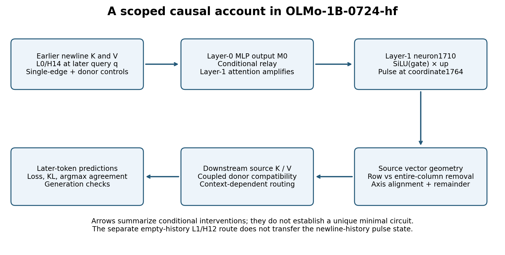
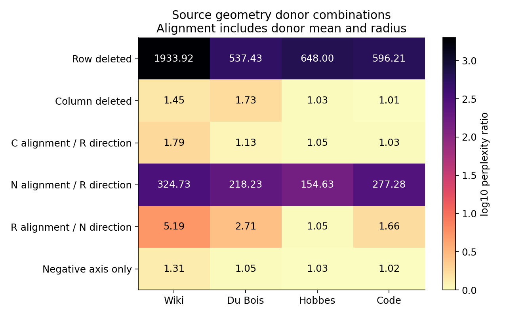

# What computation depends on an OLMo super-weight pulse?

Research snapshot, 21 October 2026. One pinned OLMo-1B-0724-hf checkpoint;
all layer/head numbers are zero-based. This is a causal case study with audited
measurements, not a claim that massive activations are now fully explained.

The pulse participates in a larger computation. Earlier attention and an MLP
determine where it appears; its output changes the geometry of a source token;
later attention uses that source through coupled key/value contributions and
context-dependent attention weights. A nearly constant source state can support
a dynamic computation. Replacing its magnitude alone does not establish that
the larger computation is constant or dispensable.

The most specific findings are a prior-newline suppression path through L0/H14,
its conditional relay through the layer-0 MLP, and strong differences between
deleting one output coordinate and deleting the whole neuron output. These
extend established super-weight and massive-activation observations in this
checkpoint. The [novelty comparison](NOVELTY.md) identifies substantial prior art.

## Model, interventions, and evidence standard

Checkpoint: `allenai/OLMo-1B-0724-hf`, revision
`d7cbab742d80589e714b1a2d7f838dcd21cbe143`. The primary target is
`layers[1].mlp.down_proj.weight[1764,1710]`, whose FP16 value is
0.63232421875. The scalar contribution is this weight times the computed
intermediate activation of neuron 1710. A **row deletion** removes this one
contribution at a specified token. A **column deletion** removes that neuron's
entire 2048-dimensional down-projection contribution at the same token.
Copied matrices implement both counterfactuals; checkpoint parameters are never
modified. Position-local deletion is distinct from permanently deleting a weight
at every position.

The work uses native FP16 SDPA execution, explicit causal masks where required,
matched token IDs and scoring spans, development-only head selection, separate
calibration, and held-out texts. Later mechanism tests reuse some panels and are
explicitly exploratory. Cross-corpus tests use Wikitext-2 validation, Du Bois,
Hobbes, and PyTorch optimizer source; earlier development uses separate Wiki
test/Hume windows. Corpus independence does not establish absence from model
pretraining. Gutenberg footer duplication in older evaluation windows was found
and tested by exclusion; the later four-window panels avoid those duplicates.

Reported perplexity ratios are `exp(mean_window(NLL_condition−NLL_native))`.
Argmax agreement and KL from native to intervention assess output fidelity.
Paired bootstrap intervals use 2000 draws, seed 20261021, and windows as sampling
units. They are conditional on fixed calibration and do not correct adaptive
selection or multiple comparisons. Most later panels have only four windows
per text. Exact closure checks validate implementation; expected architectural
closures are not scientific discoveries.

## 1. The source is stable; its downstream use is dynamic

Baseline replication recovered catastrophic primary-row deletion and the strong
rescue from a fixed source pulse. Source K/V means across layers 2–15 preserve
outputs closely on the tested panels; fresh text and calibration tests support
that limited approximation. Nevertheless, zeroing source values with fixed
source keys severely damages predictions. Removing the source from attention
can be much less harmful than supplying a zero value with its key still present.
Separate K/V patches, head controls, and source masks distinguish transmission
of the signal from later dependence on it.

At the first downstream layer, later queries are unchanged before the source
has broadcast; source K and V jointly matter for L2/H15. Later query effects
arise after transmission and must not be mistaken for the initial cause.
L12/H5 and L15/H11 tests, layer-set interventions, and value interactions show
distributed dependence rather than one sufficient downstream head.

Freezing all source-attention weights is a poor replacement: fresh Wiki tests
roughly double perplexity. Centered gate PCA performs better than matched random
subspaces, but even a 12-dimensional approximation is not output-equivalent.
Centered downstream perturbations require hundreds of directions for 90% of
variance in the examined layers. These results reject the tested simple
replacement families; they do not establish a universal minimum circuit rank.

An actual source-cache bypass was about 5% slower in the tested implementation.
Generation comparisons also expose accumulation of small errors: the best tested
hybrid matched 13 of 16 complete 64-token greedy sequences, whereas a simpler
rank 2 replacement matched 8. Near-baseline teacher-forced loss is not a speedup
or a guarantee of identical generation.

## 2. A preceding newline suppresses a later pulse

Constructed inputs hold the suffix and reset procedure fixed, use source token
`The` (ID510), and place token187 (single newline) at q=128. Changing only p=64
from space209 to newline187 suppresses q's large pulse. Double-newline535 and
the other tested p identities do not have the same effect. The edits operate on
token IDs without retokenization; conclusions concern these tokenizer entries.

A screen on 16 development windows selected **L0/H14**. On 16 separate constructed
evaluation windows, removing only its q→p edge restores the pulse. H0 and sham
edge controls do not. H14's attention mass on p rises from about 0.001 without
the earlier newline to 0.94–0.96 with it.

Local head-context recomputation separates K, V, and Q. In the no-prior-newline
recipient, the earlier-newline donor's K and V **jointly** suppress the later
pulse; K alone redirects attention without reproducing suppression, and V alone
also fails. In the reverse direction, either donor component can break
suppression. A double-newline query donor changes the response. These are
conditional interventions on specified donor worlds, not semantic labels for
keys or values. Oracle recomputations match native outputs exactly.

All 12 eligible unedited book/code windows reproduce induction by the H14 edge
intervention, with pulse contributions from −132.23 to −297.98. The Wiki windows
in this panel contain no eligible pair and are reported as ineligible. Inducing
a later pulse does **not** repair deletion of the earlier pulse: predictions
remain badly damaged. Large magnitude is insufficient evidence of compensation.

## 3. The earlier MLP carries much of the history effect

At q, decompose the residual entering the layer-1 MLP into the embedding plus
layer-0 attention output A0, layer-0 MLP output M0, and layer-1 attention output
A1. Binary clean/edge-world donor swaps freeze these three components
independently; reciprocal single-component swaps also leave downstream
computation endogenous.

Across 16 constructed and 12 natural cases:

| Intervention | Later pulse contribution |
|---|---:|
| Freeze only A0 to edge-world, M0/A1 clean | 0 to 0.00137 |
| Freeze only M0 to edge-world | −75.92 to −124.41 |
| Freeze only A1 to edge-world | 0.00078 to 0.04199 |
| Freeze M0 and A1 to edge-world | −131.60 to −311.10 |
| Swap M0 into clean, leaving A1 endogenous | −131.92 to −308.26 |
| Restore clean M0 into edge-world | 0 to 0.00220 |

Thus M0 is a key conditional carrier and endogenous A1 amplifies the response.
This is not an additive mediation percentage or proof of a unique minimal path.
The separate empty-history experiment implicated L1/H12, but reciprocal H12
context swaps did not transfer this newline-history pulse state. Those two
phenomena should not be conflated.

## 4. Deleting more of the neuron can damage less

The following source 0-only comparison uses the same16 natural512-token windows
and scores target positions2–511. Ratios are relative to each native input.

| Corpus | Delete primary row | Delete entire neuron column |
|---|---:|---:|
| Wiki validation | 1933.922 | 1.445 |
| Du Bois | 537.426 | 1.731 |
| Hobbes | 647.997 | 1.033 |
| Optimizer code | 596.206 | 1.011 |

The largest weight coordinate accounts for 97.91% of the column's squared norm.
Leaving its small complement present while removing the dominant contribution
creates a very different normalized source state from removing the whole column.
The intermediate activation is unchanged by both interventions.

This is **not** universal harmlessness of column deletion. On unedited
first-newline cases, two Du Bois source 0 windows have column-deletion ratios
11.37 and 13.06; one code window with source position1 has ratio 4.22. An induced
later column deletion can also be very harmful. The raw per-window tables retain
these counterexamples.

In the controlled prior-newline panel, swapping the column-deleted world's
source K into the row-deleted world gives ratios 1.0045–1.0139. Swapping its V
instead produces ratios 599.69–3308.76. Full K/V donor replacement has expected
closure. Blocking the damaged source across layers 2–15 greatly reduces its
additional harm, with 94.5–97.8% agreement rather than exact native recovery.
The harmful behavior therefore depends on coupled source representations and
attention use; separate K/V effects cannot be summed as independent damage.

## 5. Geometry interventions distinguish alignment from the remainder

At each downstream source attention normalization, decompose the centered vector
into a signed component along the centered coordinate 1764 axis and a unit
orthogonal direction. Donor swaps independently choose the **mean/radius/axis
alignment bundle** and the orthogonal direction from clean C, row-deleted R,
or column-deleted N states. All layers 2–15 are clamped in a row-deleted recipient.
This is a conditional all-layer source intervention, not a fitted deployment
replacement. Three seeded random directions are matched controls.

| Source0 condition | Wiki | Du Bois | Hobbes | Code |
|---|---:|---:|---:|---:|
| C alignment bundle + R direction | 1.791 | 1.128 | 1.051 | 1.031 |
| N alignment bundle + R direction | 324.729 | 218.234 | 154.628 | 277.280 |
| R alignment bundle + N direction | 5.189 | 2.711 | 1.053 | 1.660 |
| Negative coordinate axis alone | 1.307 | 1.052 | 1.026 | 1.016 |

Clean alignment strongly protects against a harmful remaining direction, while
the column world's orthogonal direction removes much of the damage even with
row-world alignment. Both components matter in these combinations. Fixed-axis
agreement is only 73.78%,89.36%,92.94%,95.78% respectively. Random controls also
show that the native orthogonal direction is not always required for approximate
loss preservation; neither observation establishes faithful replacement.

All 84 full-donor and 84 same-donor reconstruction output checks are exact in the
tested FP16 execution, with 1,176 exact vector reconstructions. Natural-newline
geometry scores after p, whereas the earlier natural pulse panel scores after
q; their aggregate ratios must not be compared as if target spans were identical.

## Correction: the paper's second coordinate

Independent review found that the original experiment's command-line arguments
overrode the second coordinate to L2/8041. The paper actually lists **L1/8041**.
Historical L2 measurements remain valid for their recorded coordinate, but their
attribution to the paper's second super weight was wrong. See the prominent
[coordinate erratum](COORDINATE_ERRATUM.md); historical archives are not rewritten.

A new 144-forward same-layer factorial tests the correctly cited pair. In these
16 source 0 contexts, L1/8041's potential contribution is only−8.58e−5 to+5.07e−5;
its row deletion reproduces native losses/predictions exactly, and whole-column
deletion changes aggregate ratios by at most 0.000154. It does not explain the
large primary row/column difference here. This does not establish its
dispensability at other positions, inputs, precisions, or checkpoints.

## What is established here, and what remains open

The evidence supports a scoped causal chain: prior-token K/V changes a named
early attention route; the layer-0 MLP conditionally carries the effect into
pulse production; the primary neuron changes downstream source geometry; and
later attention depends on the resulting K/V states and dynamic routing.
It does not identify every necessary neuron, prove a unique mechanism, or show
that one low-rank mathematical replacement preserves the full system.

Failed hypotheses are part of the result: constant gates, zero source values,
some fixed low-rank replacements, later-pulse compensation, a common H12 relay
for both histories, and universal harmlessness of column deletion all fail their
respective tests. The incorrect second-weight attribution is separately
documented, corrected, and retested.

The highest-value next step is **transfer with causal controls**, starting from
locally available checkpoints with different normalization and attention
architectures. The test must separate a similar activation magnitude from the
same prior-history, K/V, and row/column causal signature. It must select any
candidate heads on development inputs and evaluate frozen choices on fresh
inputs. The repository's transfer section will record negative results as well.

Independent reviewers performed bounded CPU-only audits of stored numerical
results and code; the latest three audits stayed below 600MiB. They did not
independently load and replicate the model.
The portable core rerun is a same-machine reproduction, which is distinct from
an independent researcher or hardware replication. See
[reproduction and audit instructions](REPRODUCING.md) and the machine-readable
validation records for the current status.
