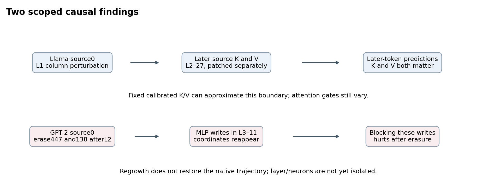
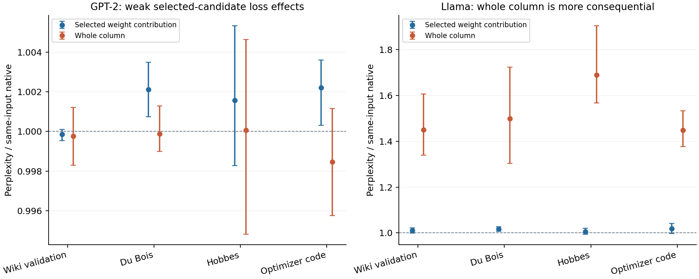
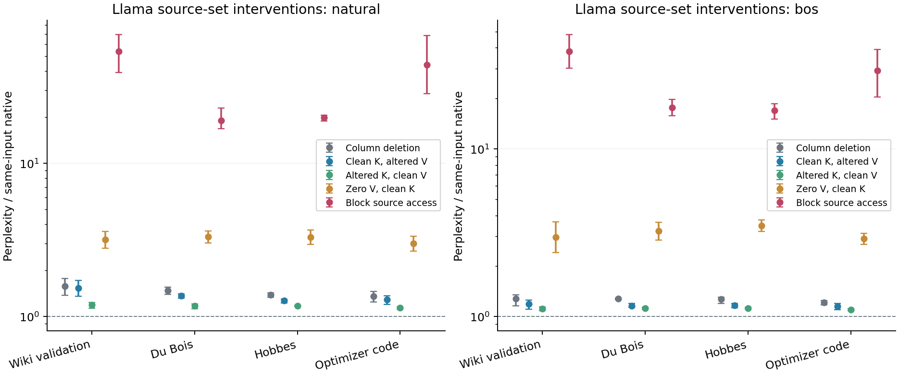
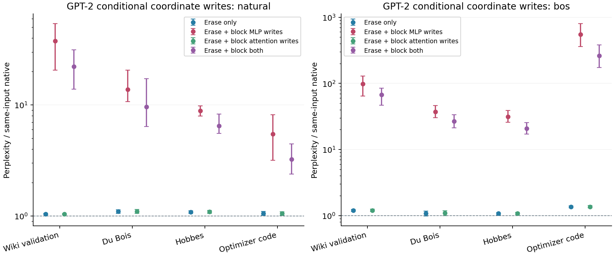
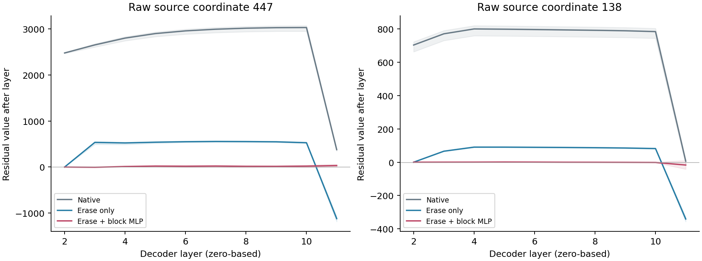

# Does the super-weight mechanism transfer?

Report 8 · 21 October 2026 · empirical continuation of the OLMo case study

The strongest transfer result is a difference in causal structure. In Llama-3.2-3B-Instruct, removing the full selected neuron-output column is consistently more damaging than removing its largest individual output contribution. Its downstream source values have a substantial role. In GPT-2, the largest development-selected contribution has little effect on held-out loss when removed. Erasing two large source coordinates reveals a different conditional dependence: later MLP writes regrow those coordinates, and blocking these writes after erasure sharply increases loss. Their raw trajectory is not restored to native values.

These are scoped intervention findings for three pinned checkpoints, including the earlier OLMo study. Similar activation magnitudes do not establish a shared causal mechanism. The original OLMo row-versus-column and newline-history signatures do not simply recur in the two transfer candidates.

## What was tested

All indices are zero-based. “Source” means position 0 in a freshly reset, teacher-forced sequence. No hidden cache history, chat template, padding or prefix insertion was used. Each baseline uses exactly the same input IDs as its intervention; only the designated first-token replacement differs between start conditions. Scoring excludes the source's immediate next-token prediction and uses targets 2..511 for the main tables.

Eight development passages from Wiki test and Hume selected one candidate per model, without evaluation loss information. The score is mean absolute source intermediate activation multiplied by the largest absolute weight in its output column. This selects a large typical contribution, not necessarily the model's most causally important weight. Same-layer random controls were frozen separately; they are not magnitude-matched.

| Checkpoint | Revision | Arithmetic | Selected layer / output / intermediate | Selected coordinate's column-energy share |
|---|---|---|---|---:|
| GPT-2, openai-community/gpt2 | `75e09b43581151bd1d9ef6700faa605df408979f` | FP32, SDPA | 2 / 447 / 666 | 98.88% |
| meta-llama/Llama-3.2-3B-Instruct | `0cb88a4f764b7a12671c53f0838cd831a0843b95` | BF16, SDPA | 1 / 588 / 1419 | 30.17% |

Initial evaluation used four passages each from Wiki validation, Du Bois, Hobbes and PyTorch optimizer source code, at 256 and 512 tokens, with natural, single-token `The`, and BOS starts. GPT-2 uses its defined BOS/EOS identity. Follow-ups use new fixed character locations, natural/BOS starts and 512 tokens. Actual token-to-character spans were checked for overlap within each model's successive panels. Models tokenize the same source passages independently; cross-model inputs are not token-matched.

Uncertainty bars are paired-window percentile bootstrap intervals:2000 draws, seed 20261021, n=4 per corpus/start, conditional on fixed selection and calibration. They do not address selection uncertainty, pretraining overlap or multiple comparisons. Perplexity ratios are exp(mean paired NLL difference), with each input compared to its own native baseline. A ratio near1 does not imply identical outputs.

## 1. The initial signature does not transfer uniformly

Natural-start512-token results; brackets are conditional95% bootstrap intervals. The two panels have different vertical scales.

### GPT-2

| Condition | Wiki validation | Du Bois | Hobbes | Optimizer code |
|---|---:|---:|---:|---:|
| Selected output contribution removed | 0.999856 [0.9995, 1.0001] | 1.00211 [1.0007, 1.0035] | 1.00157 [0.9983, 1.0053] | 1.0022 [1.0003, 1.0036] |
| Whole selected column removed | 0.999753 [0.9983, 1.0012] | 0.999876 [0.9990, 1.0013] | 1.00006 [0.9948, 1.0046] | 0.998456 [0.9958, 1.0012] |

The selected weight is large (15.0681), and its source contribution is about 946 on development inputs. Yet its loss effects are small. The three strongest development-selected columns feeding output 447 were then tested in a complete deletion factorial on fresh passages. Joint removal substantially reduced the source MLP output 447, from roughly 2331–2339 to 290–291, while natural-start PPL ratios stayed 0.9980–1.0037 for row-only removal and 0.9922–0.9988 for full-column removal. Removing the entire MLP output 447 was also weak. This does not support the simple explanation that those three columns hide a major loss effect through within-layer redundancy.

### Llama

| Condition | Wiki validation | Du Bois | Hobbes | Optimizer code |
|---|---:|---:|---:|---:|
| Selected output contribution removed | 1.0106 [0.9991, 1.0223] | 1.0165 [1.0074, 1.0261] | 1.00549 [0.9948, 1.0195] | 1.01887 [0.9972, 1.0410] |
| Whole selected column removed | 1.44977 [1.3397, 1.6071] | 1.49863 [1.3035, 1.7230] | 1.68936 [1.5676, 1.9042] | 1.44917 [1.3768, 1.5324] |

The full-column lesion has greater NLL than the single-output lesion in all 96 individual window/length/start comparisons, with positive lower confidence bounds in all 24 groups. Row deletion still changes predictions: natural-start argmax agreement is about 90–94%, despite modest loss changes. The largest coordinate carries only 30.17% of this column's squared weight norm, so the unremoved complement is substantial. Energy accounting alone is not its causal explanation.

Both models failed the predeclared newline-history screen at the frozen candidate. Earlier identical newline history did not produce the required tenfold later-pulse suppression with a sufficiently large initial pulse. This constrains these candidates and this reset-window protocol; it does not show that either model lacks other newline-dependent circuits.

## 2. Llama needs source values as well as source access

On fresh passages, C is clean; R deletes the selected contribution to output 588; N deletes its whole column at position 0. At every later layer 2..27, source 0 K and V projections were independently replaced with donors from C, R or N. All eight shared K/V heads were patched together, preserving native24-query-head grouped attention. Donors are pre-RoPE projection outputs.

Both natural and BOS starts are shown. Natural-start numerical values:

| Condition | Wiki validation | Du Bois | Hobbes | Optimizer code |
|---|---:|---:|---:|---:|
| R: row deletion | 1.01439 | 1.00954 | 1.02649 | 1.01003 |
| N: column deletion | 1.57939 | 1.48174 | 1.38192 | 1.35247 |
| N with clean keys, N values | 1.53082 | 1.36554 | 1.26904 | 1.29054 |
| N with N keys, clean values | 1.18889 | 1.17449 | 1.17205 | 1.13794 |
| Clean keys, zero source values | 3.17523 | 3.32352 | 3.29009 | 3.00072 |
| Block later queries from source | 53.776 | 19.0388 | 19.9201 | 44.1 |

Restoring clean values helps more than restoring clean keys in these comparisons, but neither mixed state restores native outputs. Zeroing values while clamping clean keys gives about 3.0–3.3× PPL; removing access to source 0 gives 19–54×. Thus source access has a role beyond simply adding its value, and the values themselves also matter. Neither effect can be read as an additive mediation percentage.

This reverses the qualitative zero-value-versus-access-block pattern of the earlier OLMo panel. Size, training, instruction tuning, precision and input distribution differ alongside architecture; no experiment here isolates which difference causes the reversal. The comparison is evidence against assuming one interchangeable source mechanism across these models.

All192 full-donor diagonal closures,64 source-blocking closures and 64 first-downstream-layer query-equality checks passed. Explicit causal-mask reference forwards matched scored per-token losses and argmax IDs exactly in 96 cases. With the same complete K/V donors, the R and N recipients also agree on scored outputs. These expected architectural closures validate intervention boundaries; they are not discoveries by themselves. Later query equality before first transmission separates the initial source route from later dependence.

## 3. GPT-2 regrows erased coordinates through conditional MLP writes

The follow-up froze coordinates447 and 138 from development evidence. E sets both source residual coordinates to zero immediately after layer 2. A prevents later attention outputs from writing those coordinates at source 0 in layers 3..11. M similarly prevents later MLP outputs from writing them. All eight E/A/M combinations were run on a third fresh passage panel, with random-coordinate and norm-rescaling controls.

Natural-start results:

| Condition | Wiki validation | Du Bois | Hobbes | Optimizer code |
|---|---:|---:|---:|---:|
| Erase E only | 1.04537 | 1.0994 | 1.08713 | 1.05667 |
| E + block MLP writes | 37.687 | 13.763 | 8.87638 | 5.46431 |
| E + block attention writes | 1.04391 | 1.10214 | 1.09069 | 1.05438 |
| E + block both writes | 22.2404 | 9.61981 | 6.48767 | 3.24809 |
| Block MLP writes without E | 1.00215 | 1.00165 | 1.00114 | 1.00369 |
| Random-coordinate E + both blocks | 1.00002 | 0.999972 | 1.00006 | 1.00002 |

Erasure alone has modest loss effects. Blocking MLP writes after erasure raises natural-start PPL5.46–37.69×, whereas blocking those same writes without erasure gives 1.0011–1.0037×. The paired E×M interaction is positive in all 32 inputs and all eight group confidence intervals have positive lower bounds. This supports conditional dependence on the MLP writes after erasure, rather than their necessity in the clean model.

BOS is much more sensitive: E plus MLP-write blocking gives 31.29–549.39× PPL, and E plus both blocks gives 20.77–262.94×. Blocking attention in addition to MLP writes improves loss in every input relative to MLP-only blocking after E (−0.805 to−0.086 nats). These lesions are therefore strongly nonadditive.

Lines show means across 16 natural-start inputs; shading shows their observed range, not a confidence interval. Both erased coordinates reappear after layer 3 in all 32 inputs. Natural-start mean values after layer 3 are about [535,66] after E, versus native [2653,771]. The measured MLP write contributes about [540,66]; attention contributes about [−5.47,0.23]. However, by layer 11 the mean erased-run coordinates are approximately[−1121,−341], versus native [378,6]. **Regrowth is not restoration of the native raw trajectory.**

The loss intervention blocks writes across nine later layers, so its effect is not uniquely attributable to layer 3. Full-vector residual reconstructions passed 3,240 exact additions;640 target-coordinate zero closures passed. A frozen random pair gives nearly native loss, but this is not a magnitude-matched or exhaustive coordinate control.

Rescaling the remainder immediately after E to the original source norm worsens natural-start PPL3.85–6.89×, despite similar early coordinate regrowth. This is evidence that those two early values alone do not establish fidelity. A specific relative-geometry explanation remains a hypothesis; this rescaling changes every remaining source component and its later trajectory.

## 4. Fresh calibration of simpler Llama replacements

Eight new natural-start calibration passages fit signed activation and per-layer source K/V means, in FP32 then cast to BF16. All eight calibration first tokens are distinct. Third-panel evaluation uses new passages and both natural/BOS starts; its source identities are explicitly checked against calibration. C/R/N have the definitions above; D removes the selected column's contributions to every output except588. These are native copied-matrix counterfactuals.

| Condition | Wiki validation | Du Bois | Hobbes | Optimizer code |
|---|---:|---:|---:|---:|
| R: selected row removed | 1.0021 [0.9963, 1.0094] | 1.02242 [1.0100, 1.0389] | 1.00626 [0.9871, 1.0258] | 1.01575 [0.9977, 1.0378] |
| D: complement removed | 1.85106 [1.6217, 2.0508] | 1.68493 [1.6078, 1.8185] | 2.05036 [1.9221, 2.1782] | 1.91555 [1.5615, 2.4641] |
| N: full column removed | 1.44966 [1.3750, 1.5284] | 1.41771 [1.3018, 1.5749] | 1.50357 [1.3913, 1.6390] | 1.40848 [1.2648, 1.5684] |
| Pooled fixed keys | 0.99866 [0.9969, 1.0004] | 1.0006 [0.9994, 1.0017] | 0.998298 [0.9957, 1.0002] | 1.00026 [0.9987, 1.0018] |
| Pooled fixed values | 0.998717 [0.9981, 0.9993] | 1.00186 [0.9996, 1.0037] | 0.99927 [0.9985, 1.0000] | 1.00022 [0.9989, 1.0017] |
| Pooled fixed keys and values | 0.998875 [0.9978, 1.0000] | 1.00147 [0.9992, 1.0036] | 0.998479 [0.9966, 0.9999] | 0.99942 [0.9977, 1.0009] |
| Mean activation, selected row | 0.998195 [0.9968, 1.0008] | 1.0035 [1.0001, 1.0100] | 0.997795 [0.9959, 0.9996] | 1.0027 [0.9991, 1.0072] |
| Mean activation, full column | 0.998018 [0.9969, 0.9986] | 1.00178 [1.0006, 1.0029] | 0.997793 [0.9950, 0.9999] | 1.00008 [0.9976, 1.0026] |
| Signed-permutation K/V control | 7.4191 [6.1985, 8.8800] | 5.49133 [4.5689, 6.7758] | 7.40424 [6.4326, 9.1413] | 9.49048 [6.0632, 14.8551] |

The complement-only lesion is worse than the full-column lesion in all 32 inputs. Its natural-start PPL is 1.685–2.050, versus 1.408–1.504 for full-column deletion; BOS gives 1.748–2.220 versus 1.206–1.360. The prespecified interaction NLL(N)−NLL(R)−NLL(D)+NLL(C) is negative in all eight corpus/start confidence intervals. Removing the selected scalar reduces loss when the rest of the column is already missing, unlike its small average effect in the clean recipient. This is not an additive partition of column importance or proof that squared weight energy determines causality.

Pooled fixed K/V gives natural-start PPL0.998479–1.001467, argmax agreement97.941–98.676%, and mean KL0.001013–0.001484 nats. BOS gives PPL1.001892–1.008919, agreement96.814–98.137%, KL0.002286–0.002802. Only2/16 natural evaluation starts appeared in calibration (15 distinct natural starts); BOS was unseen. Thus the approximate replacement extends beyond memorized calibration identities within this panel. Wiki-only and Hume-only means also remain close in loss, without selecting whichever performs better.

The matched-norm signed-permutation K/V control fails: natural-start PPL5.49–9.49 and BOS5.40–8.88. Preserving the per-vector absolute-value multiset is therefore insufficient in this control. It is one fixed randomized control, not a distribution over all matched directions.

Replacing the chosen intermediate by its freshly calibrated signed mean−426 in BF16, then recomputing its whole source output contribution, also gives near-native loss: natural PPL0.99779–1.00178 and BOS0.99471–0.99859. Argmax agreement remains below100% (natural98.68–98.87%; BOS97.55–99.12%). This is a calibrated activation replacement, not another numerical weight sweep. Generic source-contribution fields in the raw window table retain the native potential activation; the applied mean is separately recorded in pulse_checks and calibration_summary.

All72 oracle/recipient closures,320 projection-patch records and 64 pulse-locality checks passed independent audit. Calibration means and all 52 randomized vectors were recomputed independently; D preserves output 588 exactly and its other source coordinates match N exactly. The intervention leaves later query-dependent attention weights endogenous. It does not replace attention by a constant operation, prove faithful free generation, or establish a speedup. The hooks still compute the native modules before replacing their outputs.

## Findings, failed hypotheses and next discriminating tests

**Supported within the tested interventions:** Llama's whole-column lesion is more consequential than the selected scalar contribution; its key and value components have distinct conditional roles. GPT-2 has strong conditional dependence on later MLP coordinate writes after a two-coordinate lesion. Complete source K/V replacement and source blocking close exactly at the expected causal boundary.

**Failed or unsupported:** a universal “row deletion worse than column deletion” rule; transfer of the particular newline-history signature to the frozen candidates; hidden major GPT-2 loss sensitivity explained merely by its three strongest same-output columns; restoration of GPT-2's native coordinate trajectory after erasure; an additive interpretation of attention/MLP lesions.

**Still open:** whether a fixed Llama source replacement remains useful during free generation, how much dynamic source gating must be retained, which individual GPT-2 layers/neurons generate conditional regrowth, and how much the two-coordinate lesion shifts normalized geometry rather than a specific semantic feature. These are distinct questions. Source0 means require first-token identity accounting, because source 0 has no preceding context in this protocol.

## Relation to established work and novelty limits

[Super Weight in Large Language Models](https://arxiv.org/html/2411.07191v2) established extreme sensitivity to a small set of weights and their relationship with large activations. This investigation begins from that phenomenon and does not claim its discovery.

[Massive Activations in Large Language Models](https://arxiv.org/html/2402.17762v2) already studied GPT-2, identified a starting-token-only category, analyzed attention bias effects, and trained variants with explicit K/V bias. Large GPT-2 source coordinates, approximate constant-source interpretations, and explicit K/V alternatives are therefore prior art. Our particular candidate screen, paired native column/scalar lesions and fresh source-set K/V factorial are the case-study measurements.

[The Hydra Effect](https://arxiv.org/abs/2307.15771) and [Explorations of Self-Repair in Language Models](https://arxiv.org/html/2402.15390v1) established compensatory behavior after ablation; the latter includes GPT-2, normalization effects and sparse MLP contributions. The present raw-coordinate reappearance is an operationally narrower observation than restoration of logit direct effects. The E/A/M factorial tests a specific conditional source-coordinate dependence. It does not discover self-repair in general or establish one universal repair mechanism.

**Exact-coordinate precedents are closer still.** [Weight-Dictionary Decomposition](https://github.com/sunmoonron/weight-dictionary-decomposition) studies GPT-2 channel447 at the same block2→3 boundary. Its pinned primary code [perturbs that boundary](https://github.com/sunmoonron/weight-dictionary-decomposition/blob/33504a4d90840bc01d0ef75609265e48a34403bb/scripts/exp_s8_loop.py), [traces attention/MLP compensation](https://github.com/sunmoonron/weight-dictionary-decomposition/blob/33504a4d90840bc01d0ef75609265e48a34403bb/scripts/exp_t2_compensation.py), [crosses scaling with regulator ablation](https://github.com/sunmoonron/weight-dictionary-decomposition/blob/33504a4d90840bc01d0ef75609265e48a34403bb/scripts/exp_u1_reserves.py), and [separates a neuron's channel contribution from its complementary outputs](https://github.com/sunmoonron/weight-dictionary-decomposition/blob/33504a4d90840bc01d0ef75609265e48a34403bb/scripts/exp_u2_leash.py). The complete OpenReview PDF was access-blocked; these intervention definitions were verified in the author's code at commit33504a4d90840bc01d0ef75609265e48a34403bb, without executing it. We did not independently reproduce its results.

[The Communication Map of a Transformer](https://arxiv.org/pdf/2608.22007) already uses the exact447/138 pair as a causal outlier baseline, with repeated layer-boundary direction deletion. [A Mechanistic Account of Attention Sinks in GPT-2](https://arxiv.org/html/2604.14722v1) names138/378/447 and tests a positional-MLP/key/query-bias route. Our current raw-coordinate loss measurements do not test that complete route or establish that attention-sink changes mediate the loss.

Accordingly, the GPT-2 work is a **targeted replication/extension in intervention scope**, not discovery of these coordinates, coordinate regulation, the scalar/complement distinction, or self-repair. Our joint source 0-only erasure crossed with later output-write suppression, fresh paired loss panels and source-K/V comparisons define the measured case study. A different estimand does not establish priority or a unique native repair circuit.

[Transient Reserves, Sink Dampers](https://arxiv.org/html/2607.09279v1) already reports different sink and loss consequences of repeated massive-coordinate clamping across GPT-2, Pythia and Llama. [The Life Cycle of a Massive Activation](https://arxiv.org/html/2610.00423v2) tests collective magnitude and redundant carriers, including magnitude controls and training-time perturb-and-restore experiments. These precede broad nonuniversality, redundancy and magnitude-versus-identity interpretations. Our fixed-weight within-forward regrowth is a different setting; the random-coordinate control remains unmatched for magnitude.

The earlier repository literature comparison also covers [Spike, Sparse, and Sink](https://arxiv.org/html/2603.05498v1), [Refined is Better](https://arxiv.org/pdf/2503.22329v1), StreamingLLM, MAGC and selective-training studies. The remaining contribution is the scoped comparative dataset and its causal controls, without a priority claim. Both close precedents and failed transfers are part of the account.

## Reproduction, audit and resources

The local bundle preserves all scripts, frozen protocols, checkpoint and source hashes, calibration/selection tensors, private input IDs, per-token losses/KL/predictions, source vectors and oracle checks. Native projection outputs are recomputed using copied matrices; model parameters are never changed. GPT-2 uses its native Conv1D addmm with bias; Llama uses native F.linear. BF16 rounding means the copied-matrix counterfactual need not equal a separately subtracted real-arithmetic scalar product.

Independent CPU reviews checked candidate selection, hooks, token-span separation, raw metric aggregation, full-vector additions, donor closures and interpretation. Retained KL reductions can be reaggregated, but full vocabulary logits are not retained for an independent reconstruction of KL. Runtime locality assertions supplement saved source vectors; later-position vectors are not all saved. All completed runs have equal before/after model hashes and unchanged parameter version counters.

The portable six-batch workflow was also rerun on the original machine. All4,568 saved per-token loss, KL and argmax arrays matched exactly, including their input hashes and scoring spans. This is an executable local reproduction check, not replication by an independent researcher. It cost a separate4,592 forwards and 512.10 seconds of summed worker time; those validation costs are additional to the scientific batches below.

| Batch | Forwards | Evaluation records | Wall seconds | Peak GPU GiB | Peak host GiB |
|---|---:|---:|---:|---:|---:|
| gpt2_run | 984 | 976 | 29.81 | 0.715 | 1.650 |
| llama_run | 984 | 976 | 148.03 | 6.363 | 3.006 |
| gpt2_groups_run | 680 | 680 | 24.68 | 0.715 | 1.594 |
| llama_source_kv_run | 1056 | 1056 | 193.71 | 6.364 | 5.500 |
| gpt2_writes_run | 360 | 360 | 20.08 | 0.706 | 1.729 |
| llama_replacements_run | 528 | 520 | 102.53 | 6.363 | 5.249 |

Total so far: **4,592 forwards, 4,568 evaluation records, 518.85 seconds of recorded batch wall time**. Calibration/development forwards explain the record-count difference. Analysis, independent review, installation, model retrieval and report preparation are additional. One RTX 3060 Ti with 8 GiB was used sequentially; maximum measured allocated GPU memory was about 6.36 GiB, and the largest worker used about 5.5 GiB host RAM. CPU reviews stayed below1.1 GiB. A practical reproduction allowance is 8 GiB VRAM,16 GiB host RAM,25 GiB free disk including two checkpoints/environment/outputs, and 15–30minutes after dependencies and authorized inputs are ready; exact bitwise results may vary with hardware/kernels.

The repository export includes numerical results without input or prediction token IDs, model weights or corpus text. Private full bundles remain local. Restricted model inputs require the researcher's own lawful access. No new model download or paid compute was used. Qwen's available small checkpoint lacked its matching tokenizer, so no substitute tokenizer was used.

**Publication status:** the OLMo repository is preserved locally at commit `6c97a96dd3a318125ceb21e55e7c078f9222af6a`. Creation of `jaykobdetar/superweight-causal-circuits` as a private GitHub repository was denied by automatic approval review and did not execute. There is no verified remote repository or push. The denied action has not been retried, and credentials or security settings have not been changed. Transfer additions are being prepared locally; this report does not claim they are part of that earlier commit.
