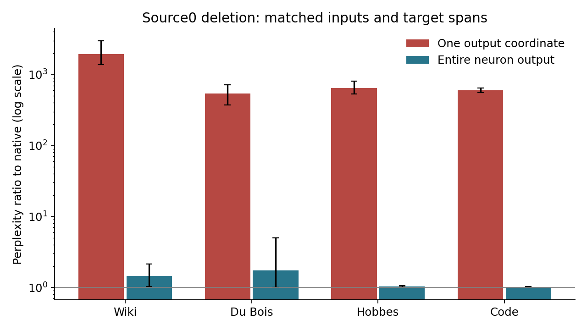

# OLMo-1B: the primary super-weight case study

[Overview](../../../README.md) · [Documentation index](../../README.md) ·
[Research log](../../../RESEARCH_LOG.md)

Start with the [full research report](../../REPORT.md). This is one pinned
`allenai/OLMo-1B-0724-hf` checkpoint at revision
`d7cbab742d80589e714b1a2d7f838dcd21cbe143`, FP16/native SDPA. The primary target is
`layers[1].mlp.down_proj.weight[1764,1710]`. All indices are zero-based.

## Findings and their evidence

| Supported result | Protocol and exported evidence |
| --- | --- |
| An earlier single newline suppresses a later pulse through development-selected L0/H14. Joint donor K/V transfers suppression; either alone fails in that direction. | [Head protocol](../../../experiments/pulse_continuation/NEWLINE_HEADS.md), [head-selection and pathway results](../../../results/pulse_continuation/newline_heads_run/), [natural-input protocol](../../../experiments/pulse_continuation/NEWLINE_NATURAL.md), [natural results](../../../results/pulse_continuation/newline_natural_run/). |
| The layer-0 MLP conditionally carries much of the history effect, with endogenous layer-1 attention amplifying it. | [Component protocol](../../../experiments/pulse_continuation/NEWLINE_COMPONENTS.md), [component and reciprocal-swap results](../../../results/pulse_continuation/newline_components_run/). |
| Removing the dominant scalar output contribution can be far worse than removing the neuron's full output at the same token. | [Column-factorial protocol](../../../experiments/pulse_continuation/COLUMN_FACTORIAL.md), [matched results](../../../results/pulse_continuation/column_factorial_run/). |
| Source K/V and normalized geometry help distinguish the damaged states; tested simple replacements retain errors. | [Geometry protocol](../../../experiments/pulse_continuation/SOURCE_GEOMETRY.md), [geometry results](../../../results/pulse_continuation/source_geometry_run/), [full report](../../REPORT.md). |

“Scalar” removes one neuron's contribution to one output coordinate; “whole
output” removes its entire down-projection contribution. Both are position-local
copied-matrix interventions, without modifying checkpoint parameters.

On the same 16 natural 512-token windows, source-0 interventions give these
perplexity ratios relative to each native input, scoring targets 2–511:

| Corpus | Scalar output removed | Whole neuron output removed |
| --- | ---: | ---: |
| Wiki validation | 1933.922 | 1.445 |
| Du Bois | 537.426 | 1.731 |
| Hobbes | 647.997 | 1.033 |
| Optimizer code | 596.206 | 1.011 |

## Interpretation and limits

The supported pathway connects earlier-token attention through H14, a conditional
MLP relay, pulse production and later source use. It does not identify every
necessary component or a unique minimal circuit. Natural testing has 12 eligible
book/code cases; the four Wiki cases in that panel are ineligible. Inducing a
later pulse does not compensate for deleting the earlier pulse. Natural tests
and later mechanism follow-ups reuse some panels and are exploratory.

Whole-output deletion is not harmless: unedited first-newline Du Bois cases
reach ratios 11.37 and 13.06. Conditional geometry clamps and K/V donor swaps are
not fitted deployment replacements or additive mediation fractions. Near-native
teacher-forced loss does not guarantee identical generation or a speedup.

Read the [coordinate erratum](../../COORDINATE_ERRATUM.md) before using older
two-unit claims: the historical second coordinate was L2/8041, while the cited
paper lists L1/8041. Old outputs remain labeled by their executed coordinates;
the corrected same-layer experiment is separate. The primary target and H14
result are unaffected. The [prior-work comparison](../../NOVELTY.md) describes
what this case study adds and what established work already showed.

## Reproduction and provenance

Use the [OLMo reproduction guide](../../REPRODUCING.md) and the root
[quick start](../../../README.md#quick-start). The CPU-only
[numerical auditor](../../../scripts/audit_results.py) checks exported loss/KL
arrays without a model. The nine-batch core model route covers the later
circuit/geometry tests, not every historical study. Earlier stages retain code,
hashes and results but require their documented dependency tensors.

The [checkpoint manifest](../../../manifests/checkpoint.json),
[input-source manifest](../../../manifests/input_sources.json),
[numeric audit record](../../../manifests/numeric_audit.json) and
[same-machine core validation](../../../manifests/core_validation.json)
record distinct evidence scopes. Public exports omit input/prediction token IDs
and private activations. Neither a numerical PASS nor original-machine replay
is an independent researcher replication.
