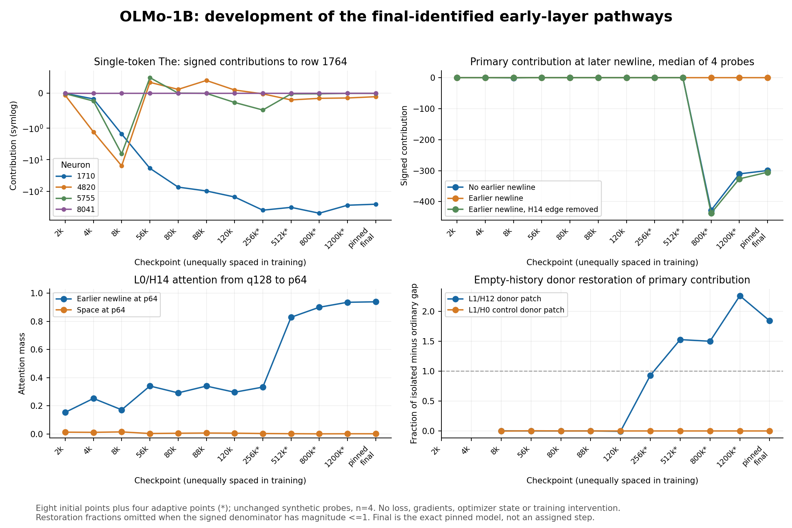

# OLMo-1B: production, native use, and training development

This update keeps three questions separate: **what produces the pulse, what normal predictions use it for, and why training built it.** Evidence for one is not automatically evidence for another. The original OLMo findings, GPT-2 and Llama reports remain at their established paths. This update adds OLMo-specific evidence, not a universal cross-model account.

## What has changed

### The large weight and the mature mechanism emerge on different schedules

A bounded survey follows the primary coefficient across 38 training checkpoints plus the pinned release. It starts at ordinary size (about 0.003565; row rank 4,245 of 8,192), reaches the row's top five by step 5,000, becomes the largest around steps 80,000–88,000, and peaks among sampled points at about 1.4184 at step 120,000. The released value is about 0.6323. Growth is not monotonic.

Eight initial functional checkpoints and four adaptively selected later checkpoints show that a dominant coefficient is not sufficient for the mature tested pathway. The final-model H12 empty-history response appears between the sampled 120k and 256k checkpoints. The tested H14 newline-history role is absent at 512k and present at 800k, even though H14 already strongly attends to the earlier newline at 512k. Token identity also matters: "The" and punctuation acquire their responses at different sampled times.

These are developmental brackets on a fixed panel, not exact birth dates or evidence that no other head implemented an analogous earlier computation. Cross-time upstream/readout swaps reveal compatibility and co-development, not causal training histories.

[Complete developmental report](../../research/olmo/training_development/combined/deliverables/training_development_report.md) · [Initial coefficient survey](../../research/olmo/training_development/initial_trajectory_report/training_origins_report.md) · [Reproduction](../../research/olmo/training_development/combined/REPRODUCE.md)

The plot records the selected probes and sampled checkpoints; connecting points
does not establish continuous onset timing.

### Other neurons, not just the inherited residual, support the surviving source direction

The full layer-1 MLP analysis separates the incoming residual, neuron 1710's output, and the other neurons' output. In the tested source states, other layer-1 neurons account for most of the surviving axial write after the primary neuron's full output is removed. Neuron 7579 is a large alternate writer in the tested initial-token states, but later newline states recruit different contributors. Source-token 187 has opposing positive and negative contributions that nearly cancel.

This clarifies why deleting one scalar and deleting a whole output are different interventions: scalar deletion leaves a large off-axis contribution intact. It does not establish that one alternate neuron is a universal backup, that an alignment improvement repairs behavior, or that the selected writer set is minimal.

[Signal-production report](../../research/olmo/signal_production/REPORT.txt) · [Compact audit and replay](../../research/olmo/signal_production/REPRODUCE.txt)

### A more specific early carrier and a partial behavioral rescue

The completed continuation tests an L0 group, neurons 1091/3419/6535/4798,
with reciprocal activation donors in four discovery and four frozen controlled
context holdouts. The group transfers or suppresses the large L1 pulse in those
conditions. Neuron 1091 is a strong contributor, not a uniquely necessary neuron
in every case. These are edited controlled contexts, not eight unmodified
natural passages, and pulse transfer alone is not a loss-based mediation claim.

A separate source-local full-model factorial tests two archived natural
newline-start prefixes and matched first-token edits. After removing neuron
1710's whole output, also removing positive writers 2476/2637/7845 partly
repairs loss. Crucially, removing only their axial opposition does not reproduce
the repair. The axial and complementary vector components interact.

| Matched 254-target mean NLL | Du Bois | Optimizer code |
| --- | ---: | ---: |
| Native | 3.293963 | 1.739449 |
| Remove neuron 1710 output | 5.069185 | 3.163742 |
| Also remove entire positive trio | 4.078297 | 1.980111 |
| Also remove only trio's axial component | 5.250598 | 3.057247 |
| Also remove only trio's complementary component | 5.120599 | 2.959813 |

The repair remains incomplete and the panel is small and selected. This is
stronger than a geometry-only observation, but not proof that a more negative
coordinate is the useful computation. The separate integration audit reproduces
all 28 saved downstream outputs' loss summaries and factorials without running
a model; it does not independently validate the new head14-only routing analysis.

[Continuation report](../../research/olmo/signal_continuation/continuation/REPORT_CONTINUATION.txt)
· [Reproduction and export mapping](../../research/olmo/signal_continuation/REPRODUCE.txt)
· [Independent summary check](../../reviews/2026-10-23-integration/independent_downstream_reduction.json)

### Native usefulness is not the same as repairing a catastrophic lesion

A separate reanalysis of exact published outputs finds meaningful native source-0 dependence. On the matched first-four-window panel, removing access to the intact source gives perplexity ratios of 3.227 for Wiki, 1.223 for Du Bois, 1.048 for Hobbes and 1.045 for code. This is much less damaging than deleting the selected scalar contribution. Near-constant source K/V replacements preserve most teacher-forced predictions on these panels, but are not exact generation replacements.

In the sampled book/code passages, source-0 removal becomes much less costly after a later single-newline token is available. The matched first-token comparisons support this descriptive pattern. They motivate, but do not by themselves establish, mediation by the later source. The fresh two-source causal factorial and content-donor interventions are outside this publication cutoff unless explicitly listed as completed in the package manifest.

A source at position zero cannot encode future suffix content. A stable source can nevertheless have query-dependent effects through both its values and its influence on attention normalization. A useful reference state is therefore plausible; a precise linguistic purpose remains unidentified.

[Native-function report](../../research/olmo/native_function/computational_role_report.md) · [Reproduction and data scope](../../research/olmo/native_function/README_REPRODUCTION.txt)

### Actual Adam state rejects a simple explanation at one checkpoint

The official native step-954000 checkpoint supplies actual first and second moments for all 8,192 entries of output row 1764, plus the recorded optimizer settings. The primary entry has the **largest absolute first moment and largest second moment in that row**. Its inverse-denominator gain is consequently the smallest. A tiny-denominator explanation relative to the other neurons in this output row is contradicted at this snapshot. This does not exclude a denominator advantage relative to other residual axes within neuron 1710; that is a different comparison.

The saved epsilon matters differently: it attenuates small-moment comparison entries more strongly. Holding the recorded moments fixed, the primary entry's absolute adaptive-update rank changes from 2,149 without epsilon to 101 with the actual epsilon. This is arithmetic on one saved state, not a changed-training experiment. The first moment is an accumulated estimate, not the current gradient. Row-local ranking is not whole-model ranking or a test across residual coordinates.

A separately frozen supplement compares the focal residual axis with 128 uniformly
preselected other axes **within neuron 1710**. Here the focal second moment is
lower than every sampled comparison, and its inverse-denominator gain is 2.08
times the sample median; its absolute adaptive push is 2.54 times the median.
Thus Adam dampens the neuron relative to other neurons in the row while favoring
this axis relative to sampled axes in the same neuron. Neither result reverses
the other. An approximately twofold gain advantage is not a denominator explosion.
The sample does not determine the full-column rank or establish when or why the
pattern formed. The protocol preserves the pre-acquisition seed and finite-
population uncertainty calculation.

[Axis-sample report and caveats](../../research/olmo/optimizer_axes/README.md)
· [Frozen protocol](../../research/olmo/optimizer_axes/protocol.json)
· [Results](../../research/olmo/optimizer_axes/results.json)

The recorded adaptive direction opposes weight decay. Conditional schedule calculations also reject passive decay as an account of the observed trajectory. They do not identify which training examples caused the signal or isolate Adam from truncated initialization, finite precision, weight decay and upstream learning. Exact early resume states and data order are still missing for that stronger question.

[Adam-state findings and exact caveats](../../research/olmo/optimizer_state/README.md) · [Recorded summary](../../research/olmo/optimizer_state/results/optimizer_snapshot_summary.json)

## Corrections and evidence boundaries

- **Native access is no longer a general blocker.** An earlier metadata addendum recorded a route-specific model-shard HTTP 403. A subsequently obtained native model row matches its HF counterpart byte for byte, and bounded official optimizer reads succeeded. The old failed receipt remains historical evidence, not a current claim that all native artifacts are inaccessible.
- **Identity is row-level.** Equality of one complete 8,192-value row does not verify the entire checkpoint or exact training-resume state.
- **Checkpoint label and optimizer counter differ.** The label is 954000 and saved counter 954001. Neither is silently substituted for the other.
- **8041's small bound is local.** The bound concerns one raw output-coordinate contribution at one checkpoint, not its whole output vector or downstream importance. The existing [coordinate erratum](../COORDINATE_ERRATUM.md) remains in force.
- **Numerical audits have a narrower scope than model replication.** The independent repository review reproduced exported statistics and checked files, not model acquisition or end-to-end inference. The new CPU implementation has its own validation boundary; precision-dependent differences are not erased by a summary-level PASS.
- **Historical reports are frozen.** Statements such as "no new model inference" or "extension paused" describe the stage at which they were written. The cutoff index identifies their subsequent completion or supersession without silently editing the original evidence.

## What is still open

The full semantic purpose, minimal sufficient circuit, causal training origin, broader-corpus validity, and usefulness of any simplified replacement remain open. The strongest next tests separate native necessity from lesion repair, validate alternative sources with construction-preserving interventions, and distinguish optimizer-specific effects from initialization and schedule effects using genuine controlled training evidence.

See the [claim-to-evidence map](CLAIM_EVIDENCE_MAP.md), [publication and audit scope](PUBLICATION_SCOPE.md), and [independent repository review](../../reviews/2026-10-22-independent/REPORT.md). Negative results and limitations are part of the research, not omitted exceptions.
