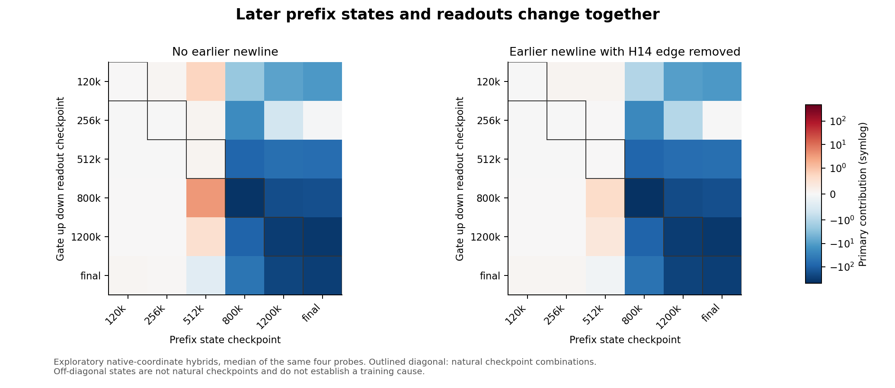
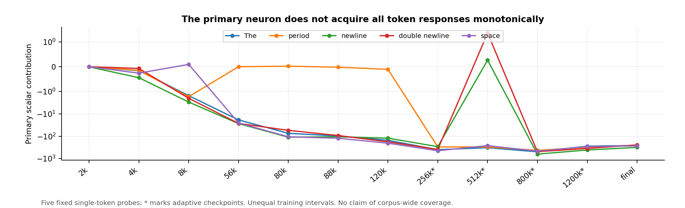

# OLMo 1B super weight development across training

Twelve checkpoint study | Eight initial points and four adaptive follow ups | 22 October 2026

## Main finding

The large coefficient, the empty-history response and the newline pathway develop at different times. The primary coefficient is already the largest in its output row at the sampled 88k checkpoint. The final-identified H12 empty-history intervention becomes effective between the sampled 120k and 256k points. The mature H14 newline effect is absent at 512k but present at 800k, 1.2M and the pinned release endpoint.

This is a measured developmental sequence, not an identified training cause. It contradicts the simple account that one scalar grows and the final mechanism immediately follows. Attention preference also precedes functional use: H14 already assigns 83% attention to the earlier newline at 512k, when the primary pulse is tiny. Intermediate token responses are non-monotonic and the upstream state and neuron readout both change.

The study uses official allenai/OLMo-1B-0724-hf tensors, CPU partial-prefix inference, four fixed prose probes and five fixed single tokens. It tracks layer-1 output coordinate 1764 and neurons 1710, 4820, 5755 and 8041. All indices are zero-based. Four later checkpoints were chosen adaptively after inspecting the initial eight; the prompts, interventions and implementation remained unchanged. Neither full-model loss nor training gradients were measured.

[PAGEBREAK]

## The measured timeline

[CHECKPOINT_TABLE]

All table contributions refer to neuron 1710 and output coordinate 1764. U is a newline at position 128 without an earlier newline. H12 is the donor-patch restoration fraction relative to the isolated-versus-ordinary empty-history gap. H14 attention is query-to-position-64 mass with an earlier newline. Values are medians over four probes; fractions with denominator magnitude at most 1 are omitted. An asterisk marks an adaptively selected checkpoint. The release endpoint is not assigned an exact training step.

1. Early activity is distributed across tracked neurons. At 8k, the single-token The contributions are -1.52 for 1710, -15.65 for 4820 and -6.51 for 5755. At 56k, The primarily uses 1710 among the tracked four (-18.67), while a period uses 4820 (-449.16) and 5755 (-112.48); 1710 contributes only +0.0010 to that period. This is token-dependent allocation, not a single universal early winner.
2. H12 is effective by 256k. It restores 84-107% of the isolated-source pulse across all four probes, with a 93% median. The H0 patch control is effectively zero. At 120k, the H12 median is -0.0064. The period source contribution also grows from -0.106 at 120k to -301 at 256k.
3. The H14 newline effect appears later. At 512k, U contributes only +0.084. At 800k it contributes -427.71; an earlier newline reduces this to +0.00036. Removing the H14 edge restores -437.27, while the H0 edge control leaves +0.00036. The corresponding effect remains strong at 1.2M and the pinned release.
4. These are brackets between sampled observations, not exact first-emergence times. The sparse trajectory cannot exclude transient earlier effects, equivalent mechanisms in other heads, or different behavior on untested prompts.

[PAGEBREAK]

## What changed between 512k and 800k

H14 attention to the earlier newline rises from 0.829 to 0.900, but its functional effect changes far more sharply. The median primary gate on U moves from -6.12 to +18.07, changing the SiLU response from strong attenuation to a large positive gate. Attention mass alone is not enough to explain the pulse.

An exploratory compatibility test crossed normalized pre-MLP1 states with selected gate, up and down readouts, using only the same four probes and existing tensors. At 512k, the natural U median is +0.084; at 800k it is -427.71. The 512k readout on the 800k state produces -80.63, whereas the 800k readout on the 512k state produces only +3.43. With the H14 edge removed, the corresponding hybrids are -79.87 and +0.63. Thus a substantial part of the transition is represented upstream of the final neuron readout, while the matched later readout further amplifies it. These native-coordinate hybrids do not distinguish functional coadaptation from representation-basis drift and are not training interventions.

The fixed single-token panel prevents a misleading monotonic story. The primary response to an isolated newline is -293 at 256k, +0.265 at 512k, then -632 at 800k, while The remains strongly negative. Its absence at 512k is not evidence that every other neuron or the whole model lost a newline response. Source-token recovery and contextual routing therefore need to be tested separately. The full cross-time matrices and all five source tokens are retained in the evidence bundle.

[PAGEBREAK]

## What this says about why these weights formed

The strongest supported account is multi-stage development involving changing representations, neuron readouts and routing. It is a description of what training produced, not yet an explanation of which optimization or data pressure produced it.

1. Coordinate-dependent optimization interacting with normalization is a strong causal candidate, but is not identified here. Non-affine LayerNorm admits function-preserving residual-basis changes, while ordinary coordinatewise Adam is not generally rotation-equivariant. Published optimizer interventions support this mechanism class in other models [4], not this exact OLMo run. Initialization and finite-precision effects can also break the symmetry.
2. Weight decay and competitive concentration remain plausible. Controlled studies elsewhere support growth and consolidation effects [5]. Here, coefficient magnitude is non-monotonic and does not determine functional maturity; token-specialized contributors also complicate a universal winner-takes-all account. No authentic dense-run optimizer moments or certified full schedule were obtained.
3. Attention-driven gradient pressure or shielding remains plausible but unmeasured. Attention preference preceding functional use is compatible with a learning lag, not proof that attention caused the outlier. The prefix stops before the full layer-1 MLP output, so it cannot test post-pulse normalization Jacobians or separate value-gradient from query/key-gradient pressure. Related backward-path interventions exist in other models [6].
4. Newline or document-boundary frequency is still a training hypothesis. A newline-responsive circuit does not establish that newline frequency caused it. Token identity, packing, resets, sequence length and data order must be separated experimentally.

## Three parameter symmetries sharpen the causal question

MLP neuron indices are interchangeable under joint permutations of gate/up rows and down columns. Index 1710 is therefore not intrinsically privileged.

For any orthogonal residual transform R that fixes the all-ones vector, non-affine LayerNorm satisfies LN(Rx) = R LN(x). Transform every embedding and residual-output projection by R, and residual-input projections and the unembedding by its inverse. Internal Q/K/V values, clipping, RoPE and attention probabilities remain unchanged. The real-arithmetic model function is preserved, yet a native coordinate spike can become distributed. Ordinary squared-weight decay is also invariant under these orthogonal changes; it cannot alone force native-axis concentration or uniquely privilege coordinate 1764. The previously completed prefix-only Householder check gave approximately 2.73e-6 scaled activation error; it was not a rotated full-model or training experiment.

Finally, scaling one up row by a nonzero factor and its entire down column by the reciprocal preserves that neuron's function with its gate fixed. Individual coefficient magnitude is therefore not function-identifying. Weight decay can break this scaling symmetry by preferring a different balance. A training explanation must address basis and scale selection as well as functional usefulness.

## The second paper listed scalar is amplitude bounded

For this architecture, normalized input h has sum(h)=0 and squared norm at most 2048. Center gate/up rows g and u; there are no gate, up or down biases. Since |SiLU(a)| <= |a|, the scalar contribution obeys

|w SiLU(g.h) (u.h)| <= |w| * 1024 * (||g|| ||u|| + |g.u|).

At the exact pinned endpoint, [1764,8041] is bounded by 0.1603298493 before floating-point roundoff. It cannot hide a primary-sized pulse on another prompt in that checkpoint. This does not bound downstream importance, establish a different revision's behavior, or show that the paper used the wrong coordinate. The primary's corresponding bound is 1262.37, consistent with its observed approximately 258 source contribution.

[PAGEBREAK]

## Discriminating causal tests

The next causal step should target the separated developmental stages rather than repeat endpoint lesions. The H12 transition is bracketed by 120k and 256k; the measured H14 transition is bracketed by 512k and 800k. Additional intermediate checkpoints could narrow those windows, but would still provide observational timing rather than a training cause.

1. Establish a trustworthy restart first. Obtain a native dense optimizer state, exact code/configuration, scheduler state, RNG and batch/data-order information. Verify an unmodified continuation against a subsequent official checkpoint before interpreting interventions. The published configuration mismatch remains unresolved for this exact dense run [3]. The similarly named 954k unsharded artifact is an upcycled mixture-of-experts model, not a verified dense restart. Public HF weight checkpoints alone are insufficient.
2. Test optimizer-basis selection. Apply a function-preserving, mean-preserving residual rotation at a matched fork. Compare original and rotated bases under Adam, with equal moment-reset controls, identical data and schedule, and a rotation-equivariant optimizer comparison. Check matching logits/loss before training. Track whether concentration reforms along the optimizer's native axes while function remains useful. Adam's diagonal second moments cannot simply be rotated as a full covariance matrix. A reset experiment tests a controlled mechanism, not literal historical causation in the original uninterrupted run.
3. Separate weight decay from learning rate. Change decay while fixing data, learning rate, clipping and initialization; use a separate learning-rate arm rather than changing both. Track contribution amplitudes, gate signs, row/column concentration, token specialization and held-out loss. Shrinking one coefficient or damaging the baseline is not evidence of a specific mechanism.
4. Isolate backward attention pressure. A backward-only value-gradient intervention can preserve the forward computation at the fork while changing the proposed pressure. Compare it with a no-op control and monitor both early head pathways and query/key-gradient alternatives. This requires training gradients and cannot be tested by this partial inference study.
5. Control boundary statistics. Change newline frequency or replace it with matched alternative separators while holding packing, sequence resets, length distribution and other token statistics as fixed as feasible. Distinguish lexical response from source-position response and contextual newline routing. A smaller OLMo-like training experiment would test the mechanism class, not certify the historical cause of this 1B run.

Training remains a separate resource decision. With 1.28B parameters and a candidate 2.1M-token batch, 1,000 steps cost approximately 1.6e19 FLOPs per arm under the 6*N*tokens estimate, before overhead. Dense FP32 parameters, gradients and Adam moments alone are about 20.5 GB before activations. Those figures are planning estimates, not a verified dense-run recipe or a compute quote. No training, GPU experiment, paid compute, user-PC access, public push or additional checkpoint-download expansion was performed.

[PAGEBREAK]

## Provenance and validation

The exact endpoint is allenai/OLMo-1B-0724-hf at d7cbab742d80589e714b1a2d7f838dcd21cbe143. The nearby step1454000 branch is numerically close but not identical, and was not substituted. The research repository was verified at 0bf1747a8d1b4e6a0adfa3aab72005f7b13df096; its scientific snapshot through Report 19 is e59cfed2df13a1d3a6e6c607648a9d6844790654. Official checkpoint availability does not itself supply a certified native optimizer-state lineage.

[REVISION_TABLE]

The forward computation is a NumPy port of the pinned Transformers 4.57.6 OLMo formulas. It includes selected embeddings, all of layer 0, layer-1 attention and four layer-1 MLP gate/up rows. It stops before the full layer-1 MLP output. PyTorch and Transformers were not installed or executed. Endpoint checks passed source-pulse references, causal/self-only invariants and qualitative H14/H12 controls. The FP16-style The pulse differs from the prior reference by 0.122%; the period reference matched exactly. This is useful validation, not full-framework or CUDA bit equivalence.

All 3,144 prefix slices were rehashed across the separately audited eight-point and four-point cohorts. Initial transfer was 2,715,887,454 bytes; the extension total was 1,356,912,941 bytes, including the interrupted portion and new metadata. Combined functional-study transfer was 4,072,800,395 bytes. Normal inference peaked at 405,811,200 bytes; the query compatibility diagnostic used about 419 MB, and the earlier symmetry check about 738 MB, all below 4 GB. The largest FP32 versus FP16-approximation scaled contribution difference was 0.00777 in the initial study and 0.00212 in the extension; all stored contributions with FP32 magnitude greater than 1 retained their signs.

The four-point transfer resumed only after approval, verified the 190 saved slices and downloaded only missing data. No partial files or acquisition process remains. The original eight-point results, protocol, audit, report and bundle remain unchanged. The new compact bundle contains both protocols, per-probe results, numerical audits, immutable-source receipts, source snapshots, normalized-state diagnostics and reproduction scripts. Bulk prefix tensors are excluded from the compact bundle but retained separately. Receipt hashes do not constitute independent hashes of entire official checkpoints.

## Primary sources

[1] Exact model and official checkpoint refs: https://huggingface.co/allenai/OLMo-1B-0724-hf/tree/d7cbab742d80589e714b1a2d7f838dcd21cbe143 ; https://huggingface.co/api/models/allenai/OLMo-1B-0724-hf/refs

[2] Pinned implementation and research repository: https://github.com/huggingface/transformers/blob/v4.57.6/src/transformers/models/olmo/modeling_olmo.py ; https://github.com/jaykobdetar/superweight-research/tree/0bf1747a8d1b4e6a0adfa3aab72005f7b13df096

[3] Configuration mismatch and upcycling context: https://github.com/allenai/OLMo/issues/901 ; https://huggingface.co/allenai/OLMoE

[4] Kaul et al., From Attention to Activation: https://arxiv.org/html/2410.17174v1

[5] McClendon et al., The Life Cycle of a Massive Activation: https://arxiv.org/html/2610.00423v1

[6] Chen and Yao, Attention Sinks Induce Gradient Sinks: https://arxiv.org/html/2603.17771v1

[7] Original super-weight paper: https://arxiv.org/html/2411.07191v1
