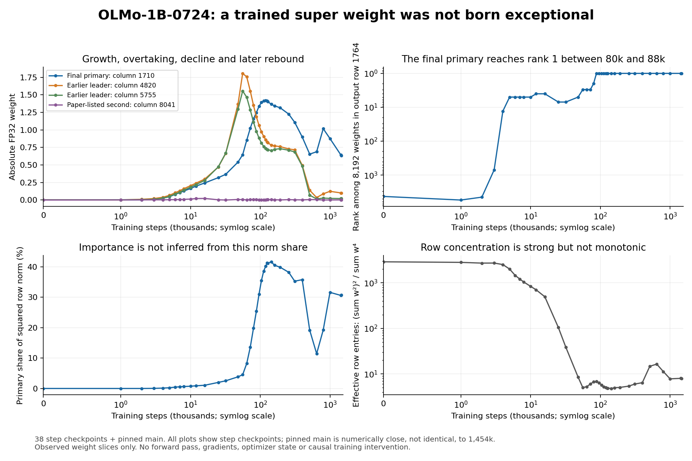

# Why did training produce OLMo-1B's super weight?
## New checkpoint evidence and a causal investigation plan
22 October 2026 | Exact model: allenai/OLMo-1B-0724-hf

## Executive conclusion
The strongest new result is an actual training trajectory, not a proposed experiment. I retrieved bounded tensor slices from 38 official step checkpoints plus the exact pinned final model, without downloading or loading any full model. The primary scalar, layer 1 down_proj[1764,1710], began ordinary, grew into an outlier very early, and only later overtook other large weights writing into the same output coordinate. Its magnitude subsequently fell, rebounded, and fell again.

This rejects two simple explanations for the weight's large final magnitude: it was not already a large scalar at initialization, and it was not first created by late-stage annealing. It does not yet establish when the full activation/routing mechanism became functional, or why training selected that mechanism. The most defensible working explanation is learned co-adaptation and concentration under coordinate-adaptive optimization, with normalization and weight decay affecting the dynamics. That explanation is testable, not established for this exact run.

## 1. What was measured
Every sampled checkpoint contributes the complete 8,192-element output row 1764 of layer 1's down projection. This permits within-row ranks, competing-coordinate trajectories and norm concentration to be computed without loading the 5.12 GB checkpoint. Four upstream gate/up rows were also fetched at 14 checkpoints: the two input vectors for neuron 1710 and for the paper-listed neuron 8041.

The acquisition used immutable Hugging Face commit IDs, safetensors headers and HTTP byte ranges. It required HTTP 206, matching Content-Range and exact response lengths. It saved raw FP32 slices, URLs, byte ranges and slice SHA256 hashes. A separate standard-library struct calculation independently checked the primary value, rank and norm share against NumPy. All 39 row checks passed.

Successful trajectory requests transferred 2,168,283 bytes, with another 458,752 bytes for upstream rows. Actual tensor payload was 1,736,704 bytes. This excludes small repository/configuration/literature research files. No forward pass, backward pass, model loading, optimizer-state inspection or training intervention occurred. Slice hashes document acquired bytes; they are not independent verification of each entire multi-gigabyte shard.

## 2. New findings
### A. The eventual primary scalar starts unremarkably
At step 0 it is 0.0035653, ranked 4,245th of 8,192 by absolute magnitude in its output row. The row's median absolute value is about 0.00374. It falls to 0.0024381 at step 1,000, then grows: 0.0114327 at 3,000, 0.0261926 at 4,000 and 0.0473659 at 5,000. By step 5,000 it is fifth-largest in that row. At step 8,000 it is 0.1280878.

Thus a large initial value of this particular scalar is not the explanation. Other initialization asymmetries, including its gate/up vectors, remain possible seeds. The actual functional emergence could precede or follow these magnitude changes.

### B. Earlier row leaders are displaced by the final primary
At step 56,000, columns 4820 and 5755 are -1.8058 and -1.5550, while column 1710 is +0.6461. Column 1710 is still second-largest at step 80,000 and first-largest at step 88,000. The official branch labels place these checkpoints at roughly 167B and 184B tokens.

This is evidence for changing allocation within one output row. It makes the earlier large neurons important candidates for the next activation experiment. It is not proof of functional competition, redundancy or conserved signal: their gate activations and signed contributions have not yet been measured.

### C. The history is not monotonic growth or monotonic concentration
The largest sampled primary value is 1.4183646 at step 120,000, approximately 251B tokens. It is 0.6543800 at 512,000, rises to 1.0172467 at 800,000, and ends at 0.6322910 in pinned main. Sparse samples cannot identify every local extremum.

At initialization, an inverse-participation measure gives about 2,895 effective entries in this row: (sum w²)² / sum w⁴. This falls to about five at step 56,000, later rises, and ends near eight. The primary's final share of squared row norm is 30.79%. This is a ROW measurement, not the previously reported 97.91% concentration of its output COLUMN. Neither norm fraction is a causal-importance measurement.

### D. The upstream neuron also changes
Neuron 1710's gate/up input-vector norms start at approximately 0.995/0.994. They become 1.643/1.236 at step 126,000 and 1.394/1.306 in pinned main. The up-vector norm continues rising over an interval when the scalar falls: approximately 1.236 at 126,000 versus 1.613 at 512,000.

Consequently, down-projection magnitude alone is an inadequate proxy for pulse strength. A SwiGLU contribution depends on the scalar, both learned input vectors and the actual normalized residual. These observations show that upstream and downstream parameters both evolve; they do not establish compensation in realized activations.

### E. The second paper-listed scalar is a useful unresolved control
For layer 1 down_proj[1764,8041], the final FP32 value is 0.00179342, ranked 5,418th in the same row. Its largest absolute sampled value is about 0.02313 at step 16,000. It never approaches the primary's magnitude in these samples. This is consistent with the repository's nearly inactive result on its tested source-0 panel, but does not prove a typo or global irrelevance. The original paper lists both layer-1 coordinates and discovers multiple weights iteratively. Test it on the same training-time panels as a control, without assuming it is a second copy of the primary mechanism. [1]

## 3. Exact provenance and consequential traps
The repository's model manifest pins the exact model revision d7cbab742d80589e714b1a2d7f838dcd21cbe143. All acquisitions and receipts use that correct revision. The repository main verified for this investigation is 0bf1747a8d1b4e6a0adfa3aab72005f7b13df096, following scientific snapshot e59cfed2df13a1d3a6e6c607648a9d6844790654. [2,3]

The official HF repository exposes 1,447 branches, comprising main and 1,446 step checkpoints. They run from step 0 through 1,454,000, largely at 1,000-step intervals, with gaps and four off-grid checkpoints. The release therefore supports much finer onset bracketing than a ten-checkpoint study. Exact sampled branch names and immutable commits appear in trajectory.csv and the request receipts. [3]

Pinned main is not byte-identical to the final named step branch, step1454000-tokens3048B (commit 5154fabb8c1cc6d0e40baec2afb525d4a8671920). The primary there is 0.6322935 versus 0.6322910 in pinned main. The maximum difference in the sampled row is 0.0000025034. Both full shard hashes differ. I therefore treat main as a separate endpoint and do not assign it an unverified exact training step. Main's FP32 primary rounds to 0.63232421875 in FP16, matching the repository's reported loaded value.

The stored architecture is 16 layers, 2,048 hidden dimensions, 16 heads, 8,192 intermediate dimensions, 4,096 context, untied embeddings, SwiGLU, QKV clipping at 8 and non-affine LayerNorm. There are no learned normalization-weight tensors in the inspected safetensors headers. [3,4]

Three provenance hazards matter for causal work:

- The public file configs/official-0724/OLMo-1B.yaml specifies tied embeddings and 2,048 context, among other mismatches. An open official-repository issue explicitly asks about this mismatch. It must not silently become the training recipe for this model. [4]
- The model card contains copied 7B-0424 training-schedule language. Its numerical schedule is not reliable evidence for this exact 1B run. [3]
- allenai/OLMo-1B-0724-954000steps-unsharded is identified by the official OLMoE project as an upcycled 8-expert initialization. Its 27.67 GB tensor file is about 6.9B parameters, not a ready-to-resume dense 1B checkpoint. The inspected file list contains no optimizer state. [5]

The upcycled artifact's config is nevertheless a provenance lead: run name mitchish1, seed 6198, matching untied/4,096 architecture, AdamW betas (0.9,0.95), nominal learning rate 4e-4 and decay 0.1, token-based cosine schedule, global batch 512, and Dolma v1_6/v1_7 data paths. It records a load path to a native step-878000 checkpoint. These are candidate ancestral settings, not a certified reconstruction of the entire dense run or all later curriculum changes. [5]

A read-only GET of the inferred native checkpoint config returned HTTP 403. Access was not obtained. The official HF weight branches are accessible; matching optimizer moments, exact restart history and training data order remain unverified. The older February OLMo-1B checkpoint inventory is a different run and is not a substitute.

## 4. Evidence-based hypothesis ranking
### Highest-priority: learned co-adaptation plus optimizer-induced coordinate concentration
Direct OLMo evidence supports learned growth, multiple early large writers to one row, changing relative dominance and adaptation of upstream vectors. It does not identify the optimizing pressure. External controlled work shows that changing Adam's moment/preconditioning basis can suppress activation outliers without requiring a corresponding removal of first-token attention. This makes optimizer-induced concentration a strong causal candidate, not a proven explanation for OLMo's specific coordinate or semantic function. [6]

The exact index is not architecturally inevitable. MLP neurons can be permuted with paired gate/up and down transformations. For non-affine LayerNorm, residual-space orthogonal transformations preserving the all-ones direction also preserve normalization when all read/write projections and embeddings are transformed consistently. Function can therefore be redistributed across coordinates without a special role for index 1764. This is a mathematical invariance argument, not a performed training experiment. Coordinate-adaptive optimization can break such equivalences during training.

### High-priority: attention-related gradient pressure with normalization-mediated shielding
A 2026 causal study attributes massive activations to aggregate value-path gradient pressure at attention sinks, and reduces them using a backward-only value-gradient rescaling intervention. This supplies a useful discriminating test. It studies RMSNorm-based models; OLMo uses centered LayerNorm, so the mechanism must be checked, not transferred verbatim. [7]

For OLMo's non-affine LayerNorm, with c=x-mean(x), s=sqrt(mean(c²)+epsilon), the Jacobian is P/s-ccᵀ/(d s³), where P removes the mean. Increasing centered norm can attenuate many gradient directions. Whether this happens at the relevant OLMo source/query positions, and whether it explains H14-mediated activation rather than merely correlating with it, requires gradients.

### High-priority regulator, not established origin: AdamW weight decay
A recent controlled study finds early stochastic activation-channel growth, weight-decay-dependent amplitude and later concentration in smaller models, with observational comparisons to Pythia. Its causal interventions support testing decay independently of the learning-rate schedule. Its model architectures, training scales and gain parameters do not reproduce this OLMo run. [8]

The observed early growth, peak and remodeling are compatible with this family of explanations, but compatibility is weak evidence of cause. A scalar's AdamW update combines gradient/moment terms and a decay term; checkpoint differences alone cannot separate them. Any claim that decay caused this exact peak needs the actual schedule and optimizer state, or a controlled continuation.

### Plausible selection pressure: boundary statistics and attention's normalization constraint
Controlled attention-sink research implicates attention normalization and shows sensitivity to training choices. This can explain why globally visible early positions are useful attention targets, but it does not by itself explain this coordinate, its scale, or the repository's value-carrying, query-dependent newline mechanism. [9]

The repository already provides evidence that the present-day pathway does more than a simple zero-value attention no-op. Boundary frequency, position, token identity and source representation should be disentangled during training. A no-op sink story alone is insufficient.

### Disfavored or excluded narrow explanations
A large initial value of the primary scalar is contradicted by the sampled initialization. Late annealing as the sole creator of its large magnitude is contradicted by its early outlier growth. Learned LayerNorm gain inflation cannot be the direct cause here because normalization is non-affine. None of these excludes later training changes in the weight's function, importance or dependence on upstream routing.

## 5. The next bounded experiment: locate functional birth
The next useful step is not another final-model lesion. It is a frozen-panel early-layer trajectory at eight revisions: steps 2k, 4k, 8k, 56k, 80k, 88k, 120k and pinned main. This spans pre-growth, early growth, older large writers, the takeover interval and the first sampled peak.

Only layer 0, layer 1 attention, selected layer-1 gate/up rows and the needed token embeddings are required to measure the proposed pulse-production mechanism. Layer-0 plus layer-1-attention weight payload is exactly 335,544,320 FP32 bytes. Adding selected vectors and at most 1,024 embedding rows keeps it below approximately 344 MB per checkpoint, or 2.75 GB across eight. Process one checkpoint at a time; no full 5.12 GB model is needed. A CPU-only implementation should fit comfortably within a provisional 2-4 GB working-memory budget, but runtime and numerical fidelity must be benchmarked before promising a duration.

Freeze the repository's existing source-0/newline and empty-history panels, and include held-out ordinary text with length-matched boundary controls. Use identical token IDs across checkpoints. Record:

- Gate preactivation, up activation, post-SwiGLU activation and signed scalar contribution for neurons 1710, 4820, 5755 and 8041.
- The pre-layer-1 residual and its centered norm, H14 attention to boundary positions and its OV contribution, plus the separate H12 empty-history path.
- Controlled early-layer H14 suppression, context/boundary swaps and MLP0 suppression, without assuming the mature pathway exists at early checkpoints.
- Distributions across examples, not one favorable prompt; per-example results and failures must be retained.

First validate the partial implementation at pinned main against existing repository outputs, acknowledging FP32/FP16 differences. This stage can establish temporal order and whether the apparent competing writers actually carry substitutable signals. It cannot establish downstream language-model necessity or the final surviving-column protection effect, which need full-model evaluation later.

This stage requires permission to exceed the present lightweight-slice/no-model-loading scope. It has not been started. It needs no paid GPU, user computer, external upload or repository modification.

## 6. Causal experiments after the onset is localized
Before any continuation, obtain authentic dense optimizer state, exact code/config, scheduler state and data-order/restart information. A successful baseline resume should reproduce the next checkpoint's relevant tensors within a declared tolerance. If that is impossible, use matched reset controls or fresh controlled training, and label the result a surrogate experiment rather than the historical cause of this run.

Then separate hypotheses rather than changing everything together:

1. Decay versus schedule. Fork immediately before measured functional growth or takeover; change decay while holding LR, batch, data and clipping fixed. A separate constant-LR arm distinguishes decay effects from schedule effects. Track activation amplitudes, contributions, gradients, loss and concentration, not just weight magnitude.
2. Optimizer basis. Change the basis used for moment preconditioning while preserving architecture/data and measuring forward-function equivalence at the fork. Existing diagonal Adam second moments cannot be naively rotated as if they were a full covariance matrix. Use a mathematically valid optimizer design or matched moment resets in every comparison arm.
3. Gradient-pressure mechanism. Use backward-only value-gradient scaling with an unchanged forward pass. Test whether pulse growth is suppressed while forward attention attraction remains. Measure query-aggregated gradients and the LayerNorm Jacobian before claiming shielding.
4. Boundary-statistics mechanism. Manipulate newline/document-boundary frequency, token identity and reset/mask treatment in separate matched arms, with token count and broad content statistics controlled. Test whether functional onset shifts, rather than merely whether a final model responds to newline.
5. Functional competition. During the measured early interval, track or transiently suppress the earlier large writers and determine whether another neuron assumes their signed contribution and causal role. A changed weight ranking without functional substitution is not consolidation evidence.

Training is not cheap: at 1.28B parameters and about 2.1M tokens per optimizer step, 1,000 dense-training steps are approximately 1.6e19 FLOPs per arm under the standard 6*N*tokens estimate, before evaluation and engineering overhead. No GPU-hour or cost estimate is reliable without benchmarking the selected hardware and implementation. No training or paid compute was launched.

## 7. Reproduction and stopping condition
The accompanying bundle contains the acquisition/analysis scripts, immutable revision receipts, raw tensor slices, config/index/header snapshots, validation audit, trajectory.csv and the figure. Scripts resolve their root relative to their own location. Re-running analyze_trajectory.py uses saved slices only and does not contact the network. NumPy and Matplotlib are the analysis dependencies; acquisition uses NumPy and Python's standard library.

The read-only investigation is complete at a concrete boundary: we have located early scalar growth and an 80k-88k within-row takeover, but not the birth of the causal activation/routing mechanism. The next requested decision is whether to authorize the approximately 2.75 GB CPU-only partial-model probe. Exact historical causal continuations remain contingent on optimizer/config/data provenance.

## Sources
[1] Yu et al., The Super Weight in Large Language Models, original paper and official code: https://arxiv.org/html/2411.07191v1 ; https://github.com/mengxiayu/LLMSuperWeight

[2] Research repository, verified main and checkpoint manifest: https://github.com/jaykobdetar/superweight-research/tree/0bf1747a8d1b4e6a0adfa3aab72005f7b13df096 ; https://github.com/jaykobdetar/superweight-research/blob/0bf1747a8d1b4e6a0adfa3aab72005f7b13df096/manifests/checkpoint.json

[3] Official model at exact revision and branch inventory: https://huggingface.co/allenai/OLMo-1B-0724-hf/tree/d7cbab742d80589e714b1a2d7f838dcd21cbe143 ; https://huggingface.co/api/models/allenai/OLMo-1B-0724-hf/refs

[4] Official training repository and configuration-mismatch issue: https://github.com/allenai/OLMo/blob/090253dac6688f2532509daa7aa2eb5fae50e956/configs/official-0724/OLMo-1B.yaml ; https://github.com/allenai/OLMo/issues/901

[5] Upcycling artifact and official OLMoE project: https://huggingface.co/allenai/OLMo-1B-0724-954000steps-unsharded/tree/a0a92efccc5be96d09c91f021e7093a5a536465b ; https://github.com/allenai/OLMoE

[6] Kaul et al., From Attention to Activation: Unravelling the Enigmas of Large Language Models: https://arxiv.org/html/2410.17174v1

[7] Chen and Yao, Attention Sinks Induce Gradient Sinks (2026 preprint): https://arxiv.org/html/2603.17771v1

[8] McClendon et al., The Life Cycle of a Massive Activation: Stochastic Birth, Weight-Decay-Driven Growth, and Competitive Consolidation (2026 preprint): https://arxiv.org/html/2610.00423v1

[9] Gu et al., When Attention Sink Emerges in Language Models: An Empirical View: https://arxiv.org/html/2410.10781v1
