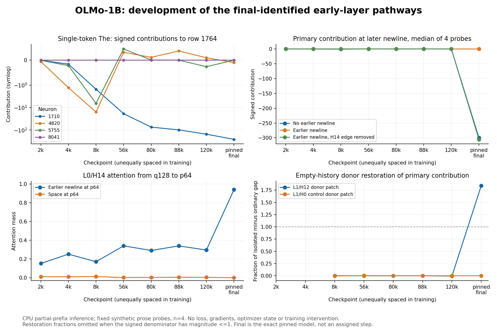
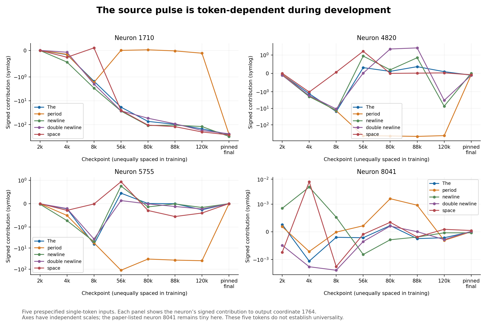
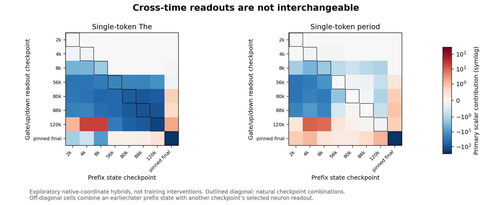

# OLMo-1B: how the super-weight mechanism develops

Eight-checkpoint functional study | 22 October 2026

## Bottom line

The large scalar and the mature circuit do not appear together. The primary weight is already dominant by 88k, but the final H14/newline and H12/empty-history mechanisms are not reproduced on the fixed probes through 120k. Earlier activity is distributed among token-specialized neurons; the final primary also has substantially different gate/up geometry. These are actual checkpoint measurements, not just a proposed experiment.

This narrows the training-origin explanation to a multi-stage process involving changing upstream representations, neuron readouts and routing. It does not yet identify the optimizer, data or gradient mechanism that caused it. A separately selected later-checkpoint extension is incomplete and excluded from every result below.

## What was tested

Official allenai/OLMo-1B-0724-hf revisions at 2k, 4k, 8k, 56k, 80k, 88k, 120k and pinned main d7cbab742d80589e714b1a2d7f838dcd21cbe143. Four fixed synthetic prose probes, 13 conditions each, five fixed single tokens, and four selected MLP neurons (1710, 4820, 5755, 8041). CPU NumPy prefix only: embeddings, all of layer 0, layer-1 attention, and the selected layer-1 gate/up rows. Scalar contributions are measured through output row 1764, not full model loss or importance.

## Developmental evidence

[CHECKPOINT_TABLE]

## Main observations

1. Early activity is not confined to the final primary. At 8k, the single-token “The” contributions are -1.52 for neuron 1710, -15.65 for 4820 and -6.51 for 5755.
2. The intermediate division of activity is token-dependent. Among the four tracked neurons at 56k, “The” is carried mainly by 1710 (-18.67), but a period is carried by 4820 (-449.16) and 5755 (-112.48); 1710 contributes only +0.0010 to the period. Their SwiGLU gates differ accordingly.
3. A large down-projection coefficient does not date the mature mechanism. The primary coefficient is largest in the row at the sampled 88k point and reaches its sampled trajectory maximum at 120k. Yet the final-identified H14/newline and H12 empty-history interventions do not have their mature effects on these probes through 120k.
4. At 120k the primary source contribution is -152.26 for “The,” but -0.106 for a period. Finally it is -258.52 and -253.87 respectively. The final primary coefficient is smaller, not larger, than its 120k value.
5. In the final model, inserting an earlier newline reduces the later-newline primary contribution from a median -299.55 to +0.00055. Removing the relevant H14 attention edge restores -305.01, while the H0 edge control does not. At 120k the corresponding three medians are +0.00216, -0.00041 and -0.00040. This study therefore has an important unmeasured later interval, which motivated the separate adaptive extension.
6. At the final model, the H12 donor patch restores a median 1.842 times the isolated-versus-ordinary empty-history gap; its H0 control does not. At 120k the H12 fraction is -0.00636. These fractions are not used when the denominator has magnitude <=1.

## Exploratory cross-time compatibility test

This was added after the eight-checkpoint results, with no new prompts, checkpoints or downloads. For the single-token “The,” the 120k prefix plus its own selected-neuron readout gives -152.26 and the final prefix/readout gives -258.52. Final readout on the 120k normalized prefix state gives +0.465; 120k readout on the final state gives +1.744. Both hybrids turn the gate negative. Gate-row and up-row cosine similarities between 120k and final are about 0.075 and 0.144; the normalized prefix-state cosine is about 0.507.

This rejects a description in which a fixed native-coordinate upstream feature is merely amplified by the scalar. It demonstrates cross-time incompatibility/coordinated geometry change. It does not distinguish functional coadaptation from a broader change of representation basis, and it is not a training intervention.

## Analytic bound on the paper-listed second weight

The pinned implementation uses non-affine LayerNorm with epsilon 1e-5, hidden dimension 2048, SiLU activation, and bias-free gate/up/down projections. For normalized input h, sum(h)=0 and ||h||^2 <= 2048. Centering the gate and up rows g and u leaves their dot products with h unchanged. Because |SiLU(a)| <= |a|,

|w * SiLU(g.h) * (u.h)| <= |w| * 1024 * (||g|| ||u|| + |g.u|).

The final W[1764,8041] bound is 0.1603298493, before floating-point roundoff. It is a prompt-independent upper bound on this one scalar contribution in this exact checkpoint. It rules out a hidden primary-sized pulse through this scalar, but not every possible downstream effect or a different model revision. The bound for neuron 1710 is 1262.37, so it is consistent with the observed approximately 258 pulse. This derivation is not valid unchanged for affine LayerNorm/RMSNorm, biases, or other activations.

## Audit and limitations

See study_audit.json and precision_audit.json. All eight checkpoints and 2,096 downloaded tensor slices were rehashed. Counted transfer: 2,715,887,454 bytes, below the 2.75 GB cap; peak inference RSS: 405,008,384 bytes. All causal-prefix checks passed. For the stored probe contributions, the maximum precision-scaled difference abs(FP32-FP16approx)/max(1,abs(FP32)) is 0.00777; all contributions with FP32 magnitude >1 retain their sign. These checks are not bit-exact full-Transformers validation.

The study does not measure end-to-end loss, whole output-column geometry, optimizer moments, real historical training batches, or training-time counterfactuals. The four prose probes and five source tokens are not representative corpus samples. Tracking final-identified H14/H12 does not rule out analogous earlier functions in other heads. Absence here means absence of the mature measured effect on this fixed panel, not absence of all possible precursor functions. Official HF checkpoint provenance does not supply the missing certified native optimizer-state lineage or repair the published training-config mismatch.

## Two exact symmetries clarify “why these weights?”

The MLP neuron indices are interchangeable: jointly permuting gate/up rows and down-projection columns leaves the function unchanged. Index 1710 is therefore not intrinsically privileged by the architecture or objective. Its selection is a fact about the training history and symmetry breaking, not a special semantic meaning of that number.

There is a stronger OLMo-specific statement. For any orthogonal residual-basis transform R that fixes the all-ones vector, non-affine LayerNorm obeys LN(Rx)=R LN(x). Transform embeddings and residual-output projections by R, transform residual-input projections and the final unembedding by its inverse, and keep internal attention coordinates unchanged. Q/K/V values, clipping, RoPE and attention probabilities remain unchanged; residual states rotate. Every layer, and hence the real-arithmetic model function, is preserved.

Consequently the objective cannot uniquely require the native residual coordinate 1764. A concentrated residual direction can have a distributed coordinate representation. This is not proof that Adam created the concentration; it identifies a parameterization choice that a training explanation must account for.

As a post-hoc numerical sanity check, a fixed mean-preserving Householder reflection was applied in memory to the existing pinned prefix. Selected activations agreed to at most 2.73e-6 scaled error, and prefix states transformed equivariantly. No full rotated model, later-layer logits or training was executed. Peak RSS for this extra check was about 738 MB, still below the 4 GB cap. The analytic global statement requires all layers and the unembedding to be transformed consistently; the check validates only the loaded prefix.

## Evidence-based hypothesis ranking

1. Multi-stage coadaptation and changing functional allocation: strongest direct support. Earlier contributors are sometimes complementary across tokens, not interchangeable copies. The final primary’s readout is poorly compatible with earlier prefix states. A simple “one scalar grows, then the final mechanism appears” story is contradicted by the measured timing. This is a description of development, not yet a causal training explanation.

2. Coordinate-dependent optimization interacting with normalization/attention: plausible and sharply testable, but not identified here. The architecture admits function-preserving basis changes, while coordinatewise Adam is not generally rotation-equivariant. Kaul et al. provide causal evidence for optimizer-basis effects in other training runs [4]. Our checkpoint evidence supplies a reason to test this exact model rather than assume the result transfers.

3. Weight decay and competitive consolidation: plausible, with causal evidence elsewhere [5], but the 56k token split warns against a simple universal winner-takes-all narrative. No authentic optimizer moments or certified full dense-run schedule were obtained. Coefficient decay alone cannot explain a final pulse that grows while the coefficient shrinks.

4. Attention-driven gradient pressure and shielding: plausible, with backward-path intervention evidence in other models [6]. This prefix stops before the full layer-1 MLP output and does not measure loss gradients or post-pulse LayerNorm Jacobians. The present observations cannot verify gradient shielding or distinguish value-gradient from query/key-gradient pressure.

5. Newline/document-boundary frequency or packing policy: still untested as a training cause. A final circuit’s response to newlines is not evidence that newline frequency caused it. The actual sequence packing, data order and restart history matter. The probes here are intentionally fixed, but are not corpus samples.

Two narrower explanations are rejected or inapplicable: the primary was not an unusually large initial scalar in the earlier weight-only scan, and a learned LayerNorm gain cannot be its explanation because these normalization modules have no learned gain or bias.

## Most discriminating next tests

First finish the already defined timing test, if authorized: 256k, 512k, 800k and 1.2M with the identical panel. It was selected adaptively because the initial eight leave the mature transition between 120k and final unobserved. Total planned incremental transfer is 1,356,912,941 bytes, including the 338,614,573 bytes already received. The transfer is paused, with no partial files or running acquisition process. No follow-up inference is included here.

For causal training claims, obtain native dense optimizer state, exact code/config, scheduler state, RNG and batch/data-order information. Verify a baseline continuation against a subsequent checkpoint before interpreting interventions. The official config mismatch remains unresolved for this exact run; the similarly named 954k “unsharded” artifact is upcycled MoE, not the required dense resume state [3].

A high-value optimizer test is a function-preserving residual-basis rotation at a matched fork. Compare ordinary Adam in the original and rotated bases, with equal moment-reset controls, identical data and schedule, and a rotation-equivariant optimizer control. First verify matching logits/loss before training. Track whether concentration reforms along the optimizer’s native axes while the underlying function remains useful. Existing diagonal Adam second moments cannot be transformed as if they were a full covariance matrix. A reset experiment establishes a controlled effect, not the literal historical cause of the original continuation.

Separately vary weight decay while holding learning rate, data and clipping fixed; use a distinct learning-rate arm rather than changing both together. A backward-only attention-value-gradient intervention can preserve the forward pass while testing the proposed training pressure. Boundary-frequency tests should separate token identity, counts and attention-reset/packing changes. All arms must monitor loss and functional contributions, not only scalar magnitude. Baseline degradation is not evidence of a specific mechanism.

Training is a separate resource decision. At 1.28B parameters and a candidate 2.1M tokens per optimizer step, 1,000 steps cost approximately 1.6e19 FLOPs per arm under the 6*N*tokens estimate, before overhead. No training, gradients, GPU or paid compute was launched. A smaller OLMo-architecture control would test a mechanism class, not certify this 1B run’s history.

## Reproduction and evidence boundaries

The initial checkpoint/prompt protocol SHA256 is 03b2692ddf8c39a4cb13e9cf089757d1a3cd099440fc3420e812c033f345b899. FP16 rounding sensitivity was added before any earlier-checkpoint inference and is explicitly not a CUDA SDPA equivalence claim. The pinned-endpoint validation passed numerical source-pulse references, causal/self-only invariants and qualitative H14/H12 effects on the new probes.

The compact bundle preserves both fixed protocols, per-example values, both numerical precisions, immutable revisions, acquisition receipts, source snapshots, validation/audit files, analytical derivations and scripts. The 2.714 GB of prefix tensor payload is retained separately in the cloud and excluded from the compact bundle. The bundle contains the small original row slices and exact range manifests needed to reacquire the same official data. Existing raw results are never silently overwritten by the provided inference runner.

Offline analysis needs Python, NumPy and Matplotlib; inference additionally uses psutil and four OpenBLAS threads. PyTorch/Transformers were not installed or executed. The forward equations were ported from the pinned Transformers 4.57.6 implementation used by the research repository, and checked against its mature reference values. The numerical “The” source pulse differed by 0.122% under the FP16 approximation; the period reference matched exactly. This is useful validation, not full-framework bit equivalence.

The exact model is allenai/OLMo-1B-0724-hf at d7cbab742d80589e714b1a2d7f838dcd21cbe143. The nearby published step1454000 checkpoint is numerically close but not identical and is not substituted for main. Full checkpoint commit IDs are in the protocol and every result. The initial eight-point audit is separate from the adaptive extension and from post-hoc compatibility/symmetry diagnostics.

## Primary sources

[1] Exact official model and checkpoint inventory: https://huggingface.co/allenai/OLMo-1B-0724-hf/tree/d7cbab742d80589e714b1a2d7f838dcd21cbe143 ; https://huggingface.co/api/models/allenai/OLMo-1B-0724-hf/refs

[2] Pinned implementation and research repository: https://github.com/huggingface/transformers/blob/v4.57.6/src/transformers/models/olmo/modeling_olmo.py ; https://github.com/jaykobdetar/superweight-research/tree/0bf1747a8d1b4e6a0adfa3aab72005f7b13df096

[3] Official configuration mismatch: https://github.com/allenai/OLMo/issues/901 ; upcycling provenance: https://github.com/allenai/OLMoE

[4] Kaul et al., From Attention to Activation: Unravelling the Enigmas of Large Language Models: https://arxiv.org/html/2410.17174v1

[5] McClendon et al., The Life Cycle of a Massive Activation (2026 preprint): https://arxiv.org/html/2610.00423v1

[6] Chen and Yao, Attention Sinks Induce Gradient Sinks (2026 preprint): https://arxiv.org/html/2603.17771v1

[7] Original super-weight paper: https://arxiv.org/html/2411.07191v1
