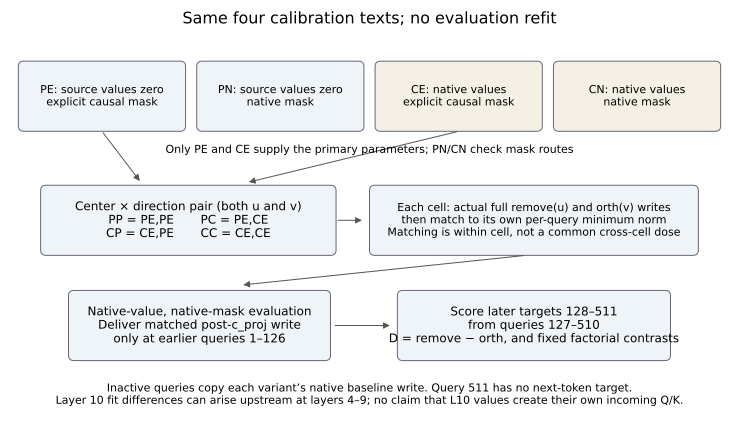
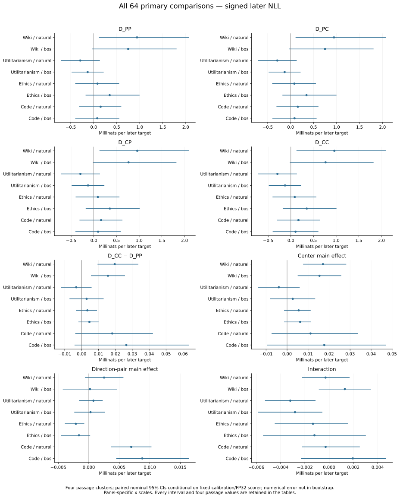

# Report 19 — Native versus value-lesioned calibration of the GPT-2 early-write intervention

**Independently reviewed; finite study and reproduction limits are stated below.**

The calibration choice changed the estimated removal-minus-orthogonal-control later-loss contrast by small amounts in this finite experiment, while most confidence intervals remained broad relative to those effects. Calibration defines manual gate edits; it does not train or change GPT-2’s weights. This does not establish equivalence, absence of a calibration effect, or irrelevance of attention bias. The comparison asks a narrower question: when an intervention is fitted on the same four calibration texts, how does retaining versus removing source-token values during calibration alter its later-loss effect in an otherwise native GPT-2 evaluation?

Across the 64 prespecified primary comparisons, 51 nominal intervals included zero. The within-cell removal-minus-orthogonal-control contrast had both positive and negative means across source/start strata. The largest absolute mean change in D_CC − D_PP between the endpoint calibration cells was about 0.0265 millinats per later target. This is a change in the removal-minus-control contrast, not the raw removal-arm loss. These are descriptive results from four passage clusters per stratum, conditional on one fit; they are not an equivalence test or a population estimate.

## What was compared

Four fixed calibration texts were run in four worlds. **PE** removed source-token values and used an explicit causal mask; **PN** used the same value lesion with the native mask route. **CE** retained native values with the explicit mask, and **CN** retained native values and the native mask. The PE intervention uses the original frozen F maps and directions, not a convenient contemporary refit. Its 64 raw allocation arrays, maps and directions passed the historical continuity gate. Across all eight observed layers and four texts, the PE/PN and CE/CN mask-route comparisons were byte-identical in all 128 paired stored-array comparisons of allocation logits and mass.

At a non-source query q, b is a 12-coordinate vector of head-wise log-odds for non-source versus source attention mass. Subtracting log(q) removes the declared query-count reference, and α centers that residual. The leading component u and its orthogonal control v therefore live in the 12 head-wise gate-logit coordinates at layer 10. They are not principal components of whole hidden states or a count of causal mechanisms. The scalar projection onto u determines the removal and control proposals. For a given native incoming state, the source-value vector and conditional non-source value mixture stay fixed while this proposal changes their allocation gate.

Only PE and CE defined the primary evaluation parameters. Each supplies a center vector, α, and a direction pair: the first principal component, u, and its declared orthogonal control, v. The four cells separate their sources: PP uses the PE center and pair; PC uses the PE center and CE pair; CP uses the CE center and PE pair; CC uses both CE components. Changing the direction pair changes both u and v, so a cell difference cannot be attributed to the principal-component direction alone. PN and CN were mask-route diagnostics, not extra evaluation cells.

At layer 10, the PE–CE center distance was 0.11718032 in L2 norm; the corresponding u and v cosines were 0.99992906 and 0.99998459. These descriptive geometric similarities do not determine functional equivalence. Calibration retained the same texts, and the native-value world can already differ upstream at layers 4–9. A layer-10 fit difference therefore does not show that layer-10 values caused that layer’s own incoming queries or keys.

## Intervention, panel and uncertainty

Evaluation kept source values native and used the native mask route throughout. Each cell first generated actual full removal and orthogonal-control proposals, including their actual attention output projections. The two proposals were then interpolated after c_proj to the smaller of their per-query full-change norms. Only earlier query rows 1–126 received the matched write; all other rows copied that variant’s baseline write. Later scored targets were 128–511, predicted from queries 127–510. Query 511 remained a control position without a next-token target.

Matching was within a cell and input variant, not across calibration cells. The largest actual paired relative RMS norm gap was 4.1807359×10⁻⁸. Nevertheless, the CC/PP active-target RMS ratio ranged from 1.00044852 to 1.01219647 across 64 main/suffix records. Different directions and different natural targets can yield different functional doses even when paired Euclidean write norms match closely. Equal vector norm is not equal computation or equal loss sensitivity.

The panel contained 16 passages from four sources—Wiki, utilitarianism, ethics and code—with natural and beginning-of-sequence starts, giving 32 identities. All calls used 512 positions with key/value caching disabled. The BOS variant changed token 0 only and preserved the other 511 tokens. Deterministic preparation tested 1,090 candidates, rejected 1,074 and accepted 16. It retained the complete calibration-buffer and interval exclusions and checked an 841-hash experimental-history guard. That recorded-exposure guard is not a pretraining-overlap proof, and these passages are not a random sample of a broad task population.

The study completed 16 calibration forwards and 1,160 evaluation forwards: 576 main, 576 rotated-suffix controls and eight native/identity anchors. Two planned 580-forward segments completed their source, parameter and precision guards. Segment A took 352.927 seconds with a peak of 2,332,804 KiB; B took 358.670 seconds with 2,164,244 KiB. Peak allocated GPU memory was 1,142,526,464 bytes. These are execution resources for this study, not a speed comparison or a generation benchmark.

## All primary results

For a cell, **D = removal − orthogonal control** in signed later negative log-likelihood. Positive values mean the removal had higher loss than its control; negative values mean lower loss. Four D contrasts plus four fixed factorial contrasts produce eight estimands in each of eight source/start strata. The center main effect averages the center change across direction pairs; the direction-pair main effect averages the pair change across centers. The joint endpoint change equals the sum of those two main effects, and the interaction is the remaining fixed difference of differences. These algebraically related comparisons are deliberately all reported, not independent opportunities for a “win.”

Intervals use 2,000 shared bootstrap resamples of the four passage clusters, with seed 20261021. Starts, arms, views, metrics and contrasts share the index array. These paired nominal intervals are conditional on the fixed calibration and canonical FP32 scorer; numerical error is not included in the bootstrap. The nominal 95% intervals are unadjusted and correlated, and omit calibration-fit uncertainty. No interval crossing rule was a scientific success criterion. Neither a zero-containing interval nor a small point estimate establishes absence or practical equivalence.

The four D families each had six positive and two negative stratum means, with 28 of their 32 intervals including zero. D_PP means ranged from −0.293120 to +0.941390 millinats per target; D_CC ranged from −0.296286 to +0.961002. The endpoint calibration shift, D_CC − D_PP, had a maximum absolute mean of 0.0264775 millinats. The center, direction-pair and interaction rows expose the full decomposition, but their small differences should not be ranked as resolved mechanisms.

The appendix table retains all 64 comparisons in a fixed order, with mean and interval in millinats per later target. The accompanying CSV and JSON retain all four passage values in original nats as well as display units. The complete frozen analysis is also embedded as a download in the self-contained HTML, including every secondary contrast, norm summary and paired-start row. No new bootstrap, refit, significance test or selective secondary analysis is performed by this report builder.

## What the independent checks establish

The numerical audit checked 41,871 stored arrays and independently rebuilt the saved-statistic summaries and fixed interval calculations. The projection audit checked 19 correlated layer-10 learned projection relations, totaling 7,471,104 coordinates. The readout audit checked all 72 predetermined full-vocabulary rows from the 18 selected Wiki natural-start states. These are complementary checks of saved artifacts, not a second model replay, ordinary whole-panel reconstruction or a universal bound on GPU arithmetic.

For those 72 selected rows, the maximum saved-FP32 versus saved-logit-FP64 KL discrepancy was 4.76524×10⁻⁷ nats; the largest defined error-to-signal ratio was 0.166774. Eight exact-zero FP64 references had undefined ratios, recorded as null. The maximum NLL discrepancy was 5.48602×10⁻⁷ nats. A 10⁻⁴ consistency threshold is not a sensitivity proof for tiny interactions, and selected-row diagnostics cannot bound every reported passage or contrast. Signed tiny KL values remain signed rather than clipped.

Infrastructure corrections were preserved separately from scientific hypotheses. They included an input-audit count-key error, a CPU-witness acceptance count-sum error, missing execution-review provenance fields detected before array access, and later receipt/policy-filename mistakes after literal activation. The fixes did not repeat model forwards or change scientific criteria. An earlier portable-workflow containment fix is likewise documented infrastructure history. Such events are neither negative experimental outcomes nor evidence that every historical transient failure operand was saved.

## Established context, limits and proposed next step

Extreme activations, their persistent effects, attention allocation as a gate, and GPT-2 attention-bias circuits already have primary literature. The role of this study is a calibration control of the GPT-2 transfer branch, not a new discovery of a GPT-2 super weight. The candidate increment here is this controlled, finite calibration-center/direction-pair comparison with actual early-write matching, explicit uncertainty and saved-artifact checks. It does not establish a unique or universal mechanism, intrinsic principal-component importance, task necessity, causal mediation fractions or priority over that earlier work.

A proposed next step is a sign-balanced ensemble of multiple orthogonal controls, evaluated at a common per-query target based on actual post-c_proj proposals, with a fixed native C fit and fresh held-out texts. Independent calibration texts would follow. No call count is an approved schedule: the components, evidence layout and resources still need prospective review. No implementation or execution of that next experiment is authorized by this report.

Aggregate presentation can be rebuilt from the supplied public JSON bundle. Portable model reproduction and the public numeric export remain pending separate acceptance. A second full 776-forward T22 replay has not been performed. This report describes the completed T23 study, not a claim that those additional reproduction steps are complete.

### Primary literature

[The Super Weight in Large Language Models](https://arxiv.org/html/2411.07191v2). Single-parameter sensitivity, induced extreme activations, skip-connection persistence and quantization are established. T23 does not introduce super-weight discovery or parameter sweeps.

[Massive Activations in Large Language Models](https://arxiv.org/html/2402.17762v2). Input-stable extreme activations, mean replacement and implicit attention biases are established. T23 does not claim that constant replacement or attention bias interpretation is new.

[Attention Sink Forges Native MoE in Attention Layers: Sink-Aware Training to Address Head Collapse](https://arxiv.org/html/2602.01203v3). First-token attention mass as an implicit gate and relation to explicit gating are established. Gate-versus-mixture algebra and head gating are not T23 novelty claims.

[A Mechanistic Account of Attention Sinks in GPT-2: One Circuit, Broader Implications for Mitigation](https://arxiv.org/html/2604.14722v1). Query-bias, transformed positional encoding and key-projection circuit studied with interventions; architecture dependence explicit. T23 does not establish universal mechanism or reproduce those distinct component ablations.

## Complete primary appendix

| Contrast | Source | Start | Mean [95% CI], millinats/target |
|---|---|---|---|
| D_PP | Wiki | natural | +0.941390 [+0.108560, +2.071487] |
| D_PP | Wiki | bos | +0.750590 [-0.033362, +1.802226] |
| D_PP | Utilitarianism | natural | -0.293120 [-0.714347, +0.133613] |
| D_PP | Utilitarianism | bos | -0.131810 [-0.480641, +0.217022] |
| D_PP | Ethics | natural | +0.081997 [-0.401271, +0.553214] |
| D_PP | Ethics | bos | +0.346934 [-0.176207, +0.996939] |
| D_PP | Code | natural | +0.149947 [-0.315360, +0.599375] |
| D_PP | Code | bos | +0.077075 [-0.402209, +0.556360] |
| D_PC | Wiki | natural | +0.944043 [+0.107572, +2.078418] |
| D_PC | Wiki | bos | +0.750131 [-0.038006, +1.805991] |
| D_PC | Utilitarianism | natural | -0.290759 [-0.711258, +0.132680] |
| D_PC | Utilitarianism | bos | -0.130120 [-0.478236, +0.217997] |
| D_PC | Ethics | natural | +0.080533 [-0.400569, +0.551156] |
| D_PC | Ethics | bos | +0.345927 [-0.178426, +0.998595] |
| D_PC | Code | natural | +0.157047 [-0.308126, +0.605926] |
| D_PC | Code | bos | +0.084856 [-0.396703, +0.566416] |
| D_CP | Wiki | natural | +0.958645 [+0.124551, +2.098458] |
| D_CP | Wiki | bos | +0.765369 [-0.019551, +1.821557] |
| D_CP | Utilitarianism | natural | -0.295445 [-0.726717, +0.135827] |
| D_CP | Utilitarianism | bos | -0.127716 [-0.487991, +0.232558] |
| D_CP | Ethics | natural | +0.088205 [-0.400623, +0.564883] |
| D_CP | Ethics | bos | +0.353792 [-0.178717, +1.010340] |
| D_CP | Code | natural | +0.161244 [-0.315754, +0.631150] |
| D_CP | Code | bos | +0.093815 [-0.405972, +0.593602] |
| D_CC | Wiki | natural | +0.961002 [+0.124105, +2.103035] |
| D_CC | Wiki | bos | +0.766205 [-0.023098, +1.826849] |
| D_CC | Utilitarianism | natural | -0.296286 [-0.726612, +0.134039] |
| D_CC | Utilitarianism | bos | -0.128837 [-0.486916, +0.229242] |
| D_CC | Ethics | natural | +0.085413 [-0.404402, +0.562335] |
| D_CC | Ethics | bos | +0.351578 [-0.178785, +1.007726] |
| D_CC | Code | natural | +0.168057 [-0.310873, +0.640569] |
| D_CC | Code | bos | +0.103553 [-0.401019, +0.608125] |
| joint_CC_minus_PP | Wiki | natural | +0.019612 [+0.009444, +0.033581] |
| joint_CC_minus_PP | Wiki | bos | +0.015615 [+0.005540, +0.025690] |
| joint_CC_minus_PP | Utilitarianism | natural | -0.003167 [-0.012265, +0.005932] |
| joint_CC_minus_PP | Utilitarianism | bos | +0.002973 [-0.007158, +0.013058] |
| joint_CC_minus_PP | Ethics | natural | +0.003416 [-0.003131, +0.009121] |
| joint_CC_minus_PP | Ethics | bos | +0.004644 [-0.001883, +0.010091] |
| joint_CC_minus_PP | Code | natural | +0.018111 [-0.003732, +0.042208] |
| joint_CC_minus_PP | Code | bos | +0.026477 [-0.004182, +0.063561] |
| center_main | Wiki | natural | +0.017107 [+0.007636, +0.028170] |
| center_main | Wiki | bos | +0.015426 [+0.005063, +0.025789] |
| center_main | Utilitarianism | natural | -0.003926 [-0.013862, +0.006010] |
| center_main | Utilitarianism | bos | +0.002688 [-0.008015, +0.013391] |
| center_main | Ethics | natural | +0.005544 [-0.001408, +0.011240] |
| center_main | Ethics | bos | +0.006254 [-0.001435, +0.011392] |
| center_main | Code | natural | +0.011154 [-0.007373, +0.033812] |
| center_main | Code | bos | +0.017718 [-0.009532, +0.047135] |
| direction_pair_main | Wiki | natural | +0.002505 [-0.000639, +0.005676] |
| direction_pair_main | Wiki | bos | +0.000189 [-0.004267, +0.004645] |
| direction_pair_main | Utilitarianism | natural | +0.000759 [-0.001591, +0.002272] |
| direction_pair_main | Utilitarianism | bos | +0.000285 [-0.002383, +0.002673] |
| direction_pair_main | Ethics | natural | -0.002128 [-0.003928, -0.000742] |
| direction_pair_main | Ethics | bos | -0.001611 [-0.004583, +0.000224] |
| direction_pair_main | Code | natural | +0.006957 [+0.003641, +0.010273] |
| direction_pair_main | Code | bos | +0.008759 [+0.004502, +0.016426] |
| interaction | Wiki | natural | -0.000296 [-0.002225, +0.001689] |
| interaction | Wiki | bos | +0.001295 [-0.000847, +0.003437] |
| interaction | Utilitarianism | natural | -0.003202 [-0.005285, -0.001119] |
| interaction | Utilitarianism | bos | -0.002811 [-0.005864, -0.000555] |
| interaction | Ethics | natural | -0.001329 [-0.004481, +0.001566] |
| interaction | Ethics | bos | -0.001208 [-0.005445, +0.003029] |
| interaction | Code | natural | -0.000287 [-0.002250, +0.002531] |
| interaction | Code | bos | +0.001957 [-0.002323, +0.004696] |

### Data and build artifacts

[All 64 primary rows, CSV](tables/all_64_primary.csv) · [JSON including four passage values](tables/all_64_primary.json) · [Exact complete frozen analysis](data/full_frozen_analysis.json) · [Methods and rebuild command](methods.md).

### Frozen evidence commitments

`gpt2_calibration_world_evaluation_run_v1/calibration_world_evaluation_analysis.json` — SHA256 `8dc01b8911cd95c08c9ba9c46c95a00e0cf5c54177d5bc70f7eda635bd1797b5`.

`gpt2_calibration_world_evaluation_run_v1/manifest.json` — SHA256 `1b2e1f8f4c36355b297b45461c3b34143d42b30a348ec438d07a0f3a665c1382`.

`gpt2_calibration_world_evaluation_run_v1/numeric_inventory.json` — SHA256 `851bd22f549a205fe53581d5c65b75974565bb8b4ef0814fc3b269d5e8e1bb05`.

`review/t23_complete_primary_readout_v1.json` — SHA256 `ff44aa2b740ee2a0fb1ad49edf99d3285cae5d7ff3e62996aaf759899145ad61`.

`review/t23_secondary_saved_fit_geometry_v1.json` — SHA256 `5b57beb4e63fae6cf471e0b26dec149895f6766c01864c196c9d22cd94c7319f`.

`review/t23_evaluation_numerical_actual_v2.json` — SHA256 `d2f81f3cd07b76792c17ab31ea4c09d1579fc6450668ae4e5a0b78f7c31125cc`.

`review/t23_selected_projection_actual_v1.json` — SHA256 `b18c4093b987238a08c843670ebe3295d0f991765b2a59f1b886ddd42012e64d`.

`review/t23_selected_readout_actual_v1.json` — SHA256 `89b8084cf33b55c25c7c653b6d92c86e7315f280a6c975dc23550da701523f24`.

`review/t23_selected_PR_actual_v1.json` — SHA256 `34fa96d1d2437c5eae78198f0825c6ba1dd8e49d3e7babe36ecd54dd9fcd1ba7`.

`review/t23_calibration_actual_result_independent_acceptance_v1.json` — SHA256 `87fe3cf002327fd7cde8bbe30bd8ea32ce9316d815a66d8ff59e2d61b74f5300`.

`review/t23_primary_literature_recheck_v1.json` — SHA256 `0f7062041552cb61f99fe5fc17b8fb5d9d22b35911bc68fbeaf3c25d76db2a0f`.

`review/t23_independent_scientific_review_v1.json` — SHA256 `ff4a58720d74a6f93d03c5bd29e0750db8ba4f17a24c06c94e42762423e8ca60`.
